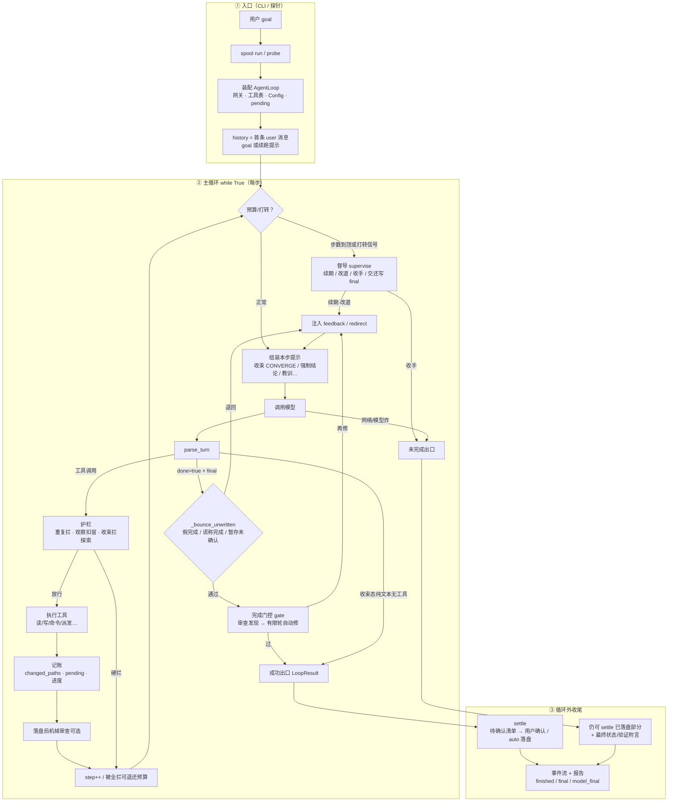

# Agent 主循环流程

权威控制流图。锚点：`agent/loop.py`（`AgentLoop.run`）、`cli/commands/run.py`、`cli/settle.py`、`agents/supervisor.py`。  
改控制流 → 同步本文件 + 变更记录（`.cursor/rules/agent-loop-flow.mdc`）。

## 总览

## 分层

| 层 | 职责 | 代码 |
|----|------|------|
| ① 入口 | goal、装配网关/工具/Config | `run.py` → `assemble_loop` |
| ② 步进 | 一步一次模型调用；督导仅预算尽/打转 | `AgentLoop.run` |
| ③ 收尾 | settle 待确认 → 工作区；`LoopResult` | `settle.py` |

| 分支 | 行为 |
|------|------|
| 督导 | 续期 / 改道 / 收手 / 交还写 final |
| 护栏 | 重复·观察扣留·收束拦探索；可退还步数。放行「有理由的重取」时**按成因分账**（结果被压掉 / 对象真变了 / 待确认落了盘 / 失败重试），总额度不放宽（`_REFRESH_LIMIT`），「压掉」那本份额更小（`_REFRESH_COMPACTED_LIMIT`） |
| `_bounce_unwritten` | 假完成 / 谎称完成 / 暂存未确认；默认不拦「只读 done」 |
| gate | 高严重度 → 有限轮自动修 |
| 收束 | 禁探索、限写；可收下纯文本结论 |

## 同步

须改图：入口/`Config` 控制流、`while` 分支、settle/`LoopResult` 语义。  
不改图：话术、标定数值、单测、无关记账。

## 变更记录

| 日期 | 变更 | 原因 |
|------|------|------|
| 2026-10-12 | 初版总览图 | 跟踪 agent 流程 |
| 2026-10-12 | 文风收紧 | 与活文档统一为契约表风格 |
| 2026-10-16 | 护栏放行按成因分账（D6） | 一个成因把整份额度吃光，真正有新内容的那次重取被硬拦；总额度不放宽，只留一次给"重取能拿到新内容" |
