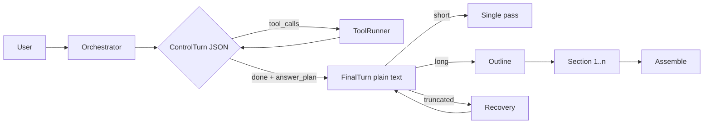

# 本地 Agent CLI 长回答改造：Cursor 落地实施方案

> **目标**：在 8K 上下文的本地 llama.cpp 上，把「长 Markdown 终稿」从受约束 JSON 中拆出来，稳定产出完整长文。
> **适用**：现有主循环 = 每步输出严格 JSON（`thought` / `tool_calls` / `done` / `final`）+ GBNF 约束 + 从半截 JSON 流式抽取 `final`。
> **给 Cursor 的用法**：先读第 11 节任务清单，按 P0 → P1 → P2 顺序执行；每个任务独立提交、跑对应测试；不要一次性重写主循环。

---

## 0. 交付物与总验收

| 交付物 | 说明 | 验收 |
|---|---|---|
| `budget.ts`（或等价模块） | 纯函数预算计算，输入 `n_ctx / n_past / phase / target`，输出 `max_tokens` | 单测覆盖边界；旧路径行为不变 |
| 协议 v2 | 控制阶段严格 JSON（无 `final`）+ 终稿阶段纯文本 | 控制 JSON 可解析率 ≥ 99.5% |
| 终稿通道 | 二次请求、前缀复用、纯文本流式 | 首字 P50 < 1.5s（本地） |
| 长文子流程 | `answer_plan` → 大纲 → 逐节 → 组装 | 长文完整率 ≥ 95% |
| 恢复状态机 | 节内续写 → 重写该节 → 短答+继续 | 终稿截断率 < 5%，重复率 < 8% |
| 指标埋点 | 分阶段记录 token / 时延 / 截断 / 缓存 | 报表可按 phase 聚合 |

**总原则**：控制流管「做什么」，终稿通道管「写什么」，编排器管「长文分几步」。三者不要塞进同一个受约束生成任务。

---

## 1. 问题陈述

| 现象 | 根因 |
|---|---|
| 长文写到一半被截断 | 8K × 15% ≈ 1228 token，装不下完整报告 |
| 截断后整段重做、用户看到半截再重来 | 单一 JSON 请求没有「续写」路径，只能重发 |
| 长文质量缩水 | ×2 仍不够时被迫「拆小/少说」 |
| 字面 `\n`、spinner 抢屏、重复刷屏 | JSON 字符串转义 + 流式抽取器脆弱 + 重试重放 |
| 工具回合与终稿互相挤预算 | `thought` + `tool_calls` + `final` 共用同一份 `max_tokens` |

**结论**：不是调比例，是协议耦合。长文必须离开 JSON 字符串字段。

---

## 2. 设计原则

1. **控制流严格，终稿自由**：工具调用用 schema/GBNF 保证可执行；终稿用纯文本保证可读、可续写、可流式。
2. **长文是编排任务，不是一次生成**：一次用户请求 → 一次规划 → 多次章节生成 → 一次组装；用户心智仍是「一次 chat」。
3. **预算按「阶段 + 任务 + 剩余窗口」分配**：`O_max = n_ctx - n_past - margin` 是硬上限，目标值是软建议，两者取 `min`。

---

## 3. 目标架构

```text
                    ┌──────────────────────────────────────────┐
User request ──────▶│ Orchestrator（主循环）                    │
                    │                                          │
                    │  ┌──────────────┐   tool_calls   ┌──────┐ │
                    │  │ ControlTurn  │───────────────▶│ Tool │ │
                    │  │ (strict JSON)│◀───────────────│Runner│ │
                    │  └──────┬───────┘   tool result  └──────┘ │
                    │         │ done=true + answer_plan           │
                    │         ▼                                  │
                    │  ┌──────────────┐                          │
                    │  │ FinalTurn    │  short → 单次纯文本       │
                    │  │ (plain text) │  long  → 大纲→逐节→组装   │
                    │  └──────┬───────┘                          │
                    │         │ truncation                        │
                    │         ▼                                  │
                    │  ┌──────────────┐                          │
                    │  │ Recovery     │ 续写→重写本节→短答+继续   │
                    │  └──────────────┘                          │
                    └──────────────────────────────────────────┘
```



**阶段职责**

| 阶段 | 输入 | 输出 | 是否流式 | 预算 |
|---|---|---|---|---|
| Control | 对话 + 工具结果 | 严格 JSON | 否（短） | 512–768 |
| Final（短） | 对话 + 工具结果摘要 | 纯文本 Markdown | 是 | `min(O_max, 2000)` |
| Outline | 对话 + 计划 | 3–7 节大纲 | 否 | 300–500 |
| Section | 大纲 + decisions + 本节要求 | 本节纯文本 | 是（章节级提交） | 600–1000 |
| Continuation | 已写尾部 200 字 | 续写纯文本 | 是 | `O_max` |

---

## 4. 协议 v2

### 4.1 ControlTurn（严格 JSON，**不含 `final`**）

```json
{
  "thought": "1–3 句中文，只写判断与下一步",
  "tool_calls": [
    { "name": "search", "arguments": { "query": "..." } }
  ],
  "done": false,
  "answer_plan": { "mode": "long", "sections": 5, "target_tokens": 1800 },
  "summary": ""
}
```

约束：

- `done=false`：`tool_calls` 非空；`summary` 必须为空。
- `done=true`：`tool_calls` 为空；`summary` ≤ 200 字，写「结论 + 依据」；`answer_plan` 可选。
- **协议里没有 `final` 字段**——模型没有地方写长文，从结构上消除「偷懒写终稿」。
- 控制阶段 `max_tokens` 512–768；超长输出判为协议错误，重试一次并提示「只输出决策与工具调用」。

### 4.2 FinalTurn（纯文本）

- 请求：复用 Control 请求的**完全相同前缀**（消息顺序、system、工具结果都不动），只在末尾追加一条 user 指令：
  `（进入终稿阶段：只输出最终 Markdown 正文，先给 150–250 字 TL;DR，再按大纲展开；不要调用工具，不要输出 JSON。）`
- `max_tokens = min(n_ctx - n_past - 192, 2500)`。
- 不设 JSON schema / GBNF；自然结束或达到 `max_tokens` 即止。
- 分节时，每节请求只替换末尾指令，保持前缀不变以命中 KV 缓存。

> ⚠️ **前缀缓存是二次请求在本地可行的前提**：llama.cpp server 的 `cache_prompt` 会复用相同 token 前缀的 KV；把「进入终稿」插到 system 或重排消息会让缓存失效、prefill 翻倍。实现后用 `timings.prompt_n` / `cache_hit` 验证。

### 4.3 流式事件

| 事件 | 负载 | 时机 |
|---|---|---|
| `final_start` | `{ phase: 'final'|'section', index? }` | 终稿/章节请求开始 |
| `final_delta` | `{ text }` | 纯文本增量 |
| `section_start` / `section_done` | `{ index, title }` | 章节边界 |
| `final_truncated` | `{ reason, generated }` | 检测到 `finish_reason == length` |
| `final_recovered` | `{ strategy: 'continue'|'rewrite'|'short' }` | 恢复完成 |
| `final_done` | `{ text, sections }` | 全部完成 |

UI 语义：章节未完成前显示为「草稿」，完成后转「正式」；截断时明确标「未完成，正在续写」，不要把半截当成功。

---

## 5. 预算算法

```ts
type Phase = 'control' | 'final' | 'outline' | 'section' | 'continuation';

interface BudgetInput {
  nCtx: number;        // 模型窗口，如 8192
  nPast: number;       // 本次实际 prompt tokens（llama.cpp timings.prompt_n）
  phase: Phase;
  targetTokens?: number; // 任务期望输出（来自 answer_plan / 配置）
  margin?: number;       // 默认 192
}

interface BudgetResult {
  maxTokens: number;
  capped: boolean;
  reason: 'ok' | 'context-full' | 'below-min';
}

const HARD_CAP: Record<Phase, number> = {
  control: 768,
  final: 2500,
  outline: 500,
  section: 1000,
  continuation: 2500,
};

export function computeBudget(i: BudgetInput): BudgetResult {
  const margin = i.margin ?? 192;
  const oMax = Math.max(0, i.nCtx - i.nPast - margin);
  if (oMax < 128) return { maxTokens: 0, capped: true, reason: 'context-full' };
  const target = i.targetTokens ?? HARD_CAP[i.phase];
  const maxTokens = Math.min(oMax, HARD_CAP[i.phase], target);
  return {
    maxTokens,
    capped: maxTokens < target,
    reason: maxTokens < target ? 'context-full' : 'ok',
  };
}
```

**8K 起点值（按实测校准，不是保证）**

| 阶段 | 目标 tokens | 说明 |
|---|---|---|
| Control | 512–768 | 只装决策与工具参数 |
| Final 短答 | ≤ 2000 | 一次写完 |
| Outline | 300–500 | 3–7 节 |
| Section | 600–1000 | 单节 600–800 字中文 |
| Continuation | 剩余窗口 | 只续写，不重来 |

> 中文 token 换算用可配置系数 `chars_per_token`（默认 1.6，按所用分词器实测校准）；`target_tokens = target_chars / chars_per_token`。

---

## 6. 长文流程

### 6.1 触发

优先级从高到低：

1. Control 阶段自报 `answer_plan.mode == "long"`（最可靠，成本几个 token）。
2. 启发式兜底：用户消息命中「完整方案 / 报告 / 对比 / 架构 / 表格 / 实施步骤 / 详细」且 `target_tokens` 预估 > 1500。
3. 其它情况一律 `short`。

**不要**只看问题字数；表格与架构图的 Markdown 源码同样吃 token。

### 6.2 大纲 → 逐节 → 组装

```ts
interface OutlineSection {
  title: string;
  points: string;       // 一句话要点
  targetTokens: number;
}

interface WritingState {
  goal: string;
  outline: OutlineSection[];
  completed: number[];      // 已完成节下标
  decisions: string[];      // 跨节约束（术语、口径、已定方案）
  nextSection: number;
}
```

- **大纲请求**：输出 3–7 节，每节一行「标题 | 要点 | 目标 tokens」；校验节数、总 token 不超窗口。
- **逐节请求**：system 只含 `outline + decisions + 当前节要求`；user 只带必要事实（工具结果摘要），**不带已写全文**。
- **组装**：按顺序拼接；检查标题齐全、无重复段落；可选一次轻量结构检查（默认不额外调用模型，省时延）。
- **上下文控制**：每节完成后把关键结论压进 `decisions`，而不是把全文塞回 prompt。

---

## 7. 截断恢复状态机

| `finish_reason` | 阶段 | 动作 | 重试上限 |
|---|---|---|---|
| `stop` | 任意 | 正常结束 | — |
| `length` | Control | 精简提示「只输出决策」重试；仍失败则报协议错误 | 1 |
| `length` | Final 单次 | 节内续写（overlap 200 字）→ 失败则整段重写一次（预算 ×1.5，**不是 ×2**） | 2 |
| `length` | Section | 节内续写 → 失败则重写该节 → 再失败则拆分该节 | 2 |
| `length` | Continuation | 停止，转「短答 + 继续入口」 | 1 |
| 上下文溢出 / `o_max < 128` | 任意 | 压缩输入（工具结果摘要化、丢旧轮次），**不加大输出预算** | — |
| JSON 无效 | Control | 重试并强调格式 | 2 |

### 7.1 续写与去重

```ts
function mergeContinuation(head: string, tail: string, overlap = 200): string {
  const win = head.slice(-overlap);
  const idx = longestSuffixPrefix(win, tail.slice(0, overlap * 2));
  return head + tail.slice(idx);
}

function looksRepeated(head: string, tail: string): boolean {
  // 12 字 n-gram 重合率 > 0.5 视为重复
  return ngramOverlapRatio(head.slice(-400), tail.slice(0, 400), 12) > 0.5;
}
```

续写 prompt（只替换末尾，前缀不变）：

```text
接着你已写的结尾继续写。不要重复已写内容，不要重新开头，不要总结，不要加标题。
```

### 7.2 明确不做

- 不在 JSON 字符串里做 completion 续写（丢约束状态）。
- 不对终稿做无条件 ×2 整段重试（成本高、体感差）。
- 不静默缩水；缩水必须走「短答 + 继续入口」并告知用户。

---

## 8. 流式与 UI

| 场景 | 行为 |
|---|---|
| Control | 不流式；只显示「思考/调用工具」状态 |
| Final 短答 | 纯文本直接流式；首段先出 TL;DR |
| Final 长文 | 章节级流式：当前节草稿 → 完成后正式；进度「第 k/n 节」 |
| 截断 | 保留已上屏内容，标「未完成」；续写内容**追加**，不是重放 |
| 重写本节 | 该节 UI 标记「重写中」，完成后替换该节，不刷全屏 |
| 上下文接近上限 | 提示「上下文接近上限，长文将分节生成」，不展示 token 数 |

---

## 9. 配置项

| key | 默认 | 说明 |
|---|---|---|
| `long_answer.enabled` | `true` | 总开关 |
| `long_answer.trigger` | `plan+heuristic` | `plan` / `heuristic` / `plan+heuristic` |
| `budget.control_max` | `768` | 控制回合上限 |
| `budget.final_max` | `2500` | 单次终稿硬上限 |
| `budget.section_max` | `1000` | 单节上限 |
| `budget.margin` | `192` | 安全余量 |
| `budget.retry_factor` | `1.5` | 重写时的预算放大 |
| `continuation.overlap_chars` | `200` | 续写重叠区 |
| `continuation.max_attempts` | `1` | 节内续写次数 |
| `outline.max_sections` | `7` | 大纲节数上限 |
| `llama.cache_prompt` | `true` | 前缀缓存 |
| `llama.context_shift` | `false` | 长文流程禁用，避免悄悄丢前缀 |
| `chars_per_token` | `1.6` | 中文估算，按分词器校准 |
| `protocol.v2` | `false` | 灰度开关，`false` 回退旧统一 JSON |

---

## 10. 数据模型（参考）

```ts
interface ToolCall { name: string; arguments: Record<string, unknown>; }

interface AnswerPlan {
  mode: 'short' | 'long';
  sections?: number;
  target_tokens: number;
}

interface ControlTurn {
  thought: string;
  tool_calls: ToolCall[];
  done: boolean;
  answer_plan?: AnswerPlan;
  summary?: string;
}

interface GenResult {
  text: string;
  finishReason: 'stop' | 'length' | 'cancelled' | 'error';
  promptTokens: number;
  generatedTokens: number;
  cacheHit?: boolean;
}

interface GenRequest {
  messages: Message[];
  phase: Phase;
  maxTokens: number;
  grammar?: string;      // 仅 control
  stop?: string[];
}
```

---

## 11. 分阶段任务清单（Cursor 执行顺序）

> 每个任务：改动 → 细节 → 验收 → 测试。完成一个提交一个，不要合并提交。

### P0-0 代码定位（只读，先做）

- **改动**：通读仓库，定位并记录到 `docs/integration-notes.md`：
  - 主循环入口（`chat_with_escalation` 或等价）
  - `max_tokens` / `output_reserve` 计算处
  - schema / GBNF 定义、`thought`/`tool_calls`/`done`/`final` 字段
  - 流式 `final` 抽取器（JSON 增量解析）
  - `finish_reason` / 截断重试逻辑
  - llama.cpp 请求封装（`n_predict`、`n_ctx`、`timings`）
- **验收**：笔记里列出每个符号的「文件:行号 + 现状一句话」。
- **完成标志**：不改任何业务代码。

### P0-1 预算计算器

- **改动**：新增 `budget.ts`，实现第 5 节 `computeBudget`；旧路径接入（`protocol.v2=false` 时行为不变）。
- **细节**：`n_past` 用 llama.cpp 返回的 `timings.prompt_n`；拿不到时退化为消息长度估算，并打日志。
- **验收**：单测覆盖 `n_past=0`、`n_past=n_ctx-100`、负数、`target < cap`、`target > cap`。
- **测试**：`<test-command> budget`。
- **完成标志**：旧长答回归无变化（仅换算法）。

### P0-2 ControlTurn v2（去掉 `final`）

- **改动**：新增 schema v2（第 4.1 节），保留旧 schema 作为 fallback；解析器支持二选一。
- **细节**：`done=true` 时校验 `summary` 非空且 ≤ 200 字；`tool_calls` 与 `done` 互斥校验。
- **验收**：单测 + 手工：模型输出旧格式时提示一次并要求 v2；连续失败降级旧协议并打日志。
- **测试**：`<test-command> control-schema`。

### P0-3 FinalTurn 纯文本通道

- **改动**：新增 `finalTurn(messages, plan)`：复用 Control 请求前缀，末尾追加终稿指令；纯文本请求，不带 grammar。
- **细节**：前缀必须逐字节一致（同一 system、同一工具结果、同一消息顺序）；用 `cache_prompt`；记录 `timings.prompt_n` 与 `cache_hit`。
- **验收**：同一对话先 Control 后 Final，第二次 `prompt_n` 增量 < 200；短答回归通过。
- **测试**：`<test-command> final-turn` + 手工观察两次请求的 `prompt_n`。

### P0-4 终稿预算与重试改造

- **改动**：终稿 `max_tokens = computeBudget(...)`；删除终稿路径里的「截断 ×2 整段重试」。
- **验收**：截断用例（mock `finish_reason=length`）不再触发整段重试；日志显示一次续写或短答降级。
- **测试**：`<test-command> truncation`。

### P0-5 流式与降级

- **改动**：纯文本 delta 直接推 `final_delta`；旧 JSON 抽取器保留给 `protocol.v2=false`。
- **验收**：长文无字面 `\n`；截断后追加而非重放。
- **测试**：手工 + 事件序列快照测试。

### P0-6 P0 集成验收

- **改动**：无新功能；跑短答/截断/工具轮回归。
- **验收**：见第 13 节指标中 P0 相关项。

### P1-1 `answer_plan` 与触发

- **改动**：ControlTurn 解析 `answer_plan`；实现 `shouldUseLongAnswer()`（第 6.1 节）。
- **验收**：单测：`mode=long` 必进长文；`mode=short` 不进；启发式兜底用例。
- **测试**：`<test-command> plan-trigger`。

### P1-2 WritingState + 大纲

- **改动**：新增 `writing-state.ts`；大纲请求（纯文本或轻 JSON）+ 校验（节数、总 token）。
- **验收**：大纲 3–7 节；超窗时自动缩节；状态可序列化/恢复。
- **测试**：`<test-command> outline`。

### P1-3 逐节生成 + 组装

- **改动**：`generateSection()`：只带 `outline + decisions + 当前节要求`；组装时校验标题齐全、去重。
- **验收**：5 节长文完整产出；每节 `prompt_n` 不随节数线性增长（只带摘要）。
- **测试**：`<test-command> sections`。

### P1-4 节内续写与去重

- **改动**：实现第 7.1 节 `mergeContinuation` / `looksRepeated`；Section 截断走续写。
- **验收**：mock 截断 → 续写拼接无重复；重复续写触发重写该节。
- **测试**：`<test-command> continuation`。

### P1-5 章节级流式与 UI 状态

- **改动**：`section_start/section_done` 事件；章节草稿/正式两态；进度。
- **验收**：重写某节只更新该节；无整屏重放。
- **测试**：事件序列快照 + 手工。

### P1-6 长文回归

- **改动**：20 条长文 prompt 回归集（方案/报告/对比/架构/表格），校验完整率、截断率、时延。
- **验收**：第 13 节指标达标。

### P2-1 证据门槛（替代硬 `required_tools`）

- **改动**：终稿前校验：`done=true` 的 `summary` 必须含依据（本轮工具结果引用）或明确「无需外部信息」；仅对「最新/今天/价格/版本」等标签硬门禁。
- **验收**：普通知识问答不被强制检索；实时信息类任务 100% 有 evidence。
- **测试**：`<test-command> evidence-gate`。

### P2-2 指标埋点

- **改动**：按第 13 节字段记录 `phase / prompt_tokens / max_tokens / generated_tokens / finish_reason / cache_hit / retry / latency`。
- **验收**：报表可按任务类型聚合；缓存命中率可见。

### P2-3 灰度、回滚与文档

- **改动**：`protocol.v2` 开关；回滚到旧统一 JSON 的步骤写入 runbook；更新协议文档。
- **验收**：开关切换后旧路径可用；runbook 可照做。

---

## 12. 测试计划

| 层级 | 内容 | 工具 |
|---|---|---|
| 单测 | 预算边界、续写去重、重复检测、状态机转移、`answer_plan` 校验 | 现有测试框架 |
| 集成 | mock llama.cpp：短答 / 截断 / 重复续写 / JSON 无效 / 工具调用 / 缓存命中 | 录制 fixture |
| 回归 | 20 条长文 prompt + 20 条短答 prompt | 脚本跑批 |
| 真机 | 8K 模型、上下文 4K/6K 两档、长文 3/5/7 节 | 手工 |

**必测边界**：`n_past=n_ctx-100`、`answer_plan.sections=0/8`、续写返回空、续写重复、`finish_reason` 缺失、旧协议 fallback。

---

## 13. 验收指标

| 指标 | 目标 | 采集 |
|---|---|---|
| 长文完整率 | ≥ 95% | 章节齐全 + 无截断 |
| 终稿截断率 | < 5% | `finish_reason=length` / 终稿请求数 |
| 首次成功率 | ≥ 80% | 无需恢复即完成 |
| 重复生成 token 占比 | < 15% | 恢复重试 token / 总 token |
| 首字时延 P50 | < 1.5s | 本地实测 |
| 单节 P95 时延 | 按模型定 | 埋点 |
| 前缀缓存命中率 | > 90% | `cache_hit` |
| 控制 JSON 合法率 | ≥ 99.5% | 解析成功率 |
| 工具正确性 | 实时类任务 100% 有依据 | evidence 检查 |
| 答案质量 | 缺失/重复/矛盾下降 | 人工抽检 |

---

## 14. 风险、回滚与灰度

| 风险 | 缓解 | 回滚 |
|---|---|---|
| 二次请求增加时延 | TL;DR 先出、前缀缓存、监控 P50 | `protocol.v2=false` |
| 模型不遵守阶段（偷写终稿） | 协议无 `final` + 小预算 + 超长判错 | 旧 schema |
| 分节前后不一致 | `decisions` + 组装结构检查 | 单次终稿 |
| 上下文溢出 | 压缩 + 禁 context shift + 分节 | 短答+继续 |
| 续写重复 | n-gram 检测 + 重写本节 | 短答+继续 |
| 缓存不命中 | 固定前缀、不改 system、日志校验 | 接受 prefill 成本 |

**灰度顺序**：内部短答 → 内部长文 → 10% 用户 → 全量；每档观察完整率、首字时延、重复率。

---

## 15. 反模式（明确不要做）

1. 把长 Markdown 塞进 JSON 字符串字段（转义 + 无法续写 + 流式脆弱）。
2. 终稿截断后无条件 ×2 整段重试。
3. 固定 15% 一刀切，不分阶段。
4. 同一请求同时约束「工具调用」和「长终稿」。
5. 让模型自由决定何时切终稿（会偷懒/拖延）——由 orchestrator 在 `done=true` 后决定。
6. 静默压缩/改口，不告诉用户。
7. 8K 上默认 plan→draft→revise 多轮自改。
8. 在 JSON 里做 completion 续写。
9. 把 `thought` 写成长散文（控制阶段 1–3 句即可）。
10. 依赖手工反转义的流式抽取器推长文（纯文本通道直接消除这类 bug）。
11. 用 context shift 悄悄丢前缀来「续命」长文。
12. 把 `required_tools` 硬编码成通用门禁（误伤普通问答）；用 evidence 门槛替代。

---

## 16. 附录 A：Prompt 模板

**Control 阶段 system**

```text
你是 Agent 控制层。只输出 JSON，字段：
- thought：1–3 句中文，只写判断与下一步；
- tool_calls：数组，可为空；
- done：布尔；
- answer_plan：done 时可给 {mode, sections, target_tokens}；
- summary：done=true 时必填，≤200 字，写结论与依据。
禁止输出终稿正文。信息足够时 done=true。
```

**Control 重试（格式错误时追加）**

```text
上一轮输出不符合协议。请只输出 JSON，不要写正文，thought 控制在 3 句内。
```

**Final 阶段（追加在末尾，不改前缀）**

```text
（进入终稿阶段：只输出最终 Markdown 正文，先给 150–250 字 TL;DR，再按大纲展开；
不要调用工具，不要输出 JSON，不要解释你在做什么。）
```

**Outline**

```text
根据对话与工具结果，给出 3–7 节大纲，每行：标题 | 一句话要点 | 目标 tokens。
总 tokens 不超过 {remaining}。
```

**Section**

```text
只写第 {i} 节「{title}」。要点：{points}。目标约 {targetTokens} tokens。
不要写其他节，不要重复已写内容，不要总结全文。
```

**Continuation**

```text
接着你已写的结尾继续写。不要重复已写内容，不要重新开头，不要总结，不要加标题。
```

---

## 17. 附录 B：llama.cpp 参数建议

| 参数 | 建议 | 说明 |
|---|---|---|
| `n_ctx` | 8192（模型实际） | prompt + generation 共享 |
| `n_predict` | `computeBudget().maxTokens` | 生成长度上限 |
| `cache_prompt` | `true` | 双请求复用前缀，必须保持前缀一致 |
| `context_shift` | 长文流程 `false` | 避免悄悄丢前缀 |
| `grammar` | 仅 Control | 终稿纯文本不加 grammar |
| `stop` | 终稿不设；分节可选 `["\n## "]` + 后处理 | 防止模型多写下一节 |
| `temperature` | 控制 0.2 / 终稿 0.7（可配） | 控制稳定、终稿自然 |
| `n_keep` | 按需 | 与 context shift 配套，长文慎用 |

**预算取数**：优先 `timings.prompt_n`；不可用时用 tokenizer 计数并加 5% 余量。

---

## 18. 附录 C：采纳与修正记录

| 来源 | 采纳 | 修正 |
|---|---|---|
| GPT | 控制/终稿分离、动作枚举、三阶段路线、验收指标、场景表、产品文案 | 控制协议保留 `tool_calls[]` 与 1–3 句 `thought`（审计并行工具）；`required_tools` 改为 evidence 门槛；2560–4096 预算改为 `min(O_max, 2500)` |
| 本方案 | 前缀缓存复用、`answer_plan` 自报信号、节内续写 + overlap 去重、GBNF 采样开销、`n_past` 硬预算、context shift 风险、TL;DR 先出 | 全部纳入 P0/P1 |
| 双方一致 | 不调比例调协议、长文分节、不做 JSON 续写、截断不再整段重做 | — |

---

## 19. 给 Cursor 的开场指令（可直接粘贴）

```text
请先完整阅读 docs/local-agent-long-answer-plan.md，然后：

1. 只做 P0-0（代码定位），把结果写到 docs/integration-notes.md，等我确认后再继续。
2. 之后按 P0 → P1 → P2 顺序执行，每个任务独立提交。
3. 每个任务完成前必须跑对应测试；没有测试就先补测试。
4. 不要一次性重写主循环；不要删除旧协议，用 protocol.v2 开关控制。
5. 遇到文档与仓库现状不一致，先记录差异并暂停，不要擅自扩大改动范围。
```
