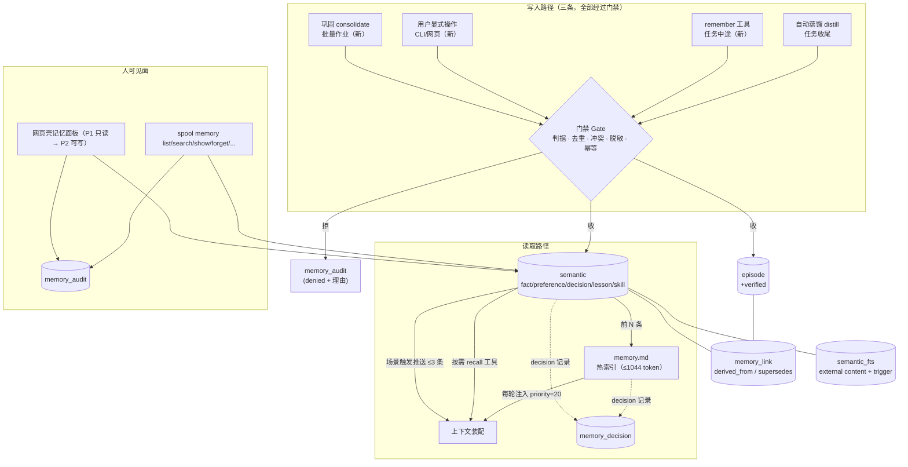

# 记忆子系统架构 —— 设计文档

日期：2026-10-02
状态：待评审
前置：[`2026-09-11-local-coding-agent-design.md`](2026-09-11-local-coding-agent-design.md) §4.4（记忆系统的原始设计）、
[`2026-09-24-workspace-session-kernel-design.md`](2026-09-24-workspace-session-kernel-design.md)（会话一级的归属）

> 本文件只做设计，**不含任何代码改动**。文中所有"现状"论断都指到 `文件:行`；
> 标 **[实测]** 的数字来自本次对该仓库与真实工作区（`D:\workSpace\agentWorkSpace`）的只读取证，
> 复现命令写在附录 A；**本文档没有取证到的部分**（含"未跑过 50 题回归集"）在附录 B 如实列出。
>
> **2026-10-02 增补**：§11 的 8 条开放决策已由产品负责人拍板，决议落在 **§13**；
> 嵌入依赖的**选型、实测数据与上下文预算纪律**落在 **§14**（本轮主体）。
> 其余章节只在**与决议冲突处**做了最小改动，**章节编号保持稳定**（改动清单见 §13.9）。
>
> **2026-10-02 二次增补**：产品负责人认可再写进四条——**状态与时序**（新章 **§15**）、
> **注入显式化**（§6 新增 §6.6/§6.7，回写 §13.10）、**时序评测用例**（§10 新增 §10.4）、
> **相关性路径的三步顺序**（§14 新增 §14.8，回写 §13.11）。
> 本轮**一条既有编号都没动**（§1–§14 与附录 A/B 原样），**既有实测数字一个没改**；
> 新增的问题集中在 **§13.13**——该节 **8 条已于 2026-10-02 由用户按建议拍板，现为已定案**
> （原有"选项 / 代价 / 我的建议"三列一字未删，另加「决定 + 日期」列）。
> 本轮改动落点清单见 **§13.12**。

---

## 1. 为什么做这一件事

产品负责人的判断是原话：

> P3 记忆问题也值得关注，它是 Agent 长任务执行下的成功率、准确率保障，也是多轮任务中
> 节约 token、提高效率的重要手段。**当前实现方式一致认为过于简陋，无法支撑产品作为一个
> 成熟的商业项目架构。**

这条判断能不能落到证据上？能，而且比"简陋"更具体：**现在的记忆系统在真实工作区里
已经处于"写进去的是噪声、想查的查不到"的状态。**

**[实测]** 真实工作区 `D:\workSpace\agentWorkSpace\.agent\memory.md`（3192 字节 / 1531 字符，
最后写入 2026-10-02 10:38）的"项目事实"一节里 9 条全部是**整段助手回复**：

| 行 | 内容（截断） | 长度 |
|---|---|---|
| `memory.md:4` | `你好！我是你的本地编程助手。…` | 42 |
| `memory.md:5` | `你好！我是你的本地编程助手。…`（**与上一行逐字相同**） | 42 |
| `memory.md:8` | `你好！我是你的本地编程助手。…`（**第三次**） | 42 |
| `memory.md:9` | `贪吃蛇小游戏已经实现完毕，文件为 snake.py…` | 244 |
| `memory.md:10` | `贪吃蛇是交互式终端游戏，我无法直接替你启动它…` | 168 |
| `memory.md:11` | `网页版贪吃蛇已经写好了，文件为 snake.html…` | 267 |
| `memory.md:12` | `任务已完成。请确认最终文件状态并宣告完成。` | 67 |
| `memory.md:6` | 一段"你之前问过两次同样的问题"的**会话回顾** | 202 |
| `memory.md:7` | 一张 12 城市的**天气表格** | 401 |

**[实测]** 同一个工作区的 `memory.db`：`memory` 表 **0 行**、`memory_fts` **0 行**、
`episode` **26 行**、`transcript` 53 行、`session` 9 行。

把这两条摆在一起，缺口就清楚了：

1. **写进去的是噪声**：寒暄、自述、"请确认"这类一次性输出被当成"项目事实"，且**三条逐字重复**；
2. **该查的查不到**：`recall` 查的是 `memory` 表与它的 FTS 索引——而这两张表是空的，
   所以模型调 `recall` 时什么都拿不到（`memory/tools.py:36`、`memory/session.py:53`）；
3. **热记忆已经顶到容量墙**：**[实测]** 1011 token / 上限 1044 token（= `8192 × 0.85 × 0.15`），
   **占用 96.8%**。也就是**再写一条事实，就会有一条既有事实被挤下去**
   （`memory/hot.py:99-105`）——而被挤下去的那些恰好是最早写入的那些。

一句话：**这一层现在不是"简陋的能力"，是"正在起反作用的负债"。**
每轮都要付它约 1011 token（`agent/loop.py:544`、`451-452`），换回来的是 9 条噪声。

---

## 2. 现状（可核对）

### 2.1 分层与存储：四层其实只有两个半

| 层 | 存哪 | 谁写 | 谁能读 |
|---|---|---|---|
| 热记忆（每轮注入） | `memory.md`，Markdown 分节 | `archive_task` 的 `promote`（`memory/archive.py:96`） | 每轮全量注入（`memory/session.py:39-49`） |
| 冷记忆（按需检索） | `memory` 表 + `memory_fts`（`memory/store.py:18-41`） | `add_memory`（`:111`）、`record_lesson`（`memory/lessons.py:52`） | `recall` 工具（`memory/tools.py:44`） |
| 情节 | `episode` 表（`memory/store.py:32-39`） | `add_episode`（`:217`），每次任务收尾必写 | `search_episodes` 的 LIKE（`:234`） |
| 教训 | 同上 `memory` 表，`kind='lesson'` | `record_lesson`（`lessons.py:52`）、`plan.py:643` | 主动推送 `match_lessons`（`lessons.py:82`） |

`hot.py:18-25` 定义的六个分节里，`doing`（进行中）**没有任何写入者**——
`distill.KINDS = ("fact","preference","decision","lesson")`（`memory/distill.py:31`）不含它，
`archive_task` 每次收尾还主动 `pop("doing")`（`archive.py:82`）。也就是说这一节是死的。

### 2.2 FTS5 覆盖了什么

`memory/store.py:41`：

```sql
CREATE VIRTUAL TABLE IF NOT EXISTS memory_fts USING fts5(text);
```

**[实测]** 这张表**只索引 `text` 一列**，全文检索的后果：

- `kind` 不在索引里 → 查 `"fact"` 命中 **0 条**；
- `trigger` 不在索引里 → 一条教训的触发词写 `"解析,正则,格式"`，查 `"正则"` 命中 **0 条**；
- `source`（`ep#12`）不在索引里 → 无法按来源回溯；
- 没有 `external content` 也没有任何触发器（**[实测]** `trigger` 数 = 0），
  即 **FTS 与主表靠调用方手工同步**：`add_memory` 手工插一条 FTS（`store.py:127-130`），
  `record_lesson` **只写主表、完全不写 FTS**（`lessons.py:60-66`）——
  于是每一条教训对 `recall` 都是不可见的。

中文处理用逐字拆（`store.py:66,82-84`），**[实测]** 查 `"归档"` 与查 `"归"` 返回同一批结果，
说明匹配粒度是**单字 OR**（`_match_query`，`store.py:87-94`）。这带来了根本性的相关度问题，见 §4.3。

### 2.3 排序：三个维度里只有一个真的在起作用

`memory/store.py:191-205`：

```python
FREQUENCY_WEIGHT = 0.6
RECENCY_WEIGHT = 0.4

def score(row):
    last = row["last_used_at"] or row["created_at"]
    age_days = max(0.0, (now - last) / 86400)
    recency = 1.0 / (1.0 + age_days)
    return row["use_count"] * FREQUENCY_WEIGHT + recency * RECENCY_WEIGHT
```

**[实测]**（本次复现）：

- `recency ∈ (0,1]`，乘 0.4 后**上限 0.4**；而 `use_count` 一项每用一次 +0.6。
  → **被用过一次的记忆，永远排在从未被用过的新记忆前面**；
- `_rank` 源码里**不出现** `confidence`、`bm25`、`kind`（**[实测]** 逐词检查），
  也就是说：`confidence` 列选了但没用于排序，教训的置信度**只影响推送、不影响检索排序**；
- `session.recall` 对**返回的每一条**调 `touch_memory`（`memory/session.py:54-57`），
  而 `touch` 就是 `use_count += 1`（`store.py:208-214`）。
  **[实测]** 连续 `recall("解析")` 四次，命中的两条 `use_count` 从 0/1 变成 **5/4**。
  → **"用过更多排更前" + "排前就记一次使用" = 自我强化的马太效应**：
  第一次偶然排前的那条会永久霸占榜位。这个循环里没有任何负反馈。
- FTS 的 `MATCH` 只给"命中/未命中"，没有用上 SQLite 现成的 `bm25()` 排序函数。

### 2.4 写入路径：只有一条，而且没有门禁

```
任务收尾 agent/loop.py:_archive (1274)
  → distiller (可选) = distill(gateway, state, final)  (runtime.py:652-658)
  → memory.archive(state, outcome, promote, final)     (memory/session.py:99)
     → add_episode(...)                                 (archive.py:62)
     → for excluded in state.excluded: add_memory(kind="failure")   (archive.py:71-78)
     → for entry in promote: sections[kind].append(text.strip())    (archive.py:96)
     → trim_to_budget(...) → write_hot(...)                        (archive.py:99-111)
```

- **没有 `remember` 工具。** `memory/tools.py` 的 `__all__` 只有 `recall_spec` 与 `search_history_spec`
  （`:224`），`assemble_loop` 也只注册这两个（`cli/runtime.py:457-478`）。
  也就是**模型没有任何显式写记忆的入口**，写什么完全由一次自动蒸馏决定。
- **没有任何写入门禁**：`archive.py:96` 直接 `append`，不去重、不查长度、不判类型是否合理；
  `distill._parse_entries`（`distill.py:119-150`）只校验 `kind ∈ KINDS` 与 `text.strip()` 非空。
- **自述冒充成功**：`_archive` 的 `outcome` 由主循环给，而 `finished=True` 的判据是
  `turn.done`（模型自己宣告完成，`loop.py:1036-1038`）或督导判断完成（`loop.py:695-704`），
  **与有没有通过验证无关**。这个 outcome 又被 `settle_lessons(..., succeeded=result.finished)`
  （`cli/commands/run.py:234`）拿去调教训置信度——**"这个教训有用"的判据是"模型说自己做完了"**。
- **敏感内容不过闸**：`redact_secrets` 全仓只有 4 处调用，全在**读取**路径
  （`transcript.py:152,189,443`），写入路径（`distill` → `archive` → `add_memory`/`record_lesson`/`write_hot`）
  **一处都没有**。`memory.md` 会每轮注入、`memory.db` 会落盘，一旦密钥被说出口就长期留着。

### 2.5 噪声是怎么进来的：一条兜底

这是 `memory.md:4,5,8` 那三条寒暄的直接来源。`memory/distill.py:259-263`：

```python
clipped_final = final.strip()
if not entries and clipped_final:
    knob_entry = limits.knob("episode_final_chars")
    max_chars = int(knob_entry.default) if knob_entry else 400
    entries = [("fact", _clip_final(clipped_final, max_chars), "")]
```

兜底本身是 T6 有意做的（`docs/roadmap.md:135-144`：让"任务结论"落进可检索记忆），
**但它把"整段交付答复"直接标成 `kind="fact"`，且只按 400 字符截断**。
配套证据：

- `episode #21`（`web-1790799477940`，10-01 04:18）summary 就是
  「你好：已完成 无记录 / 结论：你好！我是你的本地编程助手。…」；
- 同样的三条兜底 fact 分别来自 `episode #16`、`#17`、`#21` 三次不同会话的任务——
  **说明这不是一次意外，而是每次"寒暄型任务"都会复现的形状**；
- 蒸馏返回空条目时的兜底不区分 `final` 是"交付答复"还是"客套话"。

### 2.6 去重：只在一个很窄的范围内存在

`distill._merge`（`distill.py:153-168`）按 `text.strip()` 精确相等去重，
但它的调用点只有一处：**同一次 `distill` 调用内部因输出截断而分治时合并左右两半**
（`distill.py:214`）。跨任务、跨会话、跨 episode **没有任何去重**——
`archive.py:96` 的 `append` 不检查既有条目，所以 `memory.md:4/5/8` 那三条能同时存在。
（`archive.py:80` 是先 `read_hot` 再 `append` 的，既有内容就在手里，检查它不需要任何新依赖——
这是"没做"，不是"做不到"。）

### 2.7 容量与"代谢"：现状是 FIFO，与注释说的相反

`memory/hot.py:29-38` 的注释写着"事实最稳定、复用价值最高，所以最后才动它"，
`DEMOTE_ORDER` 也确实把 `fact` 放在最后（`hot.py:31-38`）。
但 `trim_to_budget` 在**同一个分节内部**是从**最前面**开始 pop 的（`hot.py:99-101`）：

```python
for kind in DEMOTE_ORDER:
    while working.get(kind) and counter.count(render_hot(working)) > budget:
        demoted.append(working[kind].pop(0))
```

而 `archive.py:96` 是**往尾部 append**。两者合起来 = **先进先出**：
**最新写进去的一定活，最早写进去的一定先被挤出去**。
"事实最后才动"这条只保护了"分节之间的顺序"，在事实节**内部**它恰恰是最先被删的。
后果很具体：今天这条噪声（寒暄）会把一个月前的构建命令挤掉。

容量本身：`hot_budget(8192) = int(8192 × 0.85 × 0.15) = 1044`（`hot.py:46-58`，
`context/budget.py:17,48`）。**[实测]** 当前 1011，占用 96.8%。

另外两处不一致：

- `MemorySession` 的计数器是 `OfflineTokenCounter`（`runtime.py:626`），
  而 `AgentLoop._budget` 用的是**真实分词器**（`runtime.py:482` 的 `counter_for(gateway)`，
  传给 `Assembler`）。`docs/benchmarking.md:499` 实测**估算比服务端高 25%**——
  即记忆的容量判定与装配的容量判定**建立在两个不同的尺子上**。
- 被下沉的内容写进 `memory` 表的 `kind='episode'`（`archive.py:103-109`），
  但它**不写 FTS**（走的是 `add_memory`，会写 FTS——这一条其实写进去了），
  而它的 `source` 是 `ep#{id}`、`confidence=0.4`，**与真正的情节表 `episode` 同名不同物**，
  分节名与表名撞车，检索里 `[episode]` 与 `[事件]` 是两回事（`memory/session.py:58-69`）。

### 2.8 读取进上下文：一条注入 + 两个按需工具

| 通道 | 入口 | 预算 |
|---|---|---|
| 热记忆全量注入 | `loop.py:544` → `Section(name="hot_memory", priority=20)`（`loop.py:451-452`） | `hot_memory_ratio=0.15`（`limits.py:136-139`） |
| 教训主动推送 | `loop.py:574-582`，`_render_lessons`（`:176-190`） | `lessons_ratio=0.10`（`limits.py:146`），`MAX_PUSHED=3`（`lessons.py:41`） |
| `recall` 工具（按需） | `memory/tools.py:44`，`limit` 默认 5 | 落在 `retrieval_ratio=0.15` 区段（`loop.py:467-470`） |
| `search_history` 工具（按需） | `memory/tools.py:151` | 同上；`history_search_limit=5`、`history_snippet_chars=240` |

装配层的裁剪是**区段级**的：`Assembler._fit` 只保证"这个区段的文本 ≤ 这个区段的配额"
（`context/assembler.py:90`），`hot_memory` 的区段文本又是 `trim_to_budget` 自己按
`hot_budget` 裁过的（`memory/session.py:44-46`）——**两处各自算一遍同一个预算**，
靠 `hot.py:40-43` 的注释要求"只有一个出处"来维持一致，没有断言或测试把它钉住。

**没有任何"为什么取了这条"的输出**：`recall` 只回 `[kind] text（来源 …）`（`session.py:58-61`），
不含分值、不含命中词、不含候选总数。调这一块时无法从输出看出是相关性还是频率把它顶了上来。

### 2.9 用户面：几乎不存在

- **CLI**：没有 `memory` 子命令（`cli/app.py` 的子命令清单：`run/plan/policy/revert/bench/session/limits/config/chat/mcp-servers/...`，
  其中只有 `spool session search` 走 `memory.db`，且只查 `transcript` 表，`cli/commands/session.py:112-208`）。
  想删一条错误事实，只能用文本编辑器改 `memory.md`——但它下次归档会被整份重写（`archive.py:111`），
  人工改动**没有任何痕迹**，也不会同步到 `memory` 表。
- **网页壳**：`WRITE_PATHS` 只有 `/run /run/stop /confirm /session/delete /session/restore /session/new`
  （`web/server.py:111-118`），没有任何记忆端点；`GET` 只有 `/` `/state` `/events`（`:776-781`）。
  网页只能显示 `transcript`（`web/runner.py:515-524`、`web/page.py:1686`）。
- **审计**：不存在。`source` 字段只有 `ep#<id>` / `未标注`（`archive.py:76,94,107`），
  没有"谁在什么时候、以什么理由写的"，也没有"这轮往上下文里注入了哪几条"的记录。

---

## 3. 现状缺陷清单

严重度：**S1** = 正在产生错误数据或安全问题；**S2** = 能力缺口；**S3** = 一致性/可维护性。

| # | 级别 | 缺陷 | 证据 | 真实症状 |
|---|---|---|---|---|
| 1 | S1 | 蒸馏空条目的兜底把整段助手答复写成 `kind="fact"`，无内容判据、无长度门禁之外的过滤 | `memory/distill.py:259-263`；`memory/archive.py:96` | **[实测]** `memory.md:4,5,8` 三条寒暄、`memory.md:9-12` 四段答复（含"任务已完成。请确认…"） |
| 2 | S1 | 跨任务无去重：`append` 前不比对既有条目 | `memory/archive.py:96`（`_merge` 只在 `distill.py:214` 单次调用内生效） | **[实测]** `memory.md` 里**三条逐字相同**的寒暄 |
| 3 | S1 | 热记忆同一分节内 FIFO 淘汰，与注释"事实最后才动"相反；且已占 96.8% | `memory/hot.py:99-101`、`archive.py:96` | **[实测]** 1011/1044 token；下一条新事实将挤掉最早的真实事实 |
| 4 | S1 | 教训写库不写 FTS，`recall` 永远查不到教训 | `memory/lessons.py:60-66`（对比 `store.py:127-130`） | FTS 只索引 `text`（`store.py:41`），`trigger`/`kind`/`source` 全不可检索 |
| 5 | S2 | 排序里"使用频次"压倒"新近度"（0.6·use_count vs ≤0.4·recency），且 `recall` 每次给命中项 +1 造成自我强化 | `memory/store.py:191-205`、`session.py:54-57` | **[实测]** 用过 1 次的旧条目永远压过 0 次的新条目；4 次 recall 把 use_count 冲到 4–5 |
| 6 | S2 | 没有相关度维度（不用 `bm25()`）、不用 `confidence`、不用 `kind`；中文查询退化成单字 OR | `store.py:181-188`、`195-205`、`87-94` | **[实测]** 查 `"归档"` 与 `"归"` 结果相同；排序源码中不出现 `confidence`/`bm25`/`kind` |
| 7 | S2 | 模型没有显式 `remember` 入口，写什么全由一次自动蒸馏决定 | `memory/tools.py:224`、`cli/runtime.py:457-478` | 用户说"记住：本项目一律用 uv"时，没有任何可靠路径把它写进去 |
| 8 | S1 | `outcome` 与教训置信度都基于"模型自称完成"，不是验证结果 | `loop.py:1036-1038`、`695-704`；`run.py:234` | 一次虚假完成会把错误教训的置信度推高（`lessons.py:44-49`） |
| 9 | S1 | 写入路径完全不过 `redact_secrets` | `redact_secrets` 仅 `transcript.py:152,189,443` 三处（读路径） | 密钥一旦被蒸馏进 `memory.md`，就每轮进上下文且长期落盘 |
| 10 | S3 | 容量判定用 `OfflineTokenCounter`，装配用真实分词器，两把尺子（估算偏高 25%） | `runtime.py:626` vs `runtime.py:482`；`docs/benchmarking.md:499` | 记忆的"是否超预算"与装配的"是否超预算"可能不同时成立 |
| 11 | S3 | 无用户面：无 CLI 记忆命令、无网页端点、无审计；手改 `memory.md` 会被下次归档整份重写且不回写库 | `cli/app.py` 子命令清单、`web/server.py:111-118`、`archive.py:111` | 用户无法查看/修改/删除一条错误记忆，也没有"谁写的"可查 |
| 12 | S3 | `hot.py:18-25` 的 `doing` 分节没有任何写入者；下沉条目用 `kind='episode'` 与真正的情节表同名不同物 | `distill.py:31`、`archive.py:82`、`archive.py:103-109`、`session.py:58-69` | 分节与表名撞车，检索输出里 `[episode]` 与 `[事件]` 是两种东西 |
| 13 | S3 | `episode` 表无任何索引、无容量上限、每次任务收尾必写 | `store.py:32-39`；**[实测]** episode 索引 = 空 | 真实工作区累计 26 条且只增不减；`search_episodes` 是 OR-LIKE 全表扫（`store.py:234-260`） |
| 14 | S3 | 写入触发点只有收尾一处，任务中途的有价值结论无法落库 | `archive.py:48`（只被 `loop.py:1274` 的收尾调用） | 长任务跑到一半被中断，中途的决策/教训全丢 |

---

## 4. 目标架构

### 4.1 一句话

**把现在"一个 Markdown 文件 + 一张混装表"改成分层、有来源、有门禁、有生命周期、可审计，
且 P1 基线完全建立在现有 SQLite/FTS5 之上的记忆子系统**（嵌入是**可选信号**，
见 §14；"零新依赖"在决议 1 后只描述 P1 基线与回退路径，不再是全设计的硬约束）——
热记忆退回"小而精的索引"，语义记忆成为真正可检索、可引用、可撤销的那一层。

### 4.2 分层：四层各是什么、存在哪、怎么命名

```
┌─ 工作记忆 working ───────────────────────────────────────────────┐
│  载体：TaskState + .agent/sessions/<sid>/tasks|progress（不变）    │
│  生命周期：一次任务。任务结束清空（现有 checkpoint 语义）           │
│  命名：不进 memory.md / memory.db                                │
├─ 情节 episode ──────────────────────────────────────────────────┤
│  载体：episode 表（一任务一行，含结果与验证状态）                  │
│  语义：episode:<id>                                              │
│  生命周期：只增；超量归档到 episode_archive 表                    │
├─ 语义 semantic ─────────────────────────────────────────────────┤
│  fact / preference / decision / lesson 四类，全在 semantic 表     │
│  语义：fact:<id> / pref:<id> / dec:<id> / lesson:<id>            │
│  生命周期：容量上限 + 衰减 + 巩固 + 软删除归档                     │
│  注：嵌入向量只存库（§14.6），热记忆不因它改变形态（决议 6）        │
├─ 技能 skill ────────────────────────────────────────────────────┤
│  载体：semantic 表 kind='skill'，字段 steps(JSON) + trigger       │
│  语义：skill:<id>                                                │
│  生命周期：与 lesson 同（按实际成功率调 confidence）               │
└──────────────────────────────────────────────────────────────────┘
        ↑ episode 通过 derived_from 引用 semantic，两者互不包含正文
```

**为什么这么定**：

- 四层的分界判据是**"它的真假会不会因为下一次任务而改变"**：
  `working` 每次任务都变；`episode` 是发生过的、永远为真；`semantic` 在被推翻前为真；
  `skill` 是"做法"而非"事实"，它的价值要用成功率来验。
  现在的问题正是这个判据**在代码里不存在**——`distill` 只让模型在四个字符串里选一个，
  没有任何结构性约束（`distill.py:31,119-150`）。
- **不这么定会怎样**：继续用"一个 `kind` 字符串"区分一切，
  那么"可以引用的东西"和"只是发生过的记录"就永远混在一张表里——
  上面第 4、12 条缺陷（教训查不到、`episode` 撞名）都是同一个根因的两次发作。
**技能层为什么这一期只做"形状"不做"执行"**：把它做成可执行的脚本/工具，
就要引入沙箱、权限、版本三个新问题，那是另一个量级的设计。
本期只让它可以被记录、检索、引用，让"我们到底有没有可复用做法"这件事**可被观测**。

### 4.3 数据模型（P1 基线全部用现有 SQLite；嵌入见 §14）

**原则一：不改 `memory` 表。** 它装着真数据，而 `docs/superpowers/plans/2026-09-24-workspace-session-kernel.md:1156`
已经立过这条规矩（"`memory.db` 表结构一个字不改"）。做法是**新增表 `semantic`，旧表保留为兼容视图来源**，
迁移期双写（§6）。

**原则二：FTS 用 external content + 触发器**，把同步责任从 4 个调用点收到数据库自己手里——
正好治第 4 条缺陷（`record_lesson` 漏写 FTS）。

> **关于"零新依赖"（决议 1 后已放宽）**：本节所有 DDL、索引、去重、审计、可解释性
> **都不需要嵌入**，所以这一段仍然是 P1 的**基线**，也是**任何嵌入后端不可用时的回退形态**。
> 但"零新依赖"不再是一条全设计的硬约束：嵌入依赖已被允许（§13.1），
> 具体的存储列（`embed_model` / `embed_dim` / `embed_vec`）与预算纪律见 §14.6 与 §14.4。

```sql
-- 1) 语义记忆（新表；承载 fact/preference/decision/lesson/skill）
CREATE TABLE IF NOT EXISTS semantic (
    id            INTEGER PRIMARY KEY,
    kind          TEXT NOT NULL,          -- fact|preference|decision|lesson|skill
    scope         TEXT NOT NULL DEFAULT 'workspace',  -- session|workspace|machine
    scope_id      TEXT NOT NULL DEFAULT '',           -- session 级时为会话 id，否则 ''
    text          TEXT NOT NULL,
    trigger       TEXT NOT NULL DEFAULT '',  -- 逗号分隔关键词（lesson/skill 必填）
    steps         TEXT NOT NULL DEFAULT '',  -- JSON 数组，仅 skill
    source        TEXT NOT NULL DEFAULT '',  -- 出处：ep#12 / user / model / import
    evidence      TEXT NOT NULL DEFAULT '',  -- 可核对的依据：file:line / 命令 / 工具输出摘要
    confidence    REAL NOT NULL DEFAULT 0.5,
    importance    REAL NOT NULL DEFAULT 0.5, -- 写入时判定，参与排序
    content_hash  TEXT NOT NULL,           -- 去重指纹（规范化文本的 sha1 前 16 位）
    status        TEXT NOT NULL DEFAULT 'active',  -- active|archived|superseded
    superseded_by INTEGER REFERENCES semantic(id),
    created_at    REAL NOT NULL,
    last_used_at  REAL,
    use_count     INTEGER NOT NULL DEFAULT 0,
    applied_count INTEGER NOT NULL DEFAULT 0,
    success_count INTEGER NOT NULL DEFAULT 0
);
CREATE INDEX IF NOT EXISTS idx_semantic_kind    ON semantic(kind, status);
CREATE INDEX IF NOT EXISTS idx_semantic_scope   ON semantic(scope, scope_id, status);
CREATE UNIQUE INDEX IF NOT EXISTS idx_semantic_dedupe
    ON semantic(content_hash) WHERE status = 'active';  -- ② 结构性去重

-- 2) 全文索引：external content + 触发器，索引 text + trigger + evidence
CREATE VIRTUAL TABLE IF NOT EXISTS semantic_fts USING fts5(
    text, trigger, evidence,
    content='semantic', content_rowid='id'
);
CREATE TRIGGER IF NOT EXISTS semantic_ai AFTER INSERT ON semantic BEGIN
    INSERT INTO semantic_fts(rowid, text, trigger, evidence)
    VALUES (new.id, new.text, new.trigger, new.evidence);
END;
CREATE TRIGGER IF NOT EXISTS semantic_ad AFTER DELETE ON semantic BEGIN
    INSERT INTO semantic_fts(semantic_fts, rowid, text, trigger, evidence)
    VALUES ('delete', old.id, old.text, old.trigger, old.evidence);
END;
CREATE TRIGGER IF NOT EXISTS semantic_au AFTER UPDATE ON semantic BEGIN
    INSERT INTO semantic_fts(semantic_fts, rowid, text, trigger, evidence)
    VALUES ('delete', old.id, old.text, old.trigger, old.evidence);
    INSERT INTO semantic_fts(rowid, text, trigger, evidence)
    VALUES (new.id, new.text, new.trigger, new.evidence);
END;

-- 3) 情节扩展（ALTER 加列，不改既有列；旧行默认值即"未验证"）
ALTER TABLE episode ADD COLUMN scope         TEXT NOT NULL DEFAULT 'session';
ALTER TABLE episode ADD COLUMN scope_id      TEXT NOT NULL DEFAULT '';
ALTER TABLE episode ADD COLUMN verified      INTEGER NOT NULL DEFAULT 0;  -- 0 未验证 1 通过 -1 失败
ALTER TABLE episode ADD COLUMN verify_detail TEXT NOT NULL DEFAULT '';
ALTER TABLE episode ADD COLUMN archived      INTEGER NOT NULL DEFAULT 0;
CREATE INDEX IF NOT EXISTS idx_episode_session ON episode(session_id, id DESC);
CREATE INDEX IF NOT EXISTS idx_episode_created ON episode(created_at DESC);

-- 4) 情节 ↔ 语义 的引用（多对多，两条边各带方向）
CREATE TABLE IF NOT EXISTS memory_link (
    id         INTEGER PRIMARY KEY,
    src_kind   TEXT NOT NULL,   -- episode|semantic
    src_id     INTEGER NOT NULL,
    dst_kind   TEXT NOT NULL,
    dst_id     INTEGER NOT NULL,
    relation   TEXT NOT NULL,   -- derived_from|supersedes|duplicate_of|uses_skill
    created_at REAL NOT NULL
);
CREATE INDEX IF NOT EXISTS idx_link_src ON memory_link(src_kind, src_id);
CREATE INDEX IF NOT EXISTS idx_link_dst ON memory_link(dst_kind, dst_id);

-- 5) 写入幂等账本
CREATE TABLE IF NOT EXISTS memory_write (
    id         INTEGER PRIMARY KEY,
    round_key  TEXT NOT NULL,   -- sha1(session_id|task_id|goal|final|step)
    source     TEXT NOT NULL,   -- distill|tool:remember|user|consolidate|migrate
    written    INTEGER NOT NULL DEFAULT 0,
    skipped    TEXT NOT NULL DEFAULT '',  -- duplicate|denied|redacted|conflict
    detail     TEXT NOT NULL DEFAULT '',
    created_at REAL NOT NULL
);
CREATE UNIQUE INDEX IF NOT EXISTS idx_write_round ON memory_write(round_key, source);

-- 6) 审计：谁、什么时候、改了什么
CREATE TABLE IF NOT EXISTS memory_audit (
    id         INTEGER PRIMARY KEY,
    at         REAL NOT NULL,
    actor      TEXT NOT NULL,   -- cli|web|agent|distill|consolidate|system
    action     TEXT NOT NULL,   -- add|edit|delete|archive|restore|supersede|demote
    target     TEXT NOT NULL,   -- semantic:12 / episode:8 / hot:fact:3
    before     TEXT NOT NULL DEFAULT '',
    after      TEXT NOT NULL DEFAULT '',
    reason     TEXT NOT NULL DEFAULT ''
);

-- 7) 读取可解释性：这一轮为什么取了这几条
CREATE TABLE IF NOT EXISTS memory_decision (
    id          INTEGER PRIMARY KEY,
    at          REAL NOT NULL,
    session_id  TEXT NOT NULL,
    task_id     TEXT NOT NULL,
    channel     TEXT NOT NULL,   -- hot|lesson_push|tool:recall|tool:search_history
    candidates  INTEGER NOT NULL,
    chosen      TEXT NOT NULL,   -- JSON：[{ref,score,parts,reason}]
    dropped     TEXT NOT NULL DEFAULT ''  -- JSON：[{ref,score,reason}]
);
```

**容量上限（写进 `limits.py` 的 `KNOBS`，全部 `CAPABILITY` 可覆盖）**：
`semantic_max_per_kind`（fact 200 / preference 50 / decision 100 / lesson 150 / skill 100，
按 kind 各一条）、`episode_archive_threshold=1000`、`hot_max_items=40`、
`hot_item_chars=200`、`remember_min_chars=8`、`remember_max_chars=400`。

**为什么这么定**：

- `content_hash` + 唯一部分索引把去重从"调用方记得检查"变成"数据库拒绝重复"——
  这才是第 2 条缺陷的根治，而且**不需要嵌入模型**：`content_hash` 用
  `sha1(去空白 + 去标点 + 全角转半角)`，`memory.md:4/5/8` 那三条逐字相同的会被同一个 hash 挡住。
- `evidence` 是有意加的**最难作假的一列**：门禁要求 `fact`/`decision` 必须能给出来处
  （§5.1），给不出来就降级为 `episode`。这一列也是"可解释性"的一半。
- `memory_decision` 是第 6 条缺陷（排序不可解释）的直接修正：
  排序变化的每一次都要留下当时的分值分解，否则"为什么这条被取了"永远只能靠猜。
- **不这么定会怎样**：把去重、审计、可解释性都做成"调用方约定"，
  那么每加一个写入路径（比如下一期的 `remember` 工具）就要重新记得一遍——
  现在 `record_lesson` 漏写 FTS 就是这种约定的必然下场。

### 4.4 目标架构图



---

## 5. 写入路径

### 5.1 什么值得记（判据）

一条内容能进 `semantic`，必须**同时**满足五条。任一条不满足 → 进 `episode`（记下来，但不每轮注入）：

| # | 判据 | 怎么机械检查 | 反例（必须被挡住） |
|---|---|---|---|
| J1 | **跨任务可复用**：下次任务在别的目标下还会用到 | 与 goal 的字符重合度 < 阈值（默认 0.6）；或不含"这次/本次/刚才/上面的"这类一次性指代 | `memory.md:12`「任务已完成。请确认最终文件状态并宣告完成。」 |
| J2 | **可核对**：`evidence` 非空，且能指到工作区内的文件/命令/工具输出 | `evidence` 经路径校验落在工作区内，或匹配 `工具名\\(` / `命令前缀` 的形状 | 无出处的断言、模型的自我描述 |
| J3 | **非寒暄/非自述**：不是问候、能力自述、致谢、过程旁白、复述用户的话 | 规则表 + 与 goal 的**近似重复检测**（规范化后相等或一方是另一方的前缀） | `memory.md:4/5/8`「你好！我是你的本地编程助手…」 |
| J4 | **非一次性产物**：不是某次交付的正文（代码、表格、清单、长解释） | 长度 ≤ `remember_max_chars`(400) **且** 不含 3 行以上同构表格/代码块 **且** 不是以"运行方式/操作说明/功能："这类交付模板开头 | `memory.md:7` 12 城市天气表、`memory.md:9-11` 三段答复 |
| J5 | **有明确范围与触发**：`scope` 必须给（默认 `workspace`）；`lesson`/`skill` 必须给 `trigger` | `trigger` 非空且至少一个词能作为子串命中未来任务的 goal | 没有触发词的教训（现在会被写进去但永远推不出来） |

`skill` 额外要求：`steps` 是**可执行动作的序列**（写文件 / 跑命令），不是"要注意 X"这类叮嘱——
叮嘱属于 `lesson`。

**为什么判据要机械可查**：现在这一层唯一的判据是一句提示词里的
"只提取具备跨任务复用价值的条目，宁可少也不要凑数"（`templates.py:555`），
以及一个 JSON schema（`distill.py:37-54`）。**提示词约束对 7B 无效**——
这次实测的三条重复寒暄就是证据。
判据必须是代码，且**拒收的理由要能说出来**（写进 `memory_audit`），否则调这一块还是猜。

### 5.2 谁决定：自动蒸馏 vs 模型显式 `remember`

**两条都留，分工不同**：

| 路径 | 何时 | 判据 | 默认 |
|---|---|---|---|
| 自动蒸馏 | 任务收尾（现有触发点，`loop.py:1274`） | 同一套门禁（§5.1）；蒸馏的 JSON schema 增加**必填** `evidence` | 开 |
| `remember` 工具 | 任务**中途**，模型显式调用 | 同一套门禁 + 工具参数里必须给 `evidence` 与 `scope` | 开（P1） |
| 用户显式 | `spool memory add`（P1） | 跳过 J1/J3/J4（人说了算），但**必须**给 `evidence` 或显式 `--force` | 开 |

`remember` 工具的形状（P1）：

```json
{"name": "remember",
 "parameters": {"type": "object",
   "required": ["kind", "text", "evidence"],
   "properties": {
     "kind":  {"enum": ["fact", "preference", "decision", "lesson", "skill"]},
     "text":  {"type": "string"},
     "evidence": {"type": "string", "description": "出处：file:line / 命令 / 工具输出摘要"},
     "trigger": {"type": "string"},
     "scope": {"enum": ["session", "workspace", "machine"]}}}}
```

拒绝时**返回可读理由**（`ok=False` + 理由），与 `search_history` 的
`limit 最多 N 条（…）`（`tools.py:81-86`）同一口径——让小模型知道"为什么没记住"，
比静默丢弃或静默记住都好。

**为什么不只留自动蒸馏**：现在的中途结论没有任何落库路径（缺陷 14）。
长任务里真正值钱的"我选了这个方案，因为它避免了 X"发生在中途，而收尾时
蒸馏只看到 `state.done` 与一段 `final`（`distill.segments_of`，`distill.py:73-89`）——
它看不到中途的取舍。

**为什么不让 `remember` 取代自动蒸馏**：模型不一定记得调（本仓已有实测：`dispatch`
在一整批 50 题里调用 0 次，`docs/benchmarking.md:116-118`）。自动路径必须留着兜底。

### 5.3 门禁：五道

```
写入请求 ──▶ ① 脱敏 redact_secrets ──▶ ② 判据 J1..J5 ──▶ ③ 幂等 round_key
                                              │                    │
                                              ▼                    ▼
                                        拒：记 audit         新：查 content_hash
                                                                    │
                                              ④ 去重命中 ──▶ touch 既有条目 + audit(duplicate)
                                                                    │
                                              ⑤ 冲突检测 ──▶ 标 superseded + link(supersedes)
                                                                    │
                                                                  写入
```

**① 脱敏（必须做，且必须在写入侧）**：`redact_secrets` 现在只在读路径用
（`transcript.py:152,189,443`）。写入侧一律先过它，**并且**在
`archive_task` 与 `remember` 之间**只有一处**调用（不是每个调用点各写一遍）。
命中脱敏时 `memory_write.skipped='redacted'`，理由里写"命中了哪一类形状"（不回显值）。
理由：`memory.md` 每轮进上下文，`memory.db` 长期落盘——密钥一旦进去就是**长期慢性泄漏**，
而现有防线（Tavily/Gemini 密钥解析三处各自为政，`specs/2026-09-27-...:41`）都在入站侧。

**② 判据（§5.1）**：不通过则**降级为 `episode` 而非丢弃**——
"发生过"这件事本身有价值，只是不该每轮注入。降级要写 audit。

**③ 幂等**：`round_key = sha1(session_id|task_id|goal|final|step)`。
同一轮重跑（`--resume`、进程被杀后重收尾、蒸馏重试）不允许写两遍：
用 `memory_write` 的唯一索引挡。**唯一索引而不是先查后写**——
先查后写有竞态，而且"漏查"这类 bug 不会报错。

**④ 去重（语义重复怎么判）**：三级，从便宜到贵，前一级命中就不做下一级：

1. **精确**：`content_hash` 相同 → 直接 `touch` 既有条目（`use_count += 1`），不新增；
2. **近似**：规范化后（去空白标点、小写、全角转半角）编辑距离 / Jaccard 相似度
   ≥ `dedupe_similarity`（默认 0.9）→ 视为同一条：
   保留**较早的** `created_at` 与**较高的** `confidence`，`text` 取更完整的那一份，
   写 `memory_link(relation='duplicate_of')`，记 audit；
3. **冲突候选**：判定为"同主题但不可合并"（见 ⑤）。

第 2 级为什么用编辑距离而不是嵌入：**零新依赖**是硬约束（§9 开放决策 1）。
编辑距离在"短条目 + 中文"这个规模上够用，代价是**只能抓字面相近**——
同义改写（"用 uv 管理依赖" vs "本仓统一用 uv"）抓不到。
这条**要在文档与 `--explain` 输出里如实说明**，不能假装它等同语义去重：
第一级（hash）能挡住实测的那三条重复，第二级是增量。

**⑤ 冲突（新旧矛盾怎么处理）**：三条都保留，但内容上分主次——

- 新条目 `status='active'`，旧条目 `status='superseded'`、`superseded_by=新 id`，写
  `memory_link(relation='supersedes')`；
- **旧条目不删**：`spool memory show <旧>` 仍能看到"我们曾经这么认为"，
  这对调试很重要（本仓风格：`lessons.prune_lessons` 也是降级而非删除，
  `lessons.py:146-163`）；
- 冲突**判定规则**（必须可解释，不能只靠模型说"这矛盾"）：
  同一 `kind` + 同一"主题键"（`trigger` 与 `text` 的前 N 个字符规范化的交集非空）
  + 文本规范化后**不同** + 两者都非 `archived` → 判定为潜在冲突，
  由一次**独立上下文的判定调用**给出"矛盾/补充/无关"，并把判定原文写进
  `memory_link.relation` 的 detail 与 audit。判定失败（模型没给出可解析结果）时
  **默认保留两条 active 并标 `needs_review`**——静默丢一条比留着两条更危险。

**⑥ 敏感**：除 ① 的正则外，再加两条本仓已有的口径：
不索引 `.env` 的任何值（`.env` 只允许被读成键名清单，与 `spool env` 同一口径）；
`memory.db` 的 `evidence` 里出现工作区外的绝对路径时，只保留文件名与相对位置。

### 5.4 幂等与可回放

- 每条 `semantic` 有稳定的引用名 `kind:id`（`fact:12`、`lesson:7`），
  `memory_link` 用它做边——**引用不受排序、分页、重排影响**；
- 归档就是把 `status` 改成 `archived`，恢复是改回 `active`，**不做物理删除**
  （`spool memory forget` 也是软删除 + audit；真要物理删除需要 `--purge` 且写明后果）；
- 归档文件（§7.3）是**可回放的文本**（JSONL），回到库里就是重新跑一遍同一个写入门禁，
  因此"导出再导入"不会绕过判据。

---

## 6. 读取路径

### 6.1 排序：五个维度，权重不写死

```python
score = w_rel * rel + w_rec * rec + w_imp * imp + w_use * use - w_pen * penalty
```

| 维度 | 怎么算 | 为什么 |
|---|---|---|
| `rel` 相关度 | `1 - exp(-bm25)` 归一化（SQLite `bm25()`），**替换现在的"命中/未命中"** | 现在 FTS 只告知命中与否，单字 OR 之下"命中"几乎无信息量（**[实测]** 查 `"归"` 与查 `"归档"` 同结果） |
| `rec` 新近度 | `exp(-age_days / half_life_days)`，`half_life_days` 默认 30 | 现在是 `1/(1+age)`，衰减太慢且被 0.4 封顶 |
| `imp` 重要度 | 写入时判定 + 用户可改：`fact/decision` 基线 0.6、`preference` 0.7、`lesson/skill` 0.5；被 `supersedes` 过或通过验证的 +0.1 | **这一维现在完全不存在**；没有它就分不出"构建命令"和"某次天气" |
| `use` 使用频次 | `log1p(use_count) / log1p(max_use)` 归一化 | 现在 `use_count` 直接线性乘 0.6，一次使用就吃掉新近度的全部权重（第 5 条缺陷） |
| `penalty` 负反馈 | `- w_pen * (applied_count / (use_count+1))`，即"推给了但没被采纳"要扣分 | 现在**没有任何负反馈**，`recall` 的 touch 只加不减，形成马太效应（**[实测]** 4 次 recall → use_count 4–5） |

**权重放哪（不写死）**：全部登记进 `limits.KNOBS`，`CAPABILITY` 类型，可被
`.agent/limits.json` 按工作区覆盖——沿用既有机制（`limits.py:267-274`）：

```
rank_w_relevance  0.40   检索排序：相关度权重
rank_w_recency    0.20   检索排序：新近度权重
rank_w_importance 0.25   检索排序：重要度权重
rank_w_usage      0.10   检索排序：使用频次权重
rank_w_penalty    0.05   检索排序：负反馈权重
rank_recency_half_life_days  30   新近度半衰期（天）
dedupe_similarity  0.90   近似去重阈值（0.9 = 很接近才算重复）
```

**可解释性（必须一起做）**：`search_memories` 返回
`(Memory, parts: dict, score: float)`，`recall` 的输出改成：

```
- [fact:12] 构建命令是 pytest -q
  （分 0.71 = 相关 0.38 + 新近 0.12 + 重要 0.18 + 频次 0.03 − 反馈 0.00；候选 7 条，命中词「构建」「命令」）
```

`spool memory search --explain` 与 `memory_decision` 表写同一份分解。
理由：现在排序不合预期时**只能靠读代码猜**（这正是 §2.3 那三条缺陷没有被更早发现的原因）。

### 6.2 token 预算：必须给出最坏占用

| 通道 | 上限 | 依据 | 最坏占用（window=8192） |
|---|---|---|---|
| 热记忆注入 | `hot_memory_ratio=0.15` × 有效预算 | 现有 `limits.py:136-139`、`budget.py:48` | **1044 token / 每轮**（**[实测]** 当前 1011） |
| 教训推送 | `lessons_ratio=0.10`，且 `MAX_PUSHED=3` | 现有 `limits.py:146`、`lessons.py:41` | 696（区段配额）|
| `recall` 工具一次 | `recall_limit=5`、`recall_entry_chars=240` | 新增（对齐 `history_search_limit=5` / `history_snippet_chars=240`） | 5 × 240 字 ≈ **1200 token** |
| 单轮记忆总额 | `memory_budget_ratio=0.30` × 有效预算 | 新增 | **2089 token** |
| 每轮固定税（机器记忆） | 0（**默认**） | §9 决策 2 | 0 |
| **嵌入对上下文的影响** | **0**（**不新增任何通道**） | §14.4 规矩 4：嵌入只回答"这 K 条是哪几条"，不回答"给几条" | **0** |
| **重排候选池（不进上下文）** | `embed_candidates_n=50` / 路，`embed_rerank_k ≤ recall_limit` | §14.4 规矩 3；候选只在内存里过一遍，**不渲染进 prompt** | **0 token**；内存上界见 §14.4 规矩 4 |
| **工作记忆注入（任务级）** | `task_state_ratio=0.05` × 有效预算（`limits.py:140`、`loop.py:455-466`） | 每轮注入（`Section(name="task_state", priority=30)`）；**计入本节的 0.30 总额** | **348 token**（= 0.05 × 6963，**上限推算，实测占用未测**）；**不让位**，自身截断 `done_inline` |
| **事件链单元的渲染上界** | `event_chain_max_units=2` × `event_chain_render_max_chars=400` | §6.7；一个单元 = 一条 `(entity, attribute)` 的有序事件链，**整链一起进或一起不进** | ≤ 2 × 400 字 ≈ **800 token**；它**代替** `recall` 里的若干单条，**与 `recall` 共用同一个通道预算，不叠加** |

**为什么给"单轮记忆总额"**：现在四个通道各有一个比例，但**没有总额**——
热记忆 15% + 教训 10% + 检索 15% 已经 40%，再叠上 `search_history`，
理论上一次请求可以有一半是记忆。加了总额封顶之后，"记忆最坏占多少"是一个
可以写进 SLO 的数字。超总额时的让位顺序：`recall` > 教训推送 > 热记忆
（热记忆是每轮都要的底账，最后让）。

**计入这 0.30 的四个通道，其上界之和 = 348(task_state) + 1044(hot) + 696(lessons) + 1200(recall) = 3288 > 2089**——
**这是刻意的**：封顶是硬的，**让位顺序就是它的执行方式**，不是"配错了"。
`task_state` **计入**这 0.30 的总额（否则 0.30 就不是"记忆最坏占多少"的答案），
但**不在让位序列里**：它是执行的前提，让掉它任务直接跑偏，
它的让位形态是**自身截断**（`done_inline` 从 N 降到 1，`loop.py:461`）。三层各自的
时机与预算**写死在 §6.6**。

**两处口径必须合一**：`MemorySession` 的计数器换成与 `AgentLoop` 同一个
`counter_for(gateway)`（`runtime.py:482`）——这是第 10 条缺陷。
**同时**保留 `OfflineTokenCounter` 作为无网关时的兜底（`build_loop` 那条离线路径，
`runtime.py:545-554`）。理由：`docs/benchmarking.md:499` 实测估算偏高 25%，
在两把尺子下"记忆超没超预算"和"装配超没超预算"会得出不同结论。

### 6.3 "为什么取了这条"（可解释性 / 可观测）

三处出口，同一份数据：

1. `memory_decision` 表：每轮每通道一条，含 `candidates` / `chosen`(带分值分解) / `dropped`(带淘汰理由)；
2. `--events` 模式下新增事件 `memory`（**只增字段，不改既有事件语义**，与心跳 `wait`
   同一做法，`specs/2026-09-21-model-wait-heartbeat-design.md:58-75`）：
   `{"type":"memory","channel":"hot","count":9,"tokens":1011,"budget":1044,"dropped":2}`；
3. `spool memory why --session <id>` / 网页壳记忆面板的"这一轮为什么注入这些"。

**三处出口的必备字段（本轮新增要求，决议见 §13.10）**：
用户点名的"相关性（检索效率）"与"重要性"都要求这条命令**能说出某一条为什么进/没进上下文**；
所以下面这些字段是**最低要求**，缺一个就算不合格（`memory_decision` / `--events memory` /
`spool memory why <ref>` 与 `why --session <id>` 输出**同一份数据**，只是视图不同）：

| 字段 | 含义 | 数据来源 |
|---|---|---|
| `channel` | **命中哪一层**（`task_state` / `hot` / `lessons` / `tool:recall` / `event_chain`），并指出落在哪一个分节的哪一条 | 装配时的 `Section.name` + `memory_decision.channel` |
| `bm25` | 该条的原始 `bm25()` 值与归一化后的 `rel` 分量（**两个都打**——只打分量就分不清是"排序错"还是"归一化错"） | 排序器 |
| `importance` | 重要度分量；**用户改过的要标出**（`importance=0.8(user)` 而不是数字裸奔） | `semantic.importance` |
| `age_days` / `rec` | 时间分量：用哪一天算的、`half_life_days` 是多少 | `semantic.last_used_at` / `created_at`、`rank_recency_half_life_days` |
| `unit` | 这条是"单条"还是"**一个含 N 条事件的事件链单元**"（§6.7） | 候选单元类型 |
| `in` / `out` + `reason` | 进或没进，以及淘汰理由（`below_k` / `over_budget` / `demoted` / `superseded` / `conflict`） | `memory_decision.chosen` / `dropped` |
| `embed` | 嵌入这次用没用（`ok` / `off:<reason>`），与 §14.4 规矩 6 是同一份数据 | `memory_decision.embed_status` |

**不这么定会怎样**：`recall` 现在只回 `[kind] text（来源 …）`（`session.py:58-61`），
不含分值、不含命中词、不含候选总数（§2.8）——**调这一块只能靠读代码猜**。
用户要"检索效率"，而效率的调参对象（分词口径、权重、门槛）**没有一个是能靠肉眼从
`[kind] text` 里看出来的**；少了这一层，§14.8 那张三步表也就无从回归。

### 6.4 "默认不进上下文"与"提高准确率"怎么平衡

**保持既有口径不动**（这是本设计里我唯一明确建议"少做"的地方）：

- `transcript` 仍然**默认不进上下文**，靠 `search_history` 按需取（`transcript.py:11-17`、
  `rationale.md:139-146`）——短上下文是这个仓的支点，不能被记忆功能绕过去；
- 有界摘要（`history_digest_turns=12` / `history_digest_chars=400`）继续带，
  因为实测小模型不会主动检索（`limits.py:155-169` 的 note）。

**提高准确率靠"进入质量"而不是"进入数量"**，三件事：

1. **进热记忆的条目本身变干净**（门禁 §5.3）——现在 9 条里 0 条是真事实；
2. **推送的门槛从"关键词命中"改成"关键词命中 + confidence ≥ 0.45 + 排序分前 3 名"**
   （`match_lessons` 现在只有 `confidence >= 0.45` 与子串命中，`lessons.py:93-107`）；
3. **给按需检索加"提示"而非"内容"**：新任务开局只在**指代/承接**命中时提醒一句
   （现有 `deictic_reminder`，`transcript.py:204-224`），并在系统提示里明确
   `recall` 的适用场景——**注入的是"你可以去查"而不是"这是答案"**。

**不这么定会怎样**：把语义记忆全量注入（或按"相关就注入十段"）会立刻吃掉 8K 窗口的
三成以上，而实测本机模型在上下文接近满载时质量显著下降
（`budget.py:3-5` 的原话：「上下文接近满载时模型质量显著下降」）。
那等于用准确率换准确率，净亏。

### 6.5 反例/不做什么（明确列出，避免过度设计）

| 不做 | 理由 |
|---|---|
| **不把向量库 / 嵌入模型 / Rerank 作为默认** | 决议 1 已放开依赖（§13.1），但**"默认"这道线不动**：P1 默认是纯 FTS5（方案 F），嵌入是**装了才启用、只作 `w_embed` 一个信号、不可用即可见回退**的可选增强（§14.2、§14.4）。理由不只是"依赖重"，而是**实测嵌入会丢符号级精确匹配**（查 `uv` 排错，§14.1.3）——它不能替代关键词 |
| **不把 `transcript` 整库灌进 `recall`** | 这是 T6 明确否掉的 C 方案（`roadmap.md:144`、`plans/2026-09-17-monitor-and-memory.md:49`） |
| **不做"每轮自动全量注入语义记忆"** | 见 §6.4；预算是硬的 |
| **不做自动删除（物理 delete）** | 记忆是底账。默认只软删除/归档，`--purge` 需要显式确认 |
| **不做跨工作区的自动共享** | 与 `search_history` 的"跨工作区依旧不做"口径一致（`transcript.py:360-362`） |
| **不做多用户 / 鉴权 / 云同步** | 与批次二同一条线：本机、单人（`specs/2026-09-27-...:147`） |
| **不做"记忆自动改写用户偏好"** | 偏好只能由用户或用户显式确认的路径写（`spool memory add --kind preference`） |
| **不给 `memory.md` 加自动格式迁移** | 热记忆仍是人类可读 Markdown（`hot.py:6-9`）；新增元数据放库，不放 Markdown |
| **不做进度/计划的再实现** | `progress.md` / 计划文件已解决"我做到哪了"（`loop.py:1241-1257`、`benchmarking.md:293-300`），记忆不重复承担 |

---

### 6.6 三层各自的注入策略与预算（**写死**，决议见 §13.10）

用户点名的"重要性"落在这里：**一次任务中的状态与教训属于热记忆，要能快速准确检索，
必要时直接注入上下文，以减少无谓的循环。** "必要时"必须被定义成可检查的规则，
否则它就等于"每层都可以每轮注入"，而那正是 §6.4 否掉的做法。

| 层 | 注入什么（**内容白名单**，不在白名单里的不许注入） | 载体 | **时机** | **预算（写死）** | 超预算时 |
|---|---|---|---|---|---|
| **工作记忆**（任务级） | 目标、当前步骤、**约束**、**已确认的决策**、未决问题 | `TaskState` + `.agent/sessions/<sid>/tasks/<task_id>.json`（`state.py:27-37`） | **每轮注入**（`Section(name="task_state", priority=30)`，`loop.py:455-466`） | `task_state_ratio=0.05`（`limits.py:140`）× 有效预算 6963 ≈ **348 token**（**上限推算；实测占用未测**） | **不让位**：只做**自身截断**（`done_inline` 由本次运行覆盖决定，`loop.py:461`） |
| **热记忆**（工作区级） | 跨任务仍有用的**偏好 / 约定 / 项目事实** | `memory.md`（人类可读 Markdown，决议 6） | **每轮注入**（`loop.py:451-452`） | `hot_memory_ratio=0.15` → **1044 token**（**[实测]** 现占 **1011/1044 = 96.8%**，§1） | 按重要度淘汰（§7.1，**不再 FIFO**） |
| **检索式**（episode / semantic / **event 链**） | 情节、语义记忆、`(entity, attribute)` 的有序事件链（§6.7） | `episode` / `semantic` / `memory_event`+`memory_state`（§15） | **默认不注入**；`recall` / `search_history` 按需取；教训按**场景触发**推送 | `retrieval_ratio=0.15`；`recall` 一次 `recall_limit=5` × 240 字 ≈ **1200 token**；教训推送 `lessons_ratio=0.10` + `MAX_PUSHED=3`（≤696） | **先让位**（顺序见下） |

**任务结束时怎么收**（工作记忆的生命周期）：`task_state` **收掉**——
不再进入任何后续上下文（检查点文件按现有 checkpoint 语义留着，`state.py:93-99`），
并**降级为 `episode`**（现有收尾路径 `archive.py:62`；§5.1 判据不过的一律**降级而非丢弃**）。
**不这么定会怎样**：任务结束后那块状态继续每轮注入，就是"上一轮的目标"污染"这一轮的目标"，
而且它占了 348 token 却对当前任务零贡献。

**白名单与现有 `TaskState` 的差（[实测] `state.py:27-37`）**：
现在六个字段是 `goal` / `done` / `current` / `verify` / `excluded` / `hypothesis`，
映射关系是 目标→`goal`、当前步骤→`current`、未决问题→`verify`（+`hypothesis`）、
约束与被否掉的方案→`excluded`。**缺两个**：「**已确认的决策**」与「**约束**」——
它们现在被挤在 `excluded`（"已排除"）与 `hypothesis`（"下一步假设"）里，
而三者在语义上是不同的：**"我选了 A" ≠ "我排除了 B" ≠ "我猜下一步是 C"**。

**最小改法**：给 `TaskState` **追加** `decisions: list[str]` 与 `constraints: list[str]` 两个字段，
`render()` **在既有行序之后追加两行**（`已定: …` / `约束: …`），**既有字段与行序一律不动**。
向后兼容性要说清（[实测] `state.py:93-106`）：
检查点是 `asdict` 写、`TaskState(**json.loads(...))` 读，所以
**旧检查点被新代码读 = 缺字段取默认值，兼容**；
**新检查点被旧代码读 = 未知字段报 `TypeError`，不兼容**——
所以加字段要与 `PRAGMA user_version`（§9.3 第 5 步）同批做，或者明确接受
"加字段之后不支持**中途降级**续跑"（检查点是过程状态，`clear_state` 在成功结束时会删掉它，
`state.py:109-116`）。
**不这么定会怎样**：模型把"已确认的决策"当成"假设"重新推翻一遍——
**这正是用户要减少的那种"无谓的循环"**；而加两个字段的代价是每轮几十个 token（上界仍在 348 之内）。

**"直接注入"的边界（新增纪律，也是本节最容易被扩大的地方）**：
允许**直接注入**（不经检索、不看相关度）的只有两类——

1. `task_state`（每轮，见上表）；
2. **命中 `status='active'` 且 `confidence ≥ 0.8` 的 `state` 行**（§15 的推导值）。
   注入时**必须带 `derived_from` 的引用**，读者一眼能看到"这是由哪几条事件推出来的"。

`semantic` 的普通条目**不做直接注入**——它走 §6.4 的"给提示不给内容"。
门槛登记进 `limits.KNOBS`：`state_direct_inject_min_confidence=0.8`、
`state_direct_inject_max=1`（一轮最多 1 条）。

**为什么只开这一道口**：用户要"减少无谓的循环"，而循环的来源恰恰是
"模型不知道某个**已经确定的量**"（余额、剩余步数、已选定的方案）——这正是 `state` 的形状：
**有键、有值、有证据、可重算**。把它放大成"语义记忆也直接注入"，
就等价于 §6.4 明确否掉的"每轮全量注入语义记忆"，立刻吃掉 8K 窗口的三成以上。

**为什么三层的时机必须写进文档而不是留给实现者**：现在的 `doing` 分节就是这么死的——
`hot.py:18-25` 定义了它，而 `distill.KINDS`（`distill.py:31`）不含它、`archive_task` 还主动
`pop("doing")`（`archive.py:82`），于是"进行中状态"这一层**没有任何注入者也没有任何写入者**（§2.1）。
时机与预算不写死，每加一个通道就多一份"要不要每轮注入"的自由裁量，结果就是零。

### 6.7 可变数量类问题：取"实体·属性的有序事件链"作为**一个单元**

**什么叫"可变数量类问题"**：答案是**一个会随事件累加/覆盖而变的量**——
"现在还剩多少""一共花了多少""到现在跑了几步"。
机械判据（可写进代码）：问句同时命中 ① 疑问词（`多少` / `几` / `还剩` / `现在` / `目前`）
与 ② 一个已注册的 `entity.attribute` 键（§15.2），或 ③ 一个时间副词（`到今天` / `目前`）。

**硬规则**：这类问题**不许只取"最相似的一条"**。要取的是 `(entity, attribute)` 的
**有序事件链**（`at_abs` 升序，含已被取代的旧 `state` 行与全部 `event`），
把它当作**一个整体单元**参与候选 → 重排：

```
问「现在还剩多少」 ──▶ 候选集 = {单条 semantic/episode} ∪ {事件链单元 × N}
                       事件链单元 = 有序 event[] + 当前 state（1 个候选，不是 N 个）
                   ──▶ 五维重排（单元分 = 链内最高 bm25 的 rel + 单元重要度 + 时序完整度）
                   ──▶ 进上下文时**整链一起进**（或整链一起不进）
```

| 项 | 规则 |
|---|---|
| 候选单元类型 | ① 单条 `semantic`/`episode`；② **`unit='event_chain'`**（内含 N 条 event + 当前 state） |
| `rel` 怎么算 | 取**链内最高** `bm25` 分（链是一个单元，不能把 N 条的分数加起来——那会让长链永远赢） |
| 时序完整度 | `derived_from` 是否覆盖写链：**缺基准值时扣分并标 `needs_review`**（§15.6），**不假装完整** |
| 渲染 | `event_chain_max_units=2`（一轮最多 2 个单元）× `event_chain_render_max_chars=400`（每单元） |
| 预算归属 | 事件链单元**代替** `recall` 里的若干单条，**与 `recall` 共用同一通道预算，不叠加**（§6.2） |
| 可解释 | `why` 里 `unit='event_chain'`，**渲染成 `event_chain(N)`**（N = 链上事件数），并列出链上每条的 `at_abs` 与分母分（§6.3） |

**为什么"最相似的一条"在这里必然错**：FAQ 式检索的隐含假设是"答案在一条文档里"。
余额这类问题的答案**不在任何一条里**——它是若干条的函数。
取最相似的一条，取回来的多半是"还剩 80"那句，而**它是过期的**；
用它回答，错的方式恰好是最难发现的：**数字对得上、时间不对**。
**切成互不相关的片段也一样错**——"100 / −20 / +50"三条孤立的片段，
正好就是 §15.1 说的"值被存成了句子"，模型只能在这三条之间猜。

**与"检索效率"的关系**：链单元把"一次取一条、取几轮凑"变成"一次取一个结论"，
**减少的是轮次而不是并发**——与 §6.4"提高准确率靠进入质量而不是进入数量"是同一条线。

---

## 7. 生命周期

### 7.1 容量与淘汰

| 对象 | 上限 | 超限动作 | 依据 |
|---|---|---|---|
| `memory.md` 热索引 | `hot_budget`（token）+ `hot_max_items=40` | 先按"分节内低重要度优先"淘汰，**不再先进先出**；被淘汰者进 `semantic`（若还没进去）并 `status='archived'` | 治缺陷 3 |
| `semantic` | 每 `kind` 一个上限（`semantic_max_per_kind`） | 按 `score` 从低到高 `archived`（**不删**），写 audit | 新增 |
| `episode` | `episode_archive_threshold=1000` | 超过则把最旧的（按 `created_at`）搬进 `episode_archive` 表，检索默认不含已归档 | 治缺陷 13 |
| 教训推送池 | `MAX_PUSHED=3`（现有） | 现有 `prune_lessons` 降级不删（`lessons.py:146`）保留 | 既有设计对 |

**热记忆淘汰顺序的新判据**（替换 `hot.py:99-101` 的 FIFO）：
`(重要性, confidence, created_at)` 升序——先淘汰"低重要度 + 低置信 + 最旧"的。
理由：注释想要的（`hot.py:29-30`：事实最后才动）与代码做的（FIFO）不一致，
新判据让"重要"这件事在**分节内部**也生效。**这不是把 FIFO 换个方向**：
同样是 fact，一条被 5 个任务引用过的构建命令必须比一条没被引用过的目录约定活得久。

### 7.2 衰减与巩固

**衰减**：不物理过期，只降低排序分（`rec` 维度，§6.1）。
`archived` 的触发条件是"分数长期垫底 + 超过容量"，而不是"时间到了"。
理由：一条三个月没被检索到的构建命令依然是对的，不该因为时间被清掉。

**巩固（把多次情节压成一条语义）**——两级：

1. **情节 → 语义**：同一 `trigger` 主题下累计 ≥ `consolidate_min_episodes`（默认 5）条
   `verified=1` 的 episode，触发一次巩固调用（独立上下文），产出**一条**语义条目，
   `source='consolidate'`，`memory_link(relation='derived_from')` 指向那 5 条 episode。
   **原始 episode 不动**（它是事实记录）。
2. **语义 → 语义**：同 `kind` + 高相似度（≥ `dedupe_similarity`）的 N 条合并成一条，
   保留最早的 `created_at`、最高的 `confidence`、以及全部 `evidence`（拼接，去重）；
   被合并者标 `superseded` + `duplicate_of`。

**触发时机**：巩固**不在任务收尾的同步路径上**（收尾已经有蒸馏一次调用，
再叠一次会让收尾变慢、且失败率翻倍）。做成显式动作：
`spool memory consolidate`（P1），以及 `spool run` 收尾时**只记一个待巩固计数**，
到阈值时在**下一次任务开局**之前跑（可选，默认关，由决策 4 定）。

**为什么不在收尾同步做**：`_archive` 现在刻意吞掉蒸馏异常
（`loop.py:1276-1280`：「归纳失败不能让用户拿不到结果」）。巩固是比蒸馏更贵的一步，
放同步路径上只会让"收尾偶尔卡一下"变成常态。

### 7.3 归档与可恢复

- `spool memory archive --kind fact --before 2026-06-01`：把符合条件的条目
  `status='archived'`，并**导出**一份 JSONL 到 `.agent/memory/archive/<日期>.jsonl`；
- 每一行是完整条目（含 `content_hash` / `confidence` / `evidence` / 全部引用边）；
- `spool memory restore <文件>`：回放该 JSONL，**逐行走同一个写入门禁**——
  所以回放不会重新引入已被拒的内容，也不会产生重复（`content_hash` 挡住）；
- **回滚**：`memory_audit` 有 `before`/`after` 两列，`spool memory audit --undo <id>`
  可以反向执行一条 `edit`/`delete`/`supersede`。
  这是"改错了/删错了能回去"的操作面。

### 7.4 "删掉/改错一条记忆"的操作面

| 动作 | CLI | 网页壳 | 语义 |
|---|---|---|---|
| 看 | `spool memory list [--kind] [--status]` | 面板列表（P1 只读） | 列出条目与分值 |
| 查 | `spool memory search <q> [--explain]` | 面板搜索 | 走 §6.1 同一份排序 |
| 看单条 | `spool memory show <ref>` | 点开条目详情 | 含来源、引用边、审计 |
| 改错 | `spool memory edit <ref> --text "…"` | P2 编辑框 | 重算 `content_hash`；与既有条目冲突则走 ⑤ |
| 删 | `spool memory forget <ref> [--purge]` | P2 删除按钮（需确认） | 默认软删除；`--purge` 才物理删 |
| 信任度 | `spool memory trust <ref> --confidence 0.9` | P2 | 人给的置信度**不被自动重算覆盖**（记 `applied_count=-1` 之类标记，见下） |
| 合并 | `spool memory merge <a> <b>` | — | 巩固的手动版 |
| 审计 | `spool memory audit [--ref]` | 面板审计页 | 谁、何时、改了什么 |

**人给的置信度必须免疫自动重算**——否则用户手工修正的条目会被下一轮
`record_outcome` 的 `recompute_confidence`（`lessons.py:44-49`）冲掉，
这正好是"记忆若不能被人工审视修正，错误会长期污染行为"（`hot.py:7-8`）的反面。

---

## 8. 范围与隔离

### 8.1 三级

| 级 | `scope` / `scope_id` | 默认可见 | 存在于哪 |
|---|---|---|---|
| 会话 | `scope='session'`, `scope_id=<会话 id>` | 只有这条会话 | `<工作区>/.agent/memory.db` |
| 工作区 | `scope='workspace'`, `scope_id=''` | 本工作区全部会话 | `<工作区>/.agent/memory.db` |
| 机器 | `scope='machine'`, `scope_id=''` | 本机**跨工作区** | `%APPDATA%\spoolkit\memory.db`（新，与用户级 `.env` 同目录，`specs/2026-09-27-...:68-69`） |

**默认值**：写入默认 `workspace`（现在**没有 scope 概念**，只有"按工作区分库存"这个物理事实——
`transcript.py:361`、`session.py:84-88`）。

### 8.2 跨级引用要不要显式授权

**要，而且口径与 `search_history` 完全对齐**：

- **工作区级**：默认可见（本工作区的所有会话都能检索到，等同现在 `search_history` 的
  `session="*"` 在同一工作区内的效果）——但**检索结果必须标注来源会话**，
  与 `render_history_hits` 的既有做法一致（`transcript.py:464-485`）；
- **跨工作区（机器级）**：**默认不可见**，必须显式
  （`spool memory search --scope machine` / 工具参数 `scope="machine"`）；
  读一次写一条 audit（"谁在什么时候读了别的机器的记忆"）；
- **写机器级**：必须显式 `--scope machine`，**且默认不自动写**——
  自动蒸馏永远只写工作区级。

**与既有 `search_history` 口径的对齐点**：`resolve_scope`（`transcript.py:352-372`）
已经确立了这条原则——"没给 = 当前（会话）；要跨必须显式；结果里标来源"。
记忆沿用同一个函数形状与同一套文案口径（`no_hits_text` 的"这不是没发生过"，
`transcript.py:488-514`），**不新造第二套默认值**。

**为什么机器级默认不可见**：工作区的存在意义就是"信任边界"
（`cli.md:46`：「工作区只能由人创建……不允许 agent 自行开辟信任边界」）。
A 工作区的记忆自动出现在 B 工作区，等于让一个临时任务顺手把信任边界挪了。

---

## 9. 迁移方案

### 9.1 原则

**旧数据一条不丢、旧行为可回滚、双写可观测、随时能停。**

### 9.2 旧 `memory.md` 怎么迁

`memory.md` 是**人类可能手改过**的文件，所以迁移**必须可解释、可拒绝**：

1. `spool memory migrate --dry-run`：解析 `memory.md`（现有 `parse_hot`，`hot.py:74-87`），
   逐条走 §5.1 门禁，**打印**：会被收进 `semantic` 的、会被降级为 `episode` 的、
   会被判重复的、以及**为什么**；
2. 真实工作区的预期（**[实测]** 9 条 fact）：3 条逐字重复的寒暄 → 全部被 ④ 去重 / ② 判据拒；
   4 段答复 → J4 不过 → 降级 `episode`（它们的正文已经在 `episode.summary` 里了，
   所以是"重定向"而不是"新写"）；天气表 → J4 不过 → 降级；会话回顾 → J1 不过 → 降级；
3. `spool memory migrate` 执行；原文件**改名为 `memory.md.bak-<日期>` 保留**，不删；
4. 新 `memory.md` 由热索引从 `semantic` 重新渲染（`render_hot` 的格式不变，
   分节标题不变，人类观感不破坏）。

### 9.3 旧库怎么迁

`memory` 表**不改结构**。迁移脚本 `spool memory migrate`：

1. `ALTER TABLE episode ADD COLUMN ...`（§4.3 第 3 块）——加列是向后兼容的，
   旧代码读它照常工作（多出来的列不影响 `SELECT *` 的既有字段名访问）；
2. 把 `memory` 的每一行按 `kind` 复制进 `semantic`：继承 `id` 之外的
   `confidence`/`use_count`/`applied_count`/`success_count`/`created_at`；
   `content_hash` 现算；`evidence` 为空 → 标 `needs_review`（**不静默丢弃**）；
3. **`memory` 表保留为只读视图来源**，`memory_fts` 保留不删——
   旧代码路径（如果还有）不会因为表被删而炸；
4. 迁移是**幂等**的：`content_hash` 唯一索引 + `memory_write(source='migrate', round_key=sha1(old_id))`
   保证跑两次不会写两份；
5. `PRAGMA user_version` 记录 schema 版本，`init_memory_schema` 里按版本逐步升级
   （现在是 `executescript` 一把梭，`store.py:105-108`——**纯 `IF NOT EXISTS` 无法给既有表加列**，
   所以必须有版本号）。

### 9.4 双写与回放

- **P0 期间双写**：新写入同时落 `semantic` 与 `memory`（旧表），
  `spool memory verify-migration` 比对两边条数与内容哈希，报告差异；
- **P1 起单写**：只写 `semantic`；`memory` 表冻结不再更新，但仍可读；
- **回滚**：`semantic` 是**追加的新表**，回滚 = 把代码回到旧版本 +
  在 `limits.json` 里关掉新路径（`memory_v2=0` 这种开关不必进代码：
  用"-1 表示退回旧路径"的能力标定值即可）。旧表与旧文件都在，**没有不可逆动作**。

### 9.5 工期与验收

| 期 | 内容 | 验收标准 | 风险 |
|---|---|---|---|
| **P0**（最小可用改进，不动 schema 之外的东西） | ① 兜底不再写 `kind='fact'`：蒸馏空条目时 final 只进 `episode.summary`（治缺陷 1、2 的直接来源）；② `archive` 落盘前做 hash 精确去重（治缺陷 2）；③ 写入路径过 `redact_secrets`（治缺陷 9）；④ `record_lesson` 补 FTS（治缺陷 4）；⑤ `hot_memory` 超预算时按重要性而非 FIFO 淘汰（治缺陷 3） | `memory.md` 不再出现寒暄/整段答复/重复条目；`reload` 后 `recall` 能查到教训；全套测试无回归；**在真实工作区上 dry-run 迁移报告与实际一致** | ①会减少蒸馏产出条数（这是想要的），但可能让"任务的真实结论"也不进热记忆——由 `episode.summary` 兜住，验收要看"结论还能不能查到" |
| **P1**（显式写入 + 人可见面） | ① `remember` 工具 + 门禁（§5.2/5.3）；② `semantic` 表 + FTS 触发器 + `memory_link`/`memory_write`/`memory_audit`；③ `spool memory list/search/show/forget/edit/audit`；④ 重排序（bm25 + 五维 + 负反馈）；⑤ 迁移命令与回放；⑥ `memory_decision` 与 `--events memory`；**⑦ 嵌入信号（§14.6 三列 + `w_embed` + 回退链，默认关）** | 50 题评测口径（§10）在"多轮可达 token 下降 ≥ 15% 且通过率不降"上成立；**新增 M2'（§14.5）：16 条固定语料上 precision@5 / recall@5 不低于纯 FTS5 基线**；`spool memory why` 能说出每条的成因；**任一"没用嵌入"的情形都能在 `memory_decision`/`--events`/`why` 三个出口看到**；迁移在真实 `memory.db` 上幂等（跑两次结果一致） | 排序换算法会让既有用户看到的 `recall` 结果顺序变化（需要在 dogfooding 记一条 + 保留 `rank_*` 权重可调回旧值）；**嵌入引入一条可失败的初始化路径**（缓解：`w_embed` 默认 0.0、不可用即回退且可见，见 §14.4 规矩 6）；网页壳 P1 只读（决议 3） |
| **P2**（生命周期与跨级） | ① 巩固（两级，**只在显式命令跑**，决议 4）；② 衰减与容量上限；③ 归档/恢复/撤销；④ 机器级 `scope` + `%APPDATA%\spoolkit\memory.db`（**默认不可见**，决议 2）；⑤ 网页壳可写面板（决议 3）；⑥ **按需引入 `sqlite-vec` 做 ANN 与向量列迁移（§14.6，仅当 `semantic` 规模需要时）** | 巩固能在真实 episode 上压出可读的一条语义且保留 `derived_from`；`forget` + `restore` 往返后条目与原条目逐字段一致（除 `status`）；跨工作区检索需要显式且留 audit | 机器级记忆是**新的信任边界**，默认关闭；巩固的模型调用可能产生错误合并——验收要求"合并前可预览、合并后可撤销" |

---

## 10. 评测：怎么证明它真的提高了成功率与 token 效率

### 10.1 口径（基于本仓已有的 50 题回归集）

`benchmarks/tasks/01..50`（**50 道**，`src/spoolkit/bench.py:45` 的 `DEFAULT_BENCH_ROOT`）。
现有两条仪器（`docs/benchmarking.md:187-205`）：**一题一会话**（A）与**整批一条会话**（B/together）。
记忆的价值只在**多轮**里能显现，所以口径围绕 B 与其改造版：

| 编号 | 仪器 | 命令 | 度量 |
|---|---|---|---|
| M0 | 基线·无记忆 | `bench --no-setup`（现状默认 `--no-memory`，见 `benchmarking.md:598`） | 通过数、调用数、输入 token、墙钟 |
| M1 | 长任务多轮·有记忆 | 同一批前 N 道铺进一个工作区，**同一条会话分两轮**：第 1 轮做前一半，第 2 轮做后一半（记忆在轮间保留） | 通过率、**第 2 轮输入 token** |
| M2 | 检索精度（离线、不起模型） | 用真实工作区的 `memory.md`/`memory.db` 做查询集 | `recall` 的 precision@5 / recall@5 |
| M3 | 噪声率（离线） | 对 `memory.md` + `semantic` 全量跑 §5.1 判据 | **噪声率** = 被 J1–J5 拒的条目 / 全部条目 |

**主判据（M1）**：

> **长任务多轮：第二轮起可用 token 下降 ≥ 15%，而通过率不降。**

"可用 token" = `bench` 报告里的**输入 token**（服务端计数，不是估算——
`benchmarking.md:499` 明确"只有服务端计数能当结论"）。
"不降"的噪声容忍：本仓实测同一配置重复跑会在 ±1 道上波动
（`benchmarking.md:32-37`、`337`），所以判据写成
**"通过数不低于基线 − 1 道"**，且**两次跑都要冷启动 llama-server**
（`benchmarking.md:36-37`；⚠️ 本机 8080 上现在有服务在跑（pid 43096），
评测时必须由使用者决定何时重启，设计里只写要求）。

### 10.2 为什么这个口径不比现状更差

**现状在 M1 上量不出任何东西**，因为现在这条路上根本没有可用的记忆：

1. `bench` 默认 `--no-memory`（`benchmarking.md:598` 的第六轮跑就是
   "冷启动服务、`--no-memory`"）——**基线本身就是"没有记忆"**，
   所以 M1 与 M0 的差就是记忆的全部贡献，**不存在"替代了某个更差的口径"**；
2. 即使打开记忆，`recall` 现在也查不到东西：**[实测]** 真实工作区
   `memory` 表 0 行、`memory_fts` 0 行；教训从不进 FTS（缺陷 4）。
   所以 M1 现在预期是 **Δ ≈ 0**，这正好是一个**可证伪的起点**——
   如果 P1 之后 Δ 仍然是 0，那就说明这一层没做出来，而不是"量不准"；
3. M1 比现有口径**更严格**而不是更松：现有基线只记"通过 + 平均输入 token"，
   两轮拆开之后，**只看第 2 轮的输入 token**——那是记忆唯一能影响的那一段。
   第 1 轮不参与判据，避免了"记忆让第一轮变慢"污染结论。

**M2/M3 是离线仪器**（不起模型、不烧 GPU、单机可跑），
它们是"记忆质量"的直接度量，不依赖 50 题的偶然波动。两者一起用的理由与
本仓既有的"两条仪器都要留着"完全一致（`benchmarking.md:203-205`）。

### 10.3 判据的边界（必须写明）

- M1 **不能**用来判"记忆对复杂长任务的价值"——50 题是单函数小题
  （`benchmarking.md:116-118`："回归集是小题（平均 2 步、单文件）"）。
  复杂长任务的记忆收益按现有文档的口径只有 `--together` 那条路能看到
  （`benchmarking.md:187-231`）；
- M1 的 15% 是**待验证的预期**，不是实测值。**本文档不声称已测到任何数字**
  （这是"不写没取证的数字"的直接落实）；
- M3 的噪声率依赖 §5.1 的判据规则表，而规则表本身会有假阳（把真事实拒掉）。
  所以 M3 必须**配合人工抽样**（每期随机抽 20 条判据决定，人工复核），
  只报机器判定是不够的。

---

### 10.4 时序评测用例（新增；**当前没跑过**）

**验收情景就是用户原话**（这是他点名要的"时序性"，当成第一个用例）：

> 第 1 天：「我身上有 100 块，花了 20」（于是剩 80）。第 2 天：「我赚了 50」。
> → 系统应知道**现在剩 130**。

| 编号 | 用例 | 断言（机械可判） | 现在能不能跑 |
|---|---|---|---|
| **M4-T1** | **跨天增量归约**（上面这个情景 = 3 条 event） | ① `state('wallet.balance').value == 130`；② **这个值必须由事件链推出**——同一份 event 链在**不调用任何模型**的条件下重算出 130（归约器是确定性的，§15.3）；③ `derived_from` 恰好覆盖 3 条 event id，且每条都能回溯到 `raw_text`（**证据链可追溯**）；④ 两种问法都对：「我当时说的（第 1 天那一刻）」→ **100**（那条 `op='set'` 的值）、「第 1 天结束时是多少」→ **80**（当日重算）、「现在是多少」→ **130**（§15.4） | **离线可跑**（纯归约器单测：不要模型、不要 8080）；**本轮没跑** |
| **M4-T2** | **相对时间解析** | 「昨天 / 今天 / 刚才」解析后 `event.at_abs` 是**绝对时间戳（含 `tz_offset_min`）**，`at_source='relative'`；解析失败或歧义 → `time_precision='unknown'`，**不猜**，且该 event 不参与需要精确时刻的断言（§15.5） | 离线可跑；**本轮没跑** |
| **M4-T3** | **取代链不是删除** | 同键新值到来后：旧 `state` 行 `valid_to` 非空 + `superseded_by` 指向新行，旧行**仍可查**；`event` 一条不少（append-only，§15.4） | 离线可跑；**本轮没跑** |
| **M4-T4** | **冲突不静默选一个** | 构造两条互斥 `op='set'`：`state.status == 'conflict'`，**两条 event 都在**，`why` 能说出"为什么判冲突"，注入时带"未定"标签（§15.6） | 离线可跑；**本轮没跑** |
| **M4-T5** | **事件链整体检索** | 问「现在还剩多少」时候选里出现 **1 个 `unit='event_chain(3)'`**，而**不是**"最相似的 1 条"；`why` 同时给出 `channel` / `bm25` / `importance` / `age_days`（§6.7、§6.3） | 需要 §6.7 的检索改动；**本轮没跑** |
| **M4-T6** | **端到端：模型会不会自己猜** | 跨天多轮会话里问「现在还剩多少」：唯一可接受的答案来源是**注入的 state / 事件链**；若模型绕过它自行算术，记一次失败（"不许凭记忆猜"的行为面） | **需要一份跨天多轮任务脚本**；**本轮没跑** |

**要跑起来还缺什么（如实列出）**：

1. **一份跨天多轮的任务脚本**：现有 50 题回归集是**单函数小题、一题一会话**
   （`benchmarking.md:116-118`），**没有"同一条会话跨天"的仪器**——
   需要新增一类脚本（如 `benchmarks/tasks/temporal/`），并且能**注入伪造时钟**
   （会话时间与 turn 时间都是参数，**不许 `datetime.now()`**，否则同一份数据两次重算日期不同，不可回归）；
2. **归约器的参考实现**（§15.3）：M4-T1..T4 就是它的单测，**没有实现就没有用例可跑**；
3. **M4-T6 另外还需要**：一条会话能跨轮保留（现有多轮/`--together` 仪器先例，
   `benchmarking.md:187-231`）+ 服务端能跑（⚠️ 8080 上有服务在跑，重启时机由使用者决定，§10.1）。

**保留（不改）**：既有多轮 token 指标——

> **第 2 轮起输入 token 下降 ≥ 15%，且通过率不降（通过数不低于基线 − 1 道）**（§10.1）。

新增的 M4-T* **不替代它，而是它的前置**：如果连"现在剩 130"都推不出来，
"第 2 轮省了 token"就没有意义——**省下的会是错误结论的 token**。

> **本节状态**：**全部为待验证**。M4-T1..T4 是**离线、确定性**的（不烧 GPU、不起服务），
> 它们的**预期值是 130 这种可精确断言的数**；**本轮一条都没跑**（见附录 B）。
> 不许把它们写成"实测通过"。

---

## 11. 开放决策清单（每条：选项 / 代价 / 建议）

> **本节状态（2026-10-02 更新）**：这 8 条**已由产品负责人拍板**，决议原文与
> "决定 / 理由 / 影响到的章节"见 **§13**。下表**保留决策当时的选项与代价**（历史记录，
> 便于回看"为什么当时这么权衡"），最后一列已改为"决议"并标注 §13 对应小节。
> 选型层面的第 9 条（嵌入后端具体选哪个）不在本节，见 **§14**。
>
> **2026-10-02 二次增补**：本轮又落了两个已定案的决策（**§13.10 三层注入策略与预算**、
> **§13.11 相关性路径的三步顺序**），以及**一批新的开放问题**——
> 它们**不在下表**（下表是历史记录，一字不改），统一列在 **§13.13**
> （**该节 8 条已于 2026-10-02 全部定案**）。

| # | 决策 | 选项 | 代价 | 决议（原"我的建议"列，已定案见 §13） |
|---|---|---|---|---|
| 1 | **要不要引入可选嵌入依赖**（嵌入 + 向量检索） | A 纯 FTS5 + hash/编辑距离（零依赖）/ B 可选 extra（`spoolkit[embed]`，默认不装，装了才启用语义近邻）/ C 默认就装 | A：同义改写抓不到，去重与检索都靠字面；B：需要下载模型权重、占内存/显存、断网首次不可用、多一个可失败的初始化路径；C：破坏"零新依赖 + 断网可用" | **【已定案：引入嵌入依赖，但选型与用法先量后定，见 §13.1 与 §14】** 原建议：**A 为默认，B 作为 P2 之后的独立选项**，且必须满足：装了才有、没装时行为逐字不变（现有 `.[socks]` 的可选依赖先例）；决策 1 之前不写任何嵌入代码 |
| 2 | **机器级（跨工作区）记忆默认可见吗** | A 默认不可见，显式 `--scope machine` / 决策 3 / B 默认可见 | A：跨工作区复用需要多一步；B：违背工作区=信任边界（`cli.md:46`） | **【已定案：A，见 §13.2】** B 会让"临时任务顺手改了信任边界"，与批次二的设计冲突 |
| 3 | **用户面给到 CLI 还是也上网页壳** | A 只 CLI（P1）/ B CLI + 网页壳只读（P1）/ C CLI + 网页壳可写（P1） | A：网页用户看不到记忆；B：多一个只读端点与面板（小）；C：可写要过 `WRITE_PATHS` 与非回环只读两条既有边界（`server.py:111-118`），且删除是不可逆动作 | **【已定案：B，见 §13.3】** 网页壳 P1 只读、P2 再开"改/删"（要确认框 + audit），这与批次二"远程只能看"的分层一致 |
| 4 | **巩固什么时候跑** | A 只在显式 `spool memory consolidate` / B 任务开局前自动跑（到阈值）/ C 任务收尾同步跑 | A：可能长期不跑；B：开局偶发变慢（模型调用）；C：收尾失败率与耗时翻倍，而收尾已经刻意吞异常（`loop.py:1276-1280`） | **【已定案：A 为默认，B 可选且默认关；C 不做，见 §13.4】** |
| 5 | **`outcome` / 教训置信度要不要接验证结果** | A 保持"自称完成" / B 接自动验证与 `verify_file` 的结果 / C 只统计"用户显式确认" | A：置信度建立在模型自述上（缺陷 8）；B：只有部分任务有自动验证，会引入样本偏差；C：样本量太小 | **【已定案：B 为优先信号、A 为兜底，且两种来源分开记，见 §13.5】** 在 `episode.verify_detail` 里写清这一轮 outcome 是哪种来源——**不要把两种来源混成一个数** |
| 6 | **热记忆要不要继续做"人类可读 Markdown"** | A 保持（格式不变，新增元数据只进库）/ B 改成库为主、Markdown 变成导出产物 | A：两处状态需要一致性检查；B：破坏"记忆可被人工审视修正"（`hot.py:6-9`），且用户手改会丢 | **【已定案：A，见 §13.6】** `memory.md` 必须是"仍可手改"的；P1 加一条 `spool memory doctor` 检查"文件与库不一致" |
| 7 | **旧 `memory` 表怎么处置** | A 保留只读、不删 / B 迁移后删表释放空间 / C 迁移后改名 | A：多一张表占空间（真实工作区 77KB，可忽略）；B：不可逆；C：破坏"表结构一个字不改"的老规矩 | **【已定案：A，见 §13.7】** 在 P2 之后才讨论删除 |
| 8 | **`episode` 容量** | A 1000 条上限 + 归档表 / B 不限 / C 按时间（90 天） | A：需要归档表与检索过滤；B：真实工作区 26 条/18 天，一年后数千条，OR-LIKE 全表扫会变慢（`store.py:234-260`）；C：三个月前的教训仍然有用 | **【已定案：A，见 §13.8】** 阈值进 `limits.json` 可调 |

---

## 12. 我不建议做的方向（反例）

1. **不建议把记忆做成"每轮全量注入的知识库"**。8K 窗口下这是把上下文让给历史，
   直接推翻本仓的支点（状态外置 + 精确取用，`roadmap.md:54-58`）。
2. **不建议为了"更像商业产品"先上向量库**。收益**尚未测量**——本仓的规矩是
   "未测量前无法判断其价值"（`specs/2026-09-11-...:670` 对向量检索库的原文）。
   **（决议 1 已放开"依赖"这道门，但这条纪律不变：先量再上，量的结果与纪律见 §14。）**
3. **不建议做自动物理删除 / 自动遗忘**。记忆是底账，误删不可逆；
   现有 `lessons.prune_lessons` 都只降级不删（`lessons.py:146-163`），这条口径要守住。
4. **不建议把 `transcript` 与语义记忆合并成一张表**。
   两者的读路径、保留策略、隐私边界都不同（一个是原文，一个是蒸馏结论），
   合并只会让 `search_history` 的作用域规则（默认只查当前会话）失去落点。
5. **不建议在记忆里做"用户画像/偏好推断"**。偏好只能被显式写入；
   自动推断出的偏好是"未经声明的越界"（`rationale.md:144-146` 的同一理由）。
6. **不建议这期做"技能自动执行"**（把 `skill` 变成可运行脚本）。
   它要引入沙箱、权限、版本三套新机制，收益未测量，风险等级远高于本期目标。
7. **不建议为记忆单独做一个服务或后台常驻进程**。
   单机单人场景下，`memory.db` 就在工作区里，进程内读写足够；
   多一个常驻进程会引入"库被两个进程写"这类新问题
   （而本仓已有"同一个工作区同时只跑一轮"的前提，`rationale.md:126`）。
8. **不建议现在就给记忆做 SLO/监控大盘**。P0/P1 阶段真正需要的是
   `memory_decision` + `--events memory` 这两条可观测出口（便宜、离线可看），
   大盘等 M1/M2/M3 口径稳定之后再说。

---

## 13. 决策记录（用户已拍板）

§11 的 8 条开放决策**已由产品负责人定案**，不再是"建议"。本节是决议原文，
**§11 那张表从此只作为历史与代价对照阅读**；本文档其余章节凡与本节冲突处，
以本节为准（冲突点已在 §13.9 逐条点名，并做了最小改动）。
选型层面的第 9 条决议（嵌入后端具体选哪个）不在本节，见 §14。

### 13.1 决策 1：引入嵌入依赖，但"选哪家、怎么用"必须先量后定

| 项 | 内容 |
|---|---|
| **决定** | **引入嵌入依赖**。原先"零新依赖"的硬约束**作废**。但依赖的**选择与使用方式**要求更慎重：优先小体积、无 torch、CPU 友好、断网可用、**不替我们管理上下文**的方案；具体后端见 §14 |
| **理由** | 用户原话：「引入嵌入依赖，我没说过一定要零依赖，只不过市面上的部分依赖往往过重，缺乏对小上下文的管理支持，会导致和我们的初衷有冲突，因此在这方面的选择和使用需要更加慎重。」→ 否决的不是"依赖"，是"**过重 + 会绕过我们的小上下文纪律**"的依赖 |
| **影响章节** | §4.3 标题与"零新依赖"措辞（已加注）、§4.1 结句、§6.5 反例表第 1 行（已改为"不作**默认**"）、§11 决策 1（已标定案）、**新增 §14**、§9.5 分期（嵌入落点见 §14.6） |

### 13.2 决策 2：机器级记忆默认不可见

| 项 | 内容 |
|---|---|
| **决定** | `scope='machine'` **默认不可见**。必须显式 `--scope machine` / 工具参数 `scope="machine"` 才可读；**写机器级必须显式且默认不自动写**（自动蒸馏永远只写工作区级）；每读一次写一条 audit |
| **理由** | 工作区就是信任边界（`cli.md:46`：「不允许 agent 自行开辟信任边界」）。默认可见等于让一个临时任务顺手把边界挪了 |
| **影响章节** | §8.1 默认可见列、§8.2、§6.2 表"每轮固定税（机器记忆）= 0"、§9.5 P2 |

### 13.3 决策 3：用户面 P1 只读，P2 才可写

| 项 | 内容 |
|---|---|
| **决定** | CLI 全部动作 P1 可用；**网页壳 P1 只读**（列表/搜索/详情/审计），**改与删放 P2**，且必须带确认框 + audit |
| **理由** | 与批次二"远程只能看"的分层一致；可写要同时过 `WRITE_PATHS` 与非回环只读两条既有边界（`server.py:111-118`），而删除是不可逆动作 |
| **影响章节** | §4.4 架构图"人可见面"（已标注 P1 只读 → P2 可写）、§7.4 表"网页壳"列、§9.5 P1/P2 风险列 |

### 13.4 决策 4：巩固只在显式命令跑

| 项 | 内容 |
|---|---|
| **决定** | 巩固**只在 `spool memory consolidate` 显式执行**。任务开局前自动跑作为**可选开关且默认关**；**任务收尾同步跑不做** |
| **理由** | `_archive` 已刻意吞掉蒸馏异常（`loop.py:1276-1280`：「归纳失败不能让用户拿不到结果」）。巩固比蒸馏更贵，放同步路径会把"收尾偶尔卡一下"变成常态 |
| **影响章节** | §7.2 "触发时机"段、§9.5 P1/P2 |

### 13.5 决策 5：outcome 优先接自动验证，且来源分开记

| 项 | 内容 |
|---|---|
| **决定** | **B 为优先信号、A 为兜底**：`outcome` 与教训置信度的首选依据是**自动验证与 `verify_file` 的结果**，模型自称完成只作兜底；**两种来源分开记**——`episode.verify_detail` 必须写清这一轮 outcome 是哪种来源，**不把两者混成一个数** |
| **理由** | 现状"这个教训有用"的判据是"模型说自己做完了"（缺陷 8）；但只有部分任务有自动验证，混成一个数会把"验证过"和"自称过"抹平，样本偏差与虚高会同时发生 |
| **影响章节** | §2.4 outcome 段、§5.3 ⑤、§7.4 "信任度"、§9.5 P1、§10.1 M1 口径说明 |

### 13.6 决策 6：热记忆保持人类可读 Markdown

| 项 | 内容 |
|---|---|
| **决定** | `memory.md` **继续是"仍可手改"的人类可读 Markdown**（分节标题与格式不变）；**新增元数据只进库，不进 Markdown**。P1 增加 `spool memory doctor` 检查"文件与库不一致" |
| **理由** | 破坏"记忆可被人工审视修正"（`hot.py:6-9`）会让用户手改直接丢失；两处状态需要一致性检查，但这是**可控的已知代价** |
| **影响章节** | §4.2 热记忆行、§7.1、§9.2 迁移第 4 步、§6.5 反例表"不给 `memory.md` 加自动格式迁移" |

### 13.7 决策 7：旧 `memory` 表保留只读

| 项 | 内容 |
|---|---|
| **决定** | 迁移后 **旧 `memory` 表保留为只读、不删不改名**；`memory_fts` 一并保留。删除推迟到 P2 之后再讨论 |
| **理由** | 沿用 `plans/2026-09-24-workspace-session-kernel.md:1156`「`memory.db` 表结构一个字不改」的老规矩；真实工作区整库 77KB，保留的代价可忽略，而删除不可逆 |
| **影响章节** | §4.3 原则一、§9.3 第 3 步、§9.4 "P1 起单写"、§4.1 |

### 13.8 决策 8：`episode` 1000 条上限 + 归档表

| 项 | 内容 |
|---|---|
| **决定** | `episode` 上限 **1000 条**，超出把最旧者搬进 `episode_archive` 表，检索默认不含已归档；阈值 `episode_archive_threshold` 进 `limits.KNOBS` / `.agent/limits.json` 可覆盖 |
| **理由** | 不限量的话 `search_episodes` 的 OR-LIKE 全表扫（`store.py:234-260`）会随真实工作区（**[实测]** 26 条 / 18 天）线性变慢；按时间（90 天）淘汰则会把仍然有用的教训清掉 |
| **影响章节** | §4.3 容量上限段、§7.1 表、§9.5 P2 |

### 13.9 为落实上述决议而做的**最小改动**（编号一律不动）

本节只列"因为拍板而必须改字"的地方；**章节号、表号、行序全部保持不变**：

1. **§4.3 标题**：`数据模型（全部用现有 SQLite，零新依赖）` → `数据模型（P1 基线全部用现有 SQLite；嵌入见 §14）`，并在原则二后加一行说明"零新依赖"只描述 **P1 基线**，不再是全设计的硬约束。
2. **§4.1 结句**：把"完全建立在现有 SQLite/FTS5 与零新依赖之上"改成"P1 基线建立在现有 SQLite/FTS5 之上；嵌入是**可选信号**，见 §14"。
3. **§4.2 四层框图标题行**：`语义 semantic` 那一格里"嵌入"不是载体，未改动；**热记忆行补注**"仍是人类可读 Markdown（决议 6）"。
4. **§6.5 反例表第 1 行**：由「**不引入向量库 / 嵌入模型 / Rerank 作为默认**」改为「**不把向量库 / 嵌入模型 / Rerank 作为默认**（已按 §14 决议：嵌入可作**可选信号**，但**不作默认**、不作唯一检索路径）」；理由列同步改写。
5. **§6.2 token 预算表**：末尾追加两行（`embed_candidates` 与 `embed_rerank_k` 的**内存/时间**上界说明），见 §14.4；**不改任何既有行的数字**。
6. **§11 决策 1、2、3、4、5、6、7、8**：在"我的建议"列前加 `【已定案，见 §13.x】` 前缀，**表格结构与选项/代价列一字不改**（保留决策当时的权衡记录）。
7. **§12 反例第 2 条**：补一句"（决议 1 已放开依赖，但'收益未测量前不落地'这条纪律不变，见 §14）"。

---

### 13.10 决策 10（**已定案**）：三层注入策略与预算写死

| 项 | 内容 |
|---|---|
| **决定** | ① **三层各自的时机与预算写死**（§6.6）：工作记忆 `task_state_ratio=0.05` / **每轮注入** / **不让位只自身截断**；热记忆 `hot_memory_ratio=0.15` / **每轮注入** / 按重要度淘汰；检索式（episode / semantic / event 链）**默认不注入**、按需取。② `task_state` **计入** `memory_budget_ratio=0.30` 的单轮总额。③ 允许**直接注入**的只有 `task_state` 与 **`status='active'` 且 `confidence ≥ 0.8` 的 `state` 行**（带 `derived_from` 引用），`semantic` 普通条目**不直接注入**。④ **可变数量类问题不许只取"最相似的一条"**，要取 `(entity, attribute)` 的**有序事件链作为一个整体单元**参与候选→重排（§6.7）。⑤ 任务结束：工作记忆**收掉 + 降级为 `episode`**（§5.1 判据不过就降级而非丢弃） |
| **理由** | 用户点名"**重要性**"：一次任务中的状态、教训属于热记忆，要能**快速准确检索**、必要时**直接注入以减少无谓的循环**。但"必要时"必须是可检查的规则，否则等于"每层都可以每轮注入"——§6.4 已明确否掉那条路。"可变数量类问题"必须整链取，是因为它的答案**不在任何一条里**（§6.7） |
| **不这么定会怎样** | 时机与预算留给实现者自由裁量，结果就是 `doing` 分节的下场：**定义了、没人写、没人注入**（§2.1）。而"最相似的一条"取回来的是**过期的那个数**（"还剩 80"），错得最难发现：数字对得上、时间不对 |
| **影响章节** | §6.2（**只追加两行**，既有数字一字不改）、§6.3（`why` 必备字段）、**新增 §6.6 / §6.7**、§10.4、§15.7 |

### 13.11 决策 11（**已定案**）：相关性路径的顺序——先分词口径 → 再 bm25 → 最后评估嵌入

| 项 | 内容 |
|---|---|
| **决定** | 顺序**定死**：① **先修中文分词口径**（现在是逐字 OR，`store.py:66,82-94`）；② **再换 bm25 排序**；③ **最后**才评估嵌入。`w_embed` **默认仍为 `0.0`（opt-in）**。顺序与依据见 **§14.8** |
| **理由** | 三步的收益/代价**不是同一个量级**，而且**依赖是单向的**（③的打分函数吃②的产物，②的输入是①的产物）。实测已经把①②分开了：换 `bm25()` 后 **top1 0.7692 → 1.0000**，而 **P@5 0.3385 / R@5 0.5962 完全不变**（§14.3.4）——**它只解决"排序与注意力"，不解决召回**，而分词口径恰恰是召回那一侧。先做①还可能让③**根本不必付成本**（512.47 MB + 24 包） |
| **不这么定会怎样** | 先引③就永远说不清"这点增益里有多少本来该由分词拿到"；先做②不做①，得到的是"更会挑那一条"而不是"能看到更多条"，**归因会记到一个没改的地方** |
| **影响章节** | **新增 §14.8**、§6.1（`rel` 的两路合成公式不变，但**执行顺序**按本节）、§10.1/§14.5（M2' 判据不变）、§13.13 第 1 条与第 6 条 |

### 13.12 本轮（2026-10-02 二次增补）改动落点清单（**既有编号一律不动**）

1. **文首**：增补说明加一段（二次增补的四条落点 + "编号未动、数字未改"）；
2. **新增 §15「状态与时序」**：全新一章，位置在 §14 之后、附录 A 之前；
3. **§6**：新增 **§6.6**（三层注入策略与预算）与 **§6.7**（事件链单元）；
   §6.3 **追加**"`why` 必备字段"一块；§6.2 表**追加两行**（`task_state` 与事件链渲染上界），
   并追加一段"四通道上界之和 3288 > 2089 是刻意的"——**既有行的数字一字不改**；
4. **§10**：新增 **§10.4**（时序用例 M4-T1..M4-T6，**全部标"本轮没跑"**）；
   §10.1–§10.3 一字不改；
5. **§14**：新增 **§14.8**（相关性路径的三步顺序 + 分词口径的候选方案与取舍）；
   **§14.1–§14.7 的所有实测数字一个不改**；
6. **§13**：新增 §13.10、§13.11、§13.12、§13.13；**§13.1–§13.9 不动**；
   **（2026-10-02 追加）§13.13 的 8 条由"待拍板"转为"已定案"**：原有「选项 / 代价 /
   我的建议」三列**一字未删**，只加一列「决定（2026-10-02 用户按建议拍板）」；
   文首、§11 表首那两处指向 §13.13 的"待拍板"措辞同步改为"已定案"，
   另有两处正文（§15.5 首条、§15.7 生命周期行）的"待拍板/未定"措辞按决议改写；
7. **§11**：表首块说明**加一句**指向 §13.13；**表格本身一字不改**。

### 13.13 本轮新增的 8 条决议（**已定案 2026-10-02**；原"待拍板"清单）

> **状态变更（2026-10-02）**：本节原为"待产品负责人拍板的开放问题"，现**8 条全部定案**。
> 每条在原有「选项 / 代价 / 我的建议」三列**一字未删**的基础上，追加「**决定 + 日期**」一列
> ——保留决策当时的权衡记录，是本仓决策记录的一贯写法（见 §13.9 第 6 条）。
> 拍板方式：**用户按建议拍板**（8 条均采纳"我的建议"列，其中第 1、6 条的**执行顺序**按决议原文分步）。
>
> 纪律仍然成立：凡涉及数字的，标了它是实测还是未测；**未取证的部分不因为拍板而变成实测**
> （尤其第 1 条没有中文分词对照读数、第 5 条的阈值是待标定初值、第 6 条常驻内存无读数）。

| # | 问题 | 选项 | 代价 | 我的建议 | **决定（2026-10-02 用户按建议拍板）** |
|---|---|---|---|---|---|
| 1 | **中文分词口径选哪条**（§14.8 第①步） | A 双字 shingle 检索列（零依赖，纯 SQLite）/ B 额外维护"已分词检索列"（引入分词器）/ C 不动分词、只靠 bm25 | A：索引 token 数约 n−1，且**跨词边界会造出假双字**（"的任"），需按标点/停用字切；B：**P1 起多一个依赖 + 词表维护 + 一条新的可失败路径**；C：已被实测否掉（top1 涨、P@5/R@5 不动） | 先做 A、B 留作可选层。**但本轮没有任何中文分词口径的对照读数**（16 条语料太小，P@5 上限只有 0.8、绝对值不可外推）——**建议先按 §14.8 末尾的清单跑一次对照再拍** | **先上 A（双字 shingle 检索列，零依赖、纯 SQLite）**；B（另建"已分词检索列"、引入分词器）**等 A 与 B 的对照读数出来再考虑**——对照没跑之前不引依赖。⚠️ 本条定案**不改变"没有对照读数"这个事实**：A 的效果仍待 §14.8 末尾清单的实测。**2026-10-02 用户按建议拍板** |
| 2 | **事件的时间基准怎么注入**（M4-T2 的断言前提） | A 会话级参数（`session.clock`）/ B 工作区文件（`.agent/clock.json`）/ C 每轮 prompt 里由用户显式给 | A：只影响这一条会话（最可控）；B：跨会话可见但会污染工作区；C：把时序正确性押在用户每次都写时间上 | A。**需要一个形式化的注入点，否则 M4-T2 无法写成断言**（§15.5 已要求"不许 `datetime.now()` 现取"） | **走可注入时钟**：生产用真实时钟，**测试可伪造**（注入点在会话级参数上，即上面 A）。理由是硬性的：**不可注入则 M4-T1 / M4-T6 无法自动化**（现取当前时间会让"昨天/刚才"的断言随运行日期飘）。**2026-10-02 用户按建议拍板** |
| 3 | **相对时间解析失败/歧义时的缺省行为** | A 落 `time_precision='unknown'` + `needs_review`，**不阻塞写入** / B 反问用户一句 / C 拒收这条 event | A：最坏情况是它不能参与精确时刻判定（但仍进证据链）；B：打断用户；C：**丢掉原始观察**，与 append-only "保留证据"冲突 | A（默认），C 不做 | **落 `time_precision='unknown'` 且不猜**：解析失败/歧义时**不阻塞写入**、**不反问用户**、**不拒收**——保留原始观察、标不确定（与 §15.6"不许静默选一个"同一条纪律）。C（拒收）不做。**2026-10-02 用户按建议拍板** |
| 4 | **`state` 的人工纠错入口** | A 只能 `event retract`（软撤销）+ 重算 / B 允许直接改 `state.value` / C 两个都做，UI/CLI 上明确区分 | A：改一条要两步，但**证据链永远自洽**；B：快，但会让"推导值"与事件链不一致（§15.3 的不一致处理会被高频触发）；C：多一套界面语义 | A 为默认；B 只留 `--force` 且必须写 `memory_audit` | **P1 先给 CLI 入口**（看 / 改 / 作废三件事都要有），**网页可写面留 P2**（与决议 3"P1 只读、P2 才可写"的网页口径一致）；改值仍走 A 为默认、`--force` 直改 `state.value` 且留 audit。⚠️ 这个入口在 **P1**，P0 不建（P0 没有 `state`/`memory_audit`）。**2026-10-02 用户按建议拍板** |
| 5 | **`memory_event` 的容量要不要设阈值** | A 设阈值 + 归档表（同 §13.8 的 `episode` 口径）/ B 不限 / C 只保留最近 N 天 | A：多一张归档表与检索过滤；B：**事件随对话线性增长**；C：会把"我当时说的"这个能力砍掉（§15.4 的第二问法） | A。**但增长速率本轮没测**（真实工作区 `episode` 26 条/18 天、整库 77KB，事件量级未知），**阈值是个待标定初值** | **做参数化上限 + 归档表**（`memory_event` 与 `episode` 1000 条**同口径**：阈值进 `limits.KNOBS` / `.agent/limits.json` 可覆盖，超限把最旧者搬进归档表，检索默认不含已归档）；阈值**标注为"待标定初值"**，等事件增长速率的实测读数回来再标定。**2026-10-02 用户按建议拍板** |
| 6 | **嵌入到底引不引入**（用户说"由你按增益换成本拍"） | A 保持 `w_embed=0.0`（永不引入）/ B 引入 `model2vec` 作 **opt-in** 增强 | **增益（实测）**：同一 16 条语料 / 13 条查询，P@5 **0.3385 → 0.4769**、R@5 **0.5962 → 0.7692**（§14.3.4）；**成本（实测）**：模型落盘 **512.47 MB** + **24 个包 / 解包 67.4 MB** + 加载 **2.51 s**；**常驻内存无读数**（§14.3.7 第 2 条、§14.7 第 4 条） | **不由我定**。注意这个决定**不影响 §14.8 的顺序**——嵌入是第③步，`w_embed=0.0` 时行为等同纯 FTS5 | **推迟到 ① 分词口径与 ② bm25 之后**再定：先拿到 ①/② 的实测增益，再按"**P@5 / R@5 的增益换 512.47 MB + 24 个包**"这笔成本决定引不引。在此之前 `w_embed` **默认 `0.0`（不引入）**——这条同时意味着 P1 的嵌入三列**不因为本条拍板而落地**（与 §14.5"嵌入落在 P1 还是 P2"一并按那时的读数定）。**2026-10-02 用户按建议拍板** |
| 7 | **"直接注入"的门槛再加不加条件**（§6.6） | A 就按 `confidence ≥ 0.8` + 上界 1 条 / B 再要求"最近 N 天内" / C 再要求"必须已通过 §15.6 的冲突检查" / D B+C 都要 | A：最简单，但一条半年前、未被复算过的 state 也会每轮进来；B：会把"长期有效的量"（如固定预算）挡住；C/D：多一个前置条件，但**冲突值本来就不该直接注入** | D（B+C）。**门槛数字（0.8 / N 天）都是设计取值，不是测出来的** | **D（B+C），且明确"不能只看相似度"**：直接注入必须**同时**过三关——① **重要度达标**（`confidence ≥ 0.8`）、② **在时间窗内**（最近 N 天）、③ **过 §15.6 的冲突检查**。**且只有任务级状态（`task_state` 与 `status='active'` 的 `state`）默认直注**，其余（`semantic` 普通条目 / episode / event 链）**一律按需检索**（§6.6、§13.10 ③）。门槛数字待标定。**2026-10-02 用户按建议拍板** |
| 8 | **`state` 是否允许跨工作区（`scope='machine'`）** | A 与 §13.2 一致，**默认不可见**、写机器级必须显式 / B 允许工作区级默认共享 | A：跨工作区复用要多一步；B：**与 §13.2 的决议冲突**（工作区 = 信任边界，`cli.md:46`） | A，**与 §13.2 保持一致**（本条是"确认口径"，不是新决策） | **不跨**：`state` 与记忆一样以**工作区为信任边界**，跨工作区默认不可见、要写得显式授权（与 §13.2 / §8.1 同一口径）。本条是**口径确认**，不新增机制。**2026-10-02 用户按建议拍板** |

---

## 14. 嵌入后端选型与上下文预算纪律

本节是本次的主体。**所有数字都是本轮实测**（复现方式见附录 A.5–A.7）；
凡是没测到的，在 §14.7 与附录 B 如实列出，**不写估数**。

### 14.1 第一步：实测（先量再说）

#### 14.1.1 已有的本机资源：8080 上的 llama-server —— **此路不通**

只读探针（**没有重启、没有停止、只打了 2 个短请求**，超时 20s）：

```
POST http://127.0.0.1:8080/v1/embeddings
body: {"input": "归档", "model": "x"}

→ HTTP 501，wall 0.032 s
{"error":{"code":501,"message":"This server does not support embeddings. Start it with `--embeddings`","type":"not_supported_error"}}
```

用真实模型名 `D:\llm\llama\models\Qwen3.8-27B-UD-IQ2_S.gguf` 再打一次，**同一错误原文**，
`wall 0.001 s`（说明连模型都没加载，是**服务端启动参数缺 `--embeddings`**，不是模型问题）。

| 记录项 | 结果 |
|---|---|
| 能不能用 | **不能**。`/v1/embeddings` 返回 **501 not_supported_error** |
| 维度 | **未取得**（没有成功响应）。旁证：`/v1/models` 的 `meta.n_embd = 5120`，但那是**该 27B 生成模型的隐层宽度，不是嵌入维度**，不能当结果用 |
| 单条延迟 | **不适用**（错误路径 0.032s / 0.001s，不含任何推理） |
| 错误原文 | `This server does not support embeddings. Start it with \`--embeddings\`` |

**为什么这条路即使能修也不该选为方案 A**（两条独立理由，都不依赖上面那个 501）：

1. `/v1/models` 的 `capabilities` 只有 `["completion"]`，且该模型是**decoder-only 的 27B 因果语言模型（IQ2_S，2.5 bpw）**。
   用生成式 LLM 的隐层做句向量偏离其训练目标，质量无保证；即使加 `--embeddings` 也只是"能返回一个向量"；
2. 本机服务**已经在被使用**（本任务被明确要求不得重启），把它变成记忆子系统的**硬依赖**，
   等于让"记忆能不能搜"取决于"那个 27B 有没有在跑"。这与 §12 第 7 条（不给记忆单独做常驻服务）同一条纪律。

> **结论：方案 A（复用 llama-server `/v1/embeddings`）实测不可用，且方向上也不该依赖它。**

#### 14.1.2 本机已装了什么（决定"边际成本"）

用仓库 venv 的 python（`D:\workSpace\agents_dev\.venv\Scripts\python.exe`，**Python 3.14.3**）
逐个 `find_spec` 探测：

| 模块 | 状态 |
|---|---|
| `numpy` | **MISSING** |
| `onnxruntime` | **MISSING** |
| `fastembed` | **MISSING** |
| `sentence_transformers` | **MISSING** |
| `torch` | **MISSING** |
| `model2vec` | **MISSING** |
| `sqlite_vec` | **MISSING** |
| `transformers` / `tokenizers` / `huggingface_hub` / `onnx` | **全部 MISSING** |

**[实测]** 该 venv 的 `site-packages` **总计 12.4 MB**，明细只有
`pygments 4.7 / _pytest 3.1 / anyio 1.1 / httpx 0.7 / httpcore 0.6 / packaging 0.5 / idna 0.4 / h11 0.2 / certifi 0.2`
（+ 若干 0MB 的 dist-info）。**该 venv 甚至没有 `pip`。**

> **这是本轮最重要的一条成本事实：`numpy` 都不在。**
> 所以"边际成本"不是"多装一个小模型"，而是**从零引入整条数值/推理链路**。
> 任何"某方案零新增依赖"的说法在本机**当前状态下都不成立**（除了纯 FTS5 那一条）。

**但有一个反向的重要事实**：HF 缓存里**已经有可离线使用的多语言嵌入模型**：

| 缓存项 | 事实 |
|---|---|
| `C:\Users\32615\.cache\huggingface\hub\models--sentence-transformers--paraphrase-multilingual-MiniLM-L12-v2` | **真实存在**，`blobs` 里的 `model.safetensors` **448.8 MB** + tokenizer **8.7 MB**（snapshot 是符号链接，**不是 0 字节占位**；只有 47 个非权重文件是 0 字节） |
| 架构 | `BertModel`，`hidden_size=384`，`num_hidden_layers=12`，`vocab_size=250037`，**117.7 M 参数**（实测） |
| 断网可用 | **是**。设 `HF_HUB_OFFLINE=1` / `TRANSFORMERS_OFFLINE=1` 后成功加载，**未发生任何下载** |
| 本机网络 | **出口不通**：`pypi.org` / `huggingface.co` / 镜像站全部 `status=000`（`schannel: SEC_E_NO_CREDENTIALS`）；系统配了 `ProxyServer=127.0.0.1:7890`（`ProxyEnable=1`）但**该端口无监听**。→ 本轮**无法安装任何新包**，也无法用网络核对全部候选的体积<br>**[2026-10-02 二轮实测更正：此行结论已过期]** `7890` **在听**，`pypi.org` 与 `hf-mirror.com` 均 **HTTP 200**（`huggingface.co` 仍被重置）；**装得上包**（本轮就这么装的）。`schannel` 报错是**本机 TLS 栈问题，不是网络问题**。详见 §14.3.5 第 3 条与附录 B.7 |

**新增体积量级（能查到的按事实写，查不到的写"不确定"）**：

| 项 | 量级 | 来源/性质 |
|---|---|---|
| `numpy` (win_amd64 wheel) | 约 **十几 MB** 量级 | **不确定**：未取得精确 wheel 大小（网络不通），只知本机另一环境解包后 **21.3 MB** |
| `onnxruntime` **1.30.0** `cp314-win_amd64` wheel | **14 675 319 B ≈ 14.0 MB**（解包后更大；本机另一环境 1.23.2 解包 **37.3 MB**） | **[实测取自 PyPI API]**，`requires_python>=3.11`，依赖 `flatbuffers / numpy>=1.21.6 / packaging / protobuf>=4.25.8` |
| `sqlite-vec` | wheel 约 **0.16 MB**（`0.0.1a37-py3-none-win_amd64.whl` = 166 273 B）；最新版 `0.1.9` 的 wheel 大小**未取到** | 部分 **[实测]**（取自 PyPI API 的历史 release）；`py3-none-win_amd64` **纯二进制 tag，不带 cp 前缀 → 不受 Python 版本限制** |
| `model2vec` | wheel **59 865 B ≈ 0.06 MB**；声明的"主要依赖只有 numpy"，基础包**不拖 torch**（`torch` 仅在 `[distill]/[onnx]/[train]` extras 里）；自带模型 ~8 MB / ~30 MB | **[实测取自 PyPI API]**（0.9.0，`requires_python>=3.10`） |
| `fastembed` | 包体本身小，但**必然拖 `onnxruntime` + `tokenizers` + `huggingface_hub`**，且**默认模型会在首次使用时下载** | **不确定**：未取到 wheel 精确大小与默认模型体积（网络不通），**不作为已核事实** |
| `sentence-transformers` / `torch` | **本机另一环境的实测解包体积：`torch` = 5 528.6 MB**（其中 `torch\lib` 5 439.8 MB，含 `torch_cuda.dll` 1 250.8 MB、`cudnn_engines_precompiled64_9.dll` 504.3 MB）；`transformers` 53.6 MB、`tokenizers` 7.3 MB、`safetensors` 0.7 MB、`huggingface_hub` 3.0 MB、`sympy` 33.6 MB | **[实测]**（`D:\workSpace\pyvideotrans\.venv`）。注意那是 **cu128 构建**；CPU-only 构建会小得多，**具体小多少本轮没测** |

#### 14.1.3 一次小规模对照实验（真跑）

**试验设计**：16 条中文短语，人工分 4 组语义（G1 归档/存档、G2 依赖管理、G3 上下文预算、G4 检索/索引），
10 条查询。两条检索路径吃**同一批文本**：

- ① **纯 FTS5 关键词**（**逐字复刻** `store.py:66,82-94` 的 `normalize_for_fts` + `_match_query`，
  建临时库、`bm25()` 排序）；
- ② **嵌入**：`paraphrase-multilingual-MiniLM-L12-v2`，**离线加载本机缓存**，
  均值池化 + L2 归一化，余弦相似度 top5。

样本集（编号即结果里的 `[n]`）：

| # | 组 | 文本 |
|---|---|---|
| 1 | G1 | 归档旧的任务记录 |
| 2 | G1 | 把过期条目存档 |
| 3 | G1 | 清理历史数据并备份 |
| 4 | G1 | 删除三个月前的日志 |
| 5 | G2 | 本项目统一用 uv 管理依赖 |
| 6 | G2 | 不要往主依赖里加包 |
| 7 | G2 | requirements 要锁版本 |
| 8 | G2 | 安装体积要可控 |
| 9 | G3 | 上下文预算必须给出最坏占用 |
| 10 | G3 | token 超了就按优先级让位 |
| 11 | G3 | 小窗口下不要全量注入 |
| 12 | G3 | 截断前先做摘要 |
| 13 | G4 | 全文检索用 FTS5 |
| 14 | G4 | 给检索结果打分排序 |
| 15 | G4 | 索引要和主表同步 |
| 16 | G4 | 关键词命中不等于相关 |

**嵌入侧成本实测**：

| 指标 | 值 |
|---|---|
| 模型加载（离线） | **0.84 s**（另一次 1.10 s） |
| 16 条语料一次批量编码 | **165 ms**（≈ 10.3 ms/条，含首次图构建） |
| 批 32 条稳态 | **72 ms**（≈ **2.3 ms/条**） |
| 单条查询（30 次平均） | **14.2 ms/条** |
| 向量维度 | **384** |
| 向量存储量 | 200 条 = 0.29 MB / 1000 条 = 1.46 MB / 5000 条 = 7.32 MB（float32） |
| 每轮上下文增加 | **0**（嵌入只影响排序，见 §14.4） |

**① 现有 FTS5 口径的真实命中**（`bm25` 列已取负号，越大越相关）：

| 查询 | `_match_query` 展开 | 命中（按 bm25 降序） |
|---|---|---|
| `归档` | `归 OR 档` | [1] 4.2183、[2] 1.9047 |
| `归` | `"归"` | [1] 2.4067 |
| `存档` | `存 OR 档` | [2] 4.4351、[1] 1.8116 |
| `备份` | `备 OR 份` | [3] 4.5891 |
| `依赖管理` | `依 OR 赖 OR 管 OR 理` | [5] 6.8386、[6] 3.4543、[3] 1.7271 |
| `uv` | `"uv"` | [5] 2.0989 |
| `上下文预算` | `上 OR 下 OR 文 OR 预 OR 算` | [9] 8.7137、[13] 2.0078、[11] 1.6502 |
| `让位` | `让 OR 位` | [10] 4.3848 |
| `全文检索` | `全 OR 文 OR 检 OR 索` | [13] 7.5654、[14] 3.0535、[11] 1.6502、[9] 1.4558、[15] 1.3912 |
| `排序` | `排 OR 序` | [14] 4.5891 |

**② 嵌入的真实命中（余弦 top5）**：

| 查询 | top5（编号 + cos） |
|---|---|
| `归档` | [2] 0.7393（**把过期条目存档**）、[1] 0.6330、[12] 0.5835、[3] 0.5185、[13] 0.4585 |
| `归` | [2] 0.6017、[1] 0.5006、[12] 0.4419、[10] 0.4120、[3] 0.3965 |
| `存档` | [2] 0.7651、[12] 0.5709、[1] 0.5654、[10] 0.5268、[13] 0.4827 |
| `备份` | [2] 0.7059、[1] 0.5742、[3] 0.5630、[12] 0.5422、[10] 0.4641 |
| `依赖管理` | [5] 0.7201、[8] 0.4985、[2] 0.4580、[10] 0.3740、[6] 0.3151 |
| `uv` | [2] 0.5214、[12] 0.4234、[10] 0.3988、[1] 0.3763、[11] 0.2925 ← **失手** |
| `上下文预算` | [9] 0.5722、[5] 0.4265、[2] 0.4223、[8] 0.3241、[10] 0.3153 |
| `让位` | [2] 0.6472、[10] 0.5364、[12] 0.5307、[11] 0.3703、[6] 0.3434 |
| `全文检索` | [12] 0.6948、[13] 0.6539、[2] 0.6482、[14] 0.5697、[1] 0.5069 |
| `排序` | [14] 0.7385、[12] 0.5312、[2] 0.4755、[15] 0.4364、[1] 0.4352 |

**关键案例：查"归档"与查"归"**——**这条必须如实改写，比原文档说的更微妙**：

| 口径 | 查 `归档` | 查 `归` | 两者相同？ |
|---|---|---|---|
| 现有 FTS5 | `[1, 2]` | `[1]` | **否** |
| 嵌入 top5 | `[2, 1, 12, 3, 13]` | `[2, 1, 12, 10, 3]` | **否** |

- **[修正先前论断]** §2.2 与缺陷 6 写的"查 `归档` 与查 `归` 返回同一批结果"，
  在**16 条**语料上**不成立**：查 `归档` 走 `归 OR 档` 命中 [1,2]，查 `归` 只命中 [1]，
  且 `bm25` 给"命中整词"的 [1]（2.4067）高于只中单字的路径。
  **原论断是在极小语料上得出的**；本轮在 4 条语料的复现里 `bm25` 全为 0.0000，
  说明**小语料下 `bm25()` 退化为无信息量**，那个观察更像是量具伪影而不是行为事实。
  → 该论断在 §2.2/§3/§6.1 的**定性结论仍然方向正确**（逐字 OR 让"归"和"档"平权），
  但**"结果相同"这句话应当弱化为"粒度被拉到单字、整词信息丢失"**。
- **真正的差异在排序**：查 `归档`（想要"归档这件事"）时，**FTS 把 [1]「归档旧的任务记录」排在 [2]「把过期条目存档」前面**；
  **嵌入反过来把 [2]（cos 0.7393）排在 [1]（0.6330）前面**——因为 [2] 谈的是"条目过期存档"这个**概念**，
  而 [1] 只是字面含"归档"二字。这正是"字面命中 ≠ 相关"（样本 #16 那句话本身）的实例。

**嵌入真正拉开差距的地方（同义改写）**：

| 查询 | FTS5 命中（组） | 嵌入 top3（组） |
|---|---|---|
| `清理旧文件` | [3]G1、[1]G1、[13]**G4**、[5]**G2**、[9]**G3**（5 条里 3 条跑组） | [3]G1 0.7072、[2]G1 0.6398、[4]G1 0.5661 —— **全部 G1** |
| `窗口快满了怎么办` | [11]G3、[10]G3（**字面撞上"窗/口/满/了"**才命中） | [11]G3 0.7565、[8]G2 0.3520、[2]G1 0.3238 |
| `打包管理`/`包管理` | [5]G2、[6]G2、[3]G1 | [2]**G1** 0.4866、[10]**G3** 0.4106、[8]G2 0.3795 ← **失手** |

**嵌入的失败案例必须写进去**（否则就是把选型建立在乐观读数上）：

1. **技术缩写/裸标识符**：查 `uv` → 嵌入 top1 是 [2]「把过期条目存档」（0.5214），
   而 FTS5 精确命中 [5]（唯一含 `uv` 的那条）。**符号级精确匹配是 FTS5 的强项，嵌入会丢掉**；
2. **领域词法**：查 `包管理` → 嵌入 top1 是 G1 的 [2]，把 G2 排到第 3；
3. 因此**嵌入不能替代 FTS5**——这正是 §14.4 把两者做成"两路候选 → 合并重排"的实测依据。
4. **[2026-10-02 二轮更正，见 §14.3]** 上面 1、2 两条是**这个模型（MiniLM）的失手**，
   **不是"嵌入"这一类的失手**：同一份 16 条语料 + 同一批查询下，
   `minishlab/potion-multilingual-128M`（model2vec）查 `uv` 的 top1 **就是 [5]**
   （cos 0.5613，第二名 0.0573，差一个数量级），查 `包管理` 的 top1 **也是 [5]**。
   → 「符号级精确匹配嵌入一定会丢」**在 D 上不成立**，只在 MiniLM 上成立。
   第 3 条（**嵌入不能替代 FTS5**）**仍然成立，但依据要换**：
   换成本轮实测的**弱项**——`清理旧文件` 上 D 的 P@5（0.60）仍低于 MiniLM（0.80），
   且"符号级查询这次做对"只有 n=2 的样本，**不足以担保稳定**。
   所以两路合并的结论不变，**只是不再拿 `uv` 当反例**。

> **同节的另一处更正**：本节末尾说"换成任何本机没有缓存的模型，在本机当前网络下会直接失败"。
> **[2026-10-02 二轮实测]** 代理 `127.0.0.1:7890` 现在**在听**，`pypi.org` 与 `hf-mirror.com`
> 都返回 **HTTP 200**（`huggingface.co` 仍被重置）。所以现在**下载得到**（本轮就是这么拿到 D 的），
> 那句"必然失败"已过期；详见 §14.3.5 第 3 条。

> **实验侧注意**：本实验用的模型**本来就在本机 HF 缓存里**，所以"离线可用"这条是**实测成立**的；
> 换成任何**本机没有缓存**的模型，在**本机当前网络下会直接失败**（§14.1.2 的出口不通）。

### 14.2 第二步：候选矩阵

评分维度固定 9 项。**"体积"一列凡标"不确定"的都是本轮没取到事实的**，不许当结论用。

| 维度 | **A** 复用本机 llama-server `/v1/embeddings` | **B** `sqlite-vec` + 小 ONNX 模型 | **C** `fastembed` 一类 onnxruntime 封装 | **D** `model2vec` 静态嵌入 | **E** `sentence-transformers` / torch | **F** 纯 BM25/FTS5 |
|---|---|---|---|---|---|---|
| **决定** | **否决** | **候选（可选索引层）** | **候选（仅在需要 ONNX 时）** | **推为首选默认** | **否决** | **永远可用的回退与基线** |
| 安装体积 | 0（**但那是唯一优点**） | `sqlite-vec` ~0.16 MB + ONNX 运行时（1.30.0 cp314 wheel **14.0 MB**，解包 37.3 MB 参考）+ `numpy` 十几 MB | 同 B 的 ONNX 链路，**再叠一层封装**；包体本身小但**传递依赖多** | wheel **0.06 MB** + **实为 24 个包（`site-packages` 解包 67.4 MB，见 §14.3.5）**；模型：**英文单语** 15–248 MB，**唯一多语言项 `potion-multilingual-128M` 实测 512.47 MB 落盘**（**比 MiniLM 还大**） | **torch 解包 5 528.6 MB（实测）** + transformers 53.6 MB | **0** |
| 是否拖 torch | 否 | 否 | 否 | **否**（`torch` 只在 extras） | **是（必然）** | 否 |
| 断网可用 | 取决于服务在不在跑；**实测 501** | **是**（ONNX 文件落盘后） | **是，但首次要下载**（默认模型） | **是**（模型文件落盘后） | 是 | **是（本来就无网络需求）** |
| Windows 支持 | 是（但**本机未开 `--embeddings`**） | `py3-none-win_amd64` 纯二进制 tag，**不受 Python 版本限制**；本机 `sqlite3` 3.50.4 **`enable_load_extension` 实测 OK**、未编译 `OMIT_LOAD_EXTENSION` | 依赖链均提供 win_amd64 | 纯 Python + numpy | 提供 win_amd64 | 是 |
| 许可 | 随 llama.cpp（MIT）/模型各自许可 | `sqlite-vec` **MIT OR Apache-2.0**；模型各自许可 | 库 Apache-2.0 系；**模型许可要逐个看** | **MIT**（库），模型各自许可 | Apache-2.0 | 随 SQLite（public domain） |
| CPU 延迟 | 未测（501）；**且要占 27B 模型的算力** | 未测 ONNX 侧；**SQLite 内检索**通常亚毫秒级（**未测**） | 未测 | 官方称"最多快 500×"（**厂商声明，非本机实测**） | 本机实测参照：MiniLM(117.7M, torch CPU) 单查询 **14.2 ms**、批 32 稳态 **2.3 ms/条** | **本机实测**：16 条语料下 FTS 查询基本即时（未单独计时） |
| 与 SQLite 的集成 | 无（外部 HTTP） | **最好**：索引与数据同库，`vec0` 虚表 + 事务 | 无（向量在 Python 内存） | 无（向量在 Python 内存） | 无 | **原生**（同一库同一事务） |
| **我们能否完全掌控上下文预算** | **不能**：服务端行为、维度、超时都不在我们手里；且它同时是**生成**服务，负载不可预期 | **能**：候选数 N 与重排数 K 由我们定，向量不回传进上下文 | 能，但**首次下载行为不由我们掌控**（默认模型、缓存路径） | **能**，且代价最小（无 session，纯前向查表） | 能，但为它付 5.5 GB 与常驻内存 | **完全能**（唯一一个"零不确定"项） |
| 不可用时的回退行为 | 服务没跑 → 直接没有信号（**且很容易变成静默降级**） | 扩展加载失败 → 退 BM25（**要显式可见**） | 模型没下载/断网 → 退 BM25 | 模型文件缺失 → 退 BM25 | 环境没装 → 退 BM25 | 它本身就是回退终点 |

**逐条说明**：

- **A 否决**：不只是因为实测 501。即便加上 `--embeddings`，它也会把"记忆检索"绑在
  一个**同时服务生成、由用户决定何时重启的 27B 进程**上（本任务本身就被禁止重启它），
  违反 §12 第 7 条"不给记忆单独做常驻服务"的同一条纪律，并让**上下文预算的一部分交给我们无法控制的进程**。
- **E 否决**：**代价是 5 528.6 MB 的 `torch`（实测解包）**，换来的是"比 D 更好的语义质量"，
  而本仓的场景是**单机单人、中文短条目、几百到几千条**。
  与本轮实测的收益（把"清理旧文件"从 5 条跑 3 组变成 3 条全对）相比，**5.5 GB 的常驻代价不成比例**。
  另外它会把"记忆能不能用"绑在"CUDA/CPU 版 torch 装没装对"上，多一条可失败初始化路径。
  **注意**：否决的是"**默认引入**"，不是"永远不许"；如果将来 M2/M3 量出 D 的质量不够，
  允许在**开发者本地**用 E 做对照实验，但**不进产品默认路径**。
- **D 首选的理由**：唯一一个"**没有 session、没有图、没有运行时**"的方案——
  静态嵌入就是"查表 + 池化"，`numpy` 是主要依赖，**不拖 torch、不需要 onnxruntime、CPU 友好、MIT、断网可用**，
  **单查询延迟 0.042 ms**（MiniLM 的 15.96 ms，约 **380×**，§14.3.2）。
  **代价如实写（已按 §14.3 实测更正）**：静态嵌入的语义分辨力**低于** transformer 嵌入——
  **这条在本轮中文语料上没有复现**（D 的 top1 1.000 反而**高于** MiniLM 的 0.692），
  但这只是 16 条语料上的读数，**不能推翻厂商的总体结论**；
  **体积优势也不成立**：D 的**多语言**模型实测 **512.47 MB**，
  比 §14.1.2 里 448.8 MB 的 MiniLM **还大**（"8–30 MB"只是**英文单语**模型，不适用中文）；
  D 真正的优势是**不拖 5.5 GB 的 torch**、**不需要 onnxruntime**、**延迟低约 380×**。
  质量证据见 §14.3.2。
- **B 作为可选**：只在"候选集大到需要在 SQLite 内做 ANN"时才值得引入
  （`sqlite-vec` 与数据同库、事务一致、体积极小、**不受 Python 版本限制**）。
  本仓规模（`semantic` 每 kind 上限 50–200 条）**根本不需要 ANN**——
  几百条向量在 Python 里一次点积是微秒级。**所以 B 不进 P1**，列为 P2 之后的按需项。
- **C 作为可选**：`fastembed` 的价值是"省掉自己写 ONNX 前后处理"。
  但它**默认会联网下载模型**，而本仓要求"不许悄悄联网下载几十 MB 到用户目录而不告知"（§14.5）。
  要用它就必须：显式 `--cache-dir` 指向工作区/`%APPDATA%\spoolkit`、首次使用必须**用户确认**、
  并且**在 `limits.json` 里登记模型名与体积**。满足这些条件时可用，否则退 D 或 F。
- **F 是回退终点**：它不是"备选"，是**基线**。§10 的 M1/M2/M3 全部以它为零点。

### 14.3 那次待补测量：已完成（2026-10-02 二轮实测）

> **本节状态已变更。** 原标题是「若证据不足，还差哪一次测量」——那一次测量**已经跑完**，
> 因此本节改为记录**实测数字、判据与结论**。所有数字都是本轮实跑读数。
> **语料与查询已写进脚本文件**（不再只存在内存里），路径见 §14.3.6。
> **仍然没测到的**单列在 §14.3.7，**不许**当结论用。

#### 14.3.1 结论（先给结论）

| 问题 | 结论 |
|---|---|
| MiniLM 基线可复现吗？ | **可复现**，且在**两个互相独立的环境**里各复现一次（§14.3.3） |
| 因此用哪条判据？ | **判据 A**（原设计那条）：D 的 top1 ≥ MiniLM top1 的 80% |
| D（`model2vec`）达标吗？ | **达标且大幅超出**：top1 **1.0000** vs 阈值 **0.5538** |
| `w_embed` 默认值改吗？ | **不改，仍是 `0.0`**（opt-in） |
| 够不够格进 P1 可选增强？ | **够**（作为**默认关闭**的可选增强，不替换 FTS5） |

**一句话结论**：`model2vec`（`minishlab/potion-multilingual-128M`）**有资格作为 P1 的
「默认关闭的可选增强」**；它**不是**默认开启，也**不是** FTS5 的替代品。

#### 14.3.2 对照表（同一份 16 条语料、同一批查询、同一套指标）

**查询集是 13 条，不是 10 条**：§14.1.3 定了 10 条；本任务另外点名必须进集合的 3 条——
`清理旧文件`、`窗口快满了怎么办`（§14.1.3 记的**两处 FTS5 弱项**）
与 `包管理`（§14.1.3 记的 **MiniLM 失手**；`uv` 本来就在那 10 条里，同属 MiniLM 失手）。
这 3 条加进去后**四个后端跑的都是同一批 13 条**，
所以可比性没有被破坏；要与 §14.1.3 的 10 条对齐，看下面的 core-10 子集。

**全部 13 条查询**（P@5 / R@5 / top1 都是 13 条的平均）：

| 后端 | 维度 | 加载 s | 单查询 ms | **P@5** | **R@5** | **top1** | 说明 |
|---|---|---|---|---|---|---|---|
| **FTS5（`store.py` 口径）** | — | 0.008 | 0.025 | **0.338** | **0.596** | **0.769** | `MATCH` + `_rank`（本实验里退化=写入序） |
| FTS5（`bm25()` 排序） | — | 0.008 | 0.019 | 0.338 | 0.596 | **1.000** | §14.1.3 表格用的那个排序 |
| **model2vec** `potion-multilingual-128M` | **256** | **2.51** | **0.042** | **0.477** | **0.769** | **1.000** | model2vec 0.9.0 / numpy 2.5.3 |
| MiniLM `paraphrase-multilingual-MiniLM-L12-v2` | **384** | **6.33** | **15.96** | **0.446** | **0.673** | **0.692** | sentence_transformers 5.4.1 / transformers 5.3.0 / torch 2.10.0+cpu |

**core-10 子集**（与 §14.1.3 的 10 条同集合）：

| 后端 | P@5 | R@5 | top1 |
|---|---|---|---|
| FTS5（`store.py` 口径） | 0.320 | 0.625 | 0.800 |
| FTS5（`bm25()`） | 0.320 | 0.625 | 1.000 |
| **model2vec** | **0.440** | **0.775** | **1.000** |
| MiniLM | 0.400 | 0.650 | 0.700 |

**必须有的一句话**：**`bm25()` 排序的 FTS5 在 top1 上也是 1.000**，
所以**top1 这一项分不出「FTS5 vs model2vec」**——
真正拉开差距的是 **P@5 与 R@5**（0.338/0.596 → 0.477/0.769）。
只用 top1 判优劣会把这条测量读成"两者一样好"。

**逐条查询的真实读数**（`[n]` 是语料编号；embedding 后附余弦）：

| 查询 | FTS5（store 口径） | model2vec top5 | MiniLM top5 |
|---|---|---|---|
| `归档` | `[1, 2]` | `[1, 2, 7, 3, 9]` (0.613/0.458/0.222) | `[2, 1, 12, 3, 13]` (0.739/0.633/0.584) |
| `归` | `[1]` | `[1, 5, 6, 3, 15]` (0.439/0.178/0.133) | `[2, 1, 12, 10, 3]` (0.602/0.501/0.442) |
| `存档` | `[1, 2]` | `[2, 1, 7, 9, 3]` (0.701/0.458/0.292) | `[2, 12, 1, 10, 13]` (0.765/0.571/0.565) |
| `备份` | `[3]` | `[3, 2, 15, 12, 9]` (0.399/0.313/0.238) | `[2, 1, 3, 12, 10]` (0.706/0.574/0.563) |
| `依赖管理` | `[3, 5, 6]` | `[5, 6, 7, 8, 1]` (0.488/0.457/0.223) | `[5, 8, 2, 10, 6]` (0.720/0.499/0.458) |
| **`uv`（点名失败案例）** | `[5]` | **`[5, 10, 8, 9, 1]` (0.561/0.057/0.017)** | `[2, 12, 10, 1, 11]` (0.521/0.423/0.399) ← **失手** |
| `上下文预算` | `[9, 11, 13]` | `[9, 15, 5, 11, 2]` (0.614/0.194/0.178) | `[9, 5, 2, 8, 10]` (0.572/0.427/0.422) |
| `让位` | `[10]` | `[10, 14, 2, 4, 8]` (0.442/0.312/0.238) | `[2, 10, 12, 11, 6]` (0.647/0.536/0.531) ← **失手** |
| `全文检索` | `[9, 11, 13, 14, 15]` | `[13, 14, 15, 12, 9]` (0.559/0.445/0.363) | `[12, 13, 2, 14, 1]` (0.695/0.654/0.648) ← **失手** |
| `排序` | `[14]` | `[14, 12, 2, 10, 1]` (0.620/0.223/0.151) | `[14, 12, 2, 15, 1]` (0.739/0.531/0.476) |
| **`清理旧文件`（成功案例）** | `[1, 3, 5, 9, 13]`（组内 **2/5**，P@5=0.40） | `[3, 1, 4, 9, 12]`（组内 **3/5**，P@5=0.60） | `[3, 2, 4, 12, 1]`（组内 **4/5**，P@5=0.80） |
| **`窗口快满了怎么办`（成功案例）** | `[10, 11]`（组内 **2/5**，P@5=0.40） | `[11, 7, 8, 10, 9]`（组内 **3/5**，P@5=0.60） | `[11, 8, 2, 12, 10]`（组内 **3/5**，P@5=0.60） |
| **`包管理`（点名失败案例）** | `[3, 5, 6]` | **`[5, 6, 1, 15, 8]` (0.243/0.223/0.153)** | `[2, 10, 8, 5, 1]` (0.487/0.411/0.380) ← **失手** |

**三点必须如实写出来的读数**：

1. **§14.1.3 的 FTS5 表被逐字复现**：13 条查询的 `_match_query` 展开式与命中集合
   （`归档`→`归 OR 档`→`[1,2]`、`上下文预算`→`[9,11,13]`、`清理旧文件`→`[1,3,5,9,13]`、
   `窗口快满了怎么办`→`[10,11]`……）**与 §14.1.3 的表完全一致**。
   → 那份 FTS5 基线是可信的，本节的比较有一个真基线。
2. **§14.1.3 的 MiniLM 表也被逐字复现**：10 条核心查询的 **cos 值四位小数全等**
   （`归档`→`0.7393/0.6330/0.5835/0.5185/0.4585` 与原文一模一样），
   另外 3 条也全等。→ 上一轮的 MiniLM 读数**不是估算，是真跑**。
3. **D 把 MiniLM 的两处"嵌入失手"都做对了**：`uv` 的 top1 是 `[5]`（cos 0.5613，
   第二名只有 0.0573，差一个数量级），`包管理` 的 top1 也是 `[5]`。
   → **这两处失败是 MiniLM 这个模型的失败，不是"嵌入"这一类的失败**（§14.1.3 已据此更正）。

#### 14.3.3 疑点澄清：MiniLM 到底能不能跑、谁跑的

上一轮报告里"借 HF 缓存里的 MiniLM 真跑了对照"缺一个交代：**用哪个解释器加载的**？
（仓库 `.venv` 里 `torch`/`transformers`/`onnxruntime` **全部 MISSING**，见 §14.1.2。）
本次查清如下，**两个疑点都有确定答案**：

**疑点 1：那个模型目录的 blobs 是不是真的？——是，而且完整。**

| 项 | 实测 |
|---|---|
| `blobs` 条目数 | **10 个** |
| blobs 求和 | **479 729 010 B = 457.5 MB** |
| `model.safetensors` | **470 641 600 B = 448.8 MB**（与 §14.1.2 写的 448.8 MB 一致） |
| `tokenizer.json` | **9 081 518 B = 8.66 MB**（§14.1.2 写 8.7 MB，一致） |
| **0 字节的 blob** | **0 个**（**该模型目录里没有任何空壳**） |
| snapshot 里的 `model.safetensors` | 是符号链接，指向上面那个 448.8 MB 的 blob，**不是 0 字节占位** |

→ §14.1.2 「HF 缓存里已经有可离线使用的多语言嵌入模型」这句**成立**，
在**这个模型目录上**没有"0.0 MB 空壳"问题（空壳问题在本机其它几个缓存目录里可能存在，但与本模型无关）。

**疑点 2：哪个解释器/包能加载它？——本机至少有 5 个环境能，且 A.7 早就写了是哪个。**

本机全盘探针（12 个候选解释器）结果：

| 解释器 | Python | 能加载 MiniLM 的包 |
|---|---|---|
| `D:\workSpace\pyvideotrans\.venv\Scripts\python.exe` | 3.10.19 | torch 2.7.1+cu128 / transformers 4.57.6（**无** `sentence_transformers`） |
| `C:\Users\32615\.pyenv\pyenv-win\versions\3.14.3\python.exe` | 3.14.3 | torch 2.10.0+cpu / transformers 5.3.0 / sentence_transformers 5.4.1 |
| `C:\Python314\python.exe` | 3.14.3 | 同上 |
| `C:\Users\32615\.pyenv\pyenv-win\versions\3.11.9\python.exe` | 3.11.9 | torch 2.11.0+cpu / transformers 5.7.0 / sentence_transformers 5.4.1 |
| `C:\Users\32615\AppData\Local\Programs\Python\Python311\python.exe` | 3.11.9 | 同上 |

- **上一轮用的就是上表第一行**（附录 A.7 已经写明）；
  它**没有** `sentence_transformers`，所以那一轮只能走 `transformers` 的 `AutoModel` + 手写均值池化。
  → 「没说是用哪个解释器加载的」这个缺口，**是 §14.1.2 只探了仓库 venv、没指向 A.7**，
  **不是那一次的读数站不住**。
- **本轮把这条路真跑了一遍**：在 `pyvideotrans\.venv` 里
  （torch 2.7.1+cu128 / transformers 4.57.6 / numpy 1.26.0，离线、不装任何包）
  用 `AutoModel` + 均值池化复算查询 `归档`，得到
  `[2] 0.7393, [1] 0.6330, [12] 0.5835, [3] 0.5185, [13] 0.4585`
  —— 与 §14.1.3 表**逐位相同**。
- 另一路（pyenv 3.14.3 + `sentence_transformers` 5.4.1）复算全部 13 条查询，
  **cos 值同样与 §14.1.3 四位小数全等**。

> **结论：MiniLM 基线可比、可复现，而且是"换一个环境、换一条实现路径仍然复现"。**
> 因此 §14.3 的判据**用判据 A**（而不是自足判据 B）。
> 注：上一轮 Appendix A.7 记的加载耗时 0.84 s 与本次 6.33 s 不矛盾——
> 本次的「加载」是**从进程启动算起、含 `import torch`**（其中 import 5.15 s、建模 1.18 s），
> A.7 报的是**进程内的加载**；两者量的不是同一段。

#### 14.3.4 判据评估（两条都算，结论一致）

**判据 A（原设计，因 MiniLM 可复现而生效）**：

```
MiniLM top1       = 0.6923
阈值 = 80% × 0.6923 = 0.5538
model2vec top1    = 1.0000
→ 0.5538 ≤ 1.0000   PASS（不仅达标，而且高于基线本身）
```

**判据 B（自足判据，作为交叉验证）**——两条必须同时成立：

| 条件 | 实测 | 结果 |
|---|---|---|
| ① `model2vec` P@5 ≥ FTS5 P@5 | 0.4769 ≥ 0.3385 | **满足** |
| ① `model2vec` R@5 ≥ FTS5 R@5 | 0.7692 ≥ 0.5962 | **满足** |
| ② 在 §14.1.3 点名的 FTS5 失败案例上给出正确 top1 | `清理旧文件` 组内 2/5→**3/5**（P@5 0.40→0.60）；`窗口快满了怎么办` 组内 2/5→**3/5**（P@5 0.40→0.60） | **满足** |

> **判据 B 的口径要说清**：任务书把 `uv`/`包管理` 也列为"FTS5 失败案例"，
> 但按 §14.1.3 的原文，这两条是**嵌入（MiniLM）失手、FTS5 做对**的案例。
> 所以②只在**真正的 FTS5 弱项**上评估（`清理旧文件`、`窗口快满了怎么办`），
> 而 `uv`/`包管理` 作为**回归检查**另列：D 在这两条上**都做对了**（top1 均为 `[5]`），
> **没有复现 MiniLM 的回归**。
> 另外「`归档` vs `归` 的粒度问题」在**四个后端上"结果都不同"**
> （FTS5 `[1,2]`/`[1]`；model2vec `[1,2,7,3,9]`/`[1,5,6,3,15]`；
> MiniLM `[2,1,12,3,13]`/`[2,1,12,10,3]`）
> → §14.1.3 对附录 A.3 那句"两者返回同一批"的更正**仍然成立**。

**因此：结论是「够格进 P1 的可选增强」，`w_embed` 默认仍为 `0.0`。**

#### 14.3.5 本轮顺带推翻的三处旧结论（必须改口径，否则会误导选型）

1. **"model2vec 的主要依赖只有 numpy"——不成立。**
   实测 `uv pip install model2vec numpy` 一次拉进 **24 个包**，
   `site-packages` 解包 **67.4 MB**（numpy 19.7 + numpy.libs 20.2 + hf_xet 9.1 +
   tokenizers 7.7 + huggingface_hub 3.1 + jinja2/fsspec/joblib/safetensors/httpx…）。
   下载的 wheel 里 `numpy` 12.1 MiB、`tokenizers` 2.7 MiB、`hf-xet` 3.8 MiB。
   → §14.2 的 D 行"是否拖 torch：否"**仍然对**（确实没拖 torch），
   但**"1 个依赖"的说法不成立**：它是**一条 24 包的依赖链**。
2. **"model2vec 模型 8–30 MB、比 MiniLM 小 1–2 个数量级"——只在英文模型上成立。**
   实测审计了 `minishlab/*` **全部 17 个模型仓**的体积：
   `potion-base-2M` 15.3 MB / `-4M` 29.7 MB / `-8M` 58.6 MB / `-32M` 248 MB —— **都是英文单语**；
   **唯一的多语言模型**是 `potion-multilingual-128M`，
   它的 `model.safetensors` = **512 361 560 B = 488.6 MB**，
   落盘（含 tokenizer 17.75 MB + vocab 6.06 MB，已跳过 onnx 副本）**合计 512.47 MB**。
   → **它比 MiniLM 的 448.8 MB 还大**。
   §14.2 「D 首选的理由」里"模型 8–30 MB 与 448.8 MB 差 1–2 个数量级"这句
   **对中文场景是错的**；§14.5 的"`numpy` + 8 MB 级模型"同样要改。
   **D 相对 E 的体积优势（不拖 5.5 GB 的 torch）仍然成立**，
   但**相对 MiniLM 的体积优势不存在**。
3. **网络与代理的旧结论已过期。** 实测：`127.0.0.1:7890` **在听**（TCP 握手成功，
   `CONNECT pypi.org:443` 返回 `HTTP/1.1 200 Connection established`），`1080` **主动拒绝**；
   走 7890 时 `pypi.org` **HTTP 200**、`hf-mirror.com` **HTTP 200**，
   但 **`huggingface.co` 被重置**（`WinError 10054`）。
   §14.1.2 / 附录 B.7 写的"出口不通、7890 无监听"**现在不成立**。
   另有一条与网络无关的坑要记下来：**Windows 的 schannel 全线失败**
   （`Invoke-WebRequest`/`curl.exe` 报 `SEC_E_NO_CREDENTIALS`），
   所以那两条命令**测不出网通不通**，必须换 Python/OpenSSL 或 `uv`（rustls）才准。

#### 14.3.6 复现路径（脚本与语料都在仓里，不在内存里）

**位置：`.tmp\embed-bench\`**（临时目录，不进产品、不进 `pyproject.toml`）。

| 文件 | 作用 |
|---|---|
| `bench_common.py` | **语料 16 条 + 查询 13 条 + 相关度标签 + 指标定义**（本节唯一的口径来源） |
| `run_fts5.py` | 后端①：逐字复制 `store.py` 的 `normalize_for_fts`/`_match_query`，附 `bm25` 排序 |
| `run_embed.py` | 后端②③：`model2vec` / `minilm`（按参数切换，各自在能跑的解释器下运行） |
| `download_m2v.py` | 经 `hf-mirror` 取 `potion-multilingual-128M`（跳过 `onnx/*`） |
| `report.py` | 汇总对照表 + 自动判判据 A/B；输出 `REPORT.txt` |
| `results_*.json` | 四个后端的**逐条原始读数**（命中序列、cos、延迟、版本、解释器路径） |
| `check_latency.py` / `check_appendix_a7_interp.py` | 延迟独立复核 / A.7 解释器复核 |
| `probe_interp.py` / `list_models.py` / `probe_hosts.py` | 解释器探针 / 模型体积审计 / 端点连通性 |

**环境（一次性、隔离）**：`.tmp\embed-venv`（`uv 0.10.8` 建，CPython **3.14.3**），
装的是 `model2vec==0.9.0` + `numpy==2.5.3`。**仓库 `.venv` 全程未被触碰**（未装、未改）。
模型落在 `.tmp\hf\models\potion-multilingual-128M`。

> **纪律**：这份依赖只存在于临时 venv 里。**产品侧零新依赖的对象性没有变**——
> `pyproject.toml` **一个字都没改**，本节只是在论证"若将来加 `embed-light` extra，值不值"。

#### 14.3.7 本节仍然没测到的

1. **`onnxruntime` / `sqlite-vec` / `fastembed` 一条路径都没跑**（方案 B/C）。
   网络现在通了，但本轮的任务只要求测 D；**B/C 的延迟与 Windows 行为仍是空的**。
2. **没有测常驻内存**（RSS）：与 §14.7 第 4 条同一原因，探针拿不到读数。
   已知的只有模型**落盘**体积（D 512.47 MB / MiniLM 457.5 MB）与**向量本体**体积（§14.1.3）。
3. **语料太小（16 条）、查询太少（13 条）**：分组查询的 P@5 上限只有 0.8、
   R@5 上限 0.8，**绝对数字不能外推**到几百条的真实库；能外推的只有**相对排序**。
4. **每组只有 4 条**，`包管理`/`uv` 这类"符号级"查询各只有 1 条样本，
   **不足以断言 D 的符号级召回稳定**（它这次做对了，但 n=2）。
5. **没有跑 §10 的 M1/M2' 端到端回归**——M2' 现在有了基线数字，但**尚未变成 CI 里的护栏**。
6. **没有验证中文以外的多语言质量**（`potion-multilingual-128M` 声称 101 种语言，本轮只测中文）。

### 14.4 第三步：上下文预算纪律（硬规矩）

这一节是用户最在意的一点，**逐条都是可检查的规矩，不是原则宣言**。

#### 规矩 1：嵌入只是五维打分里的**一个信号**

- `rel`（§6.1 的相关度维度）由**两路候选合并后**得到，公式固定为：

  ```
  rel = normalize( w_bm25 * bm25_norm  +  w_embed * embed_cos )
  ```

  `w_bm25` / `w_embed` 全部登记进 `limits.KNOBS`（`CAPABILITY`，可按工作区覆盖），
  **默认 `w_embed = 0.0`**——即**没装嵌入时行为与现状逐字一致**。
- **禁止**：用嵌入替换 FTS5；用嵌入单独决定取哪几条；把 `embed_cos` 当"相关"的同义词。</br>
  依据就是 §14.1.3 的实测：`uv` 与 `包管理` 两个查询上**嵌入错、FTS5 对**。

#### 规矩 2：切块策略（按什么切、多大）

- **切块单位 = 一条 `semantic` 条目**，不做二次切分。理由：`remember_max_chars = 400`（§4.3）
  已经给单条封了顶，且条目本身是原子语义单元；再切会把"一条结论"拆成不成句的碎片，反而伤 `bm25`。
- **嵌入输入文本** = `text` + `\n` + `trigger`（`trigger` 是逗号分隔关键词，对 lesson/skill 必填）；
  **`evidence` 不进嵌入输入**（它是 `file:line` 这类高熵短串，会污染句向量），但**进 FTS5 索引**（§4.3 已定）。
- **超限处理**：条目文本 > 256 token 时**只取前 256 token 做嵌入**（**[实测]** 该截断在本机 MiniLM 上生效，
  `attention_mask.sum()` = 256），**但 `text` 原样存储、原样检索**——即"嵌入被截断"不影响可读性与 FTS 命中。
- **块大小上界（写进 `limits`）**：`embed_chunk_chars = 400`（= `remember_max_chars`，**两者必须相等**，
  否则会出现"能存进去但嵌不全"的静默不一致）。

#### 规矩 3：候选 → 重排两阶段（N / K 全部进 `limits` 且可覆盖）

```
查询 ──┬── FTS5/bm25 取 topN_bm25 ──┐
       │                            ├── 合并去重 ──▶ 五维打分重排 ──▶ 取 topK ──▶ 进上下文
       └── 嵌入余弦取 topN_embed ───┘         （rel/rec/imp/use/penalty）
```

| 旋钮 | 默认 | 含义 | 可覆盖 |
|---|---|---|---|
| `embed_candidates_n` | **50** | 每路各取多少候选（两路相加后合并去重，实际唯一候选 ≤ 100） | `CAPABILITY`，`.agent/limits.json` |
| `embed_rerank_k` | **与现有 `recall_limit` 同值（5）** | 重排后真正进上下文几条 | 同上 |
| `embed_min_cos` | **0.25** | 低于此余弦值**不参与 `w_embed` 项**（防噪声项拉偏排序） | 同上 |
| `embed_timeout_ms` | **50** | 单轮嵌入编码的墙钟上限；超时即按规矩 5 回退 | 同上 |

**硬约束**：`embed_rerank_k ≤ recall_limit`，且**重排只能减少进上下文的条数，不能增加**。
理由：现在 `recall` 一次最多 5 条 × 240 字（§6.2），重排若能把 K 顶到 10，
预算表里那 1200 token 立刻失效。

#### 规矩 4：最坏占用（token 与内存各给上界与算法）

**token 上界（算法）**：嵌入**不新增任何上下文通道**，它只改变"这 K 条是哪几条"。
因此：

```
记忆每轮最坏 token = hot(1044) + lessons(696) + recall(K × 240 字)
                    且受 memory_budget_ratio(0.30) × 有效预算 = 2089 封顶
```

**结论：引入嵌入后，§6.2 那张表的每一个数字都不变。** 这是刻意的设计结果，不是巧合：
把嵌入限定在"排序信号"这个位置，是**唯一**能保证"加能力不加预算"的接法。

**内存上界（算法）**：

```
embed_mem_bytes ≈ n_active × dim × 4              # 向量本体
                + n_active × embed_chunk_chars × 2  # 候选文本（临时，重排后可释放）
                + model_bytes                       # 模型权重常驻
```

以本机实测值代入（`dim = 384`，`float32`）：

| `n_active` | 向量本体 | 模型（MiniLM 448.8 MB） | 模型（model2vec ~8 MB 级） |
|---|---|---|---|
| 200 | 0.29 MB | 449.1 MB | ~8.3 MB |
| 1000 | 1.46 MB | 450.3 MB | ~9.5 MB |
| 5000 | 7.32 MB | 456.1 MB | ~15.3 MB |

**结论**：**内存的大头是"模型权重"，不是向量库**。所以"检索留在 SQLite 内"（方案 B）
省下的是**亚 MB 级的向量存储**，而不是那几百 MB —— 这一条直接解释了为什么 B 不值得进 P1。

**时间上界**：单条查询 **14.2 ms**（**[实测]**，MiniLM/torch CPU，30 次平均）+ 重排
（≤100 条 × 384 维点积，微秒级）。`embed_timeout_ms = 50` 给了约 3 倍余量。

#### 规矩 5：超预算与不可用时的让位顺序

**让位顺序沿用 §6.2、不改**：`recall` > 教训推送 > 热记忆（热记忆是每轮都要的底账，最后让）。
嵌入作为 `recall` 通道内部的一个信号，**让位时先降 `w_embed` 再降 `embed_candidates_n`，最后整个关掉嵌入**——
**绝不允许**用"少给热记忆"来换"多给嵌入候选"。

#### 规矩 6：回退链（**行为不许崩、不许静默降级**）

```
嵌入可用 ──▶ 两路候选合并重排
   │
   ├─ 没装依赖（ImportError）──────┐
   ├─ 模型文件缺失 / 首次未预热 ────┤
   ├─ 断网且无本地模型 ────────────┼──▶ 退纯 BM25（= 现状行为），
   ├─ 编码超时（> embed_timeout_ms）┤    且必须**在三个出口同时可见**：
   └─ 余弦全部 < embed_min_cos ─────┘    ① memory_decision 写 used_embed=0 + reason
                                          ② --events memory 事件带 "embed":"off:<reason>"
                                          ③ spool memory why 打印同一行
```

**"不许静默降级"的可检查定义**（这是本节最重要的一条）：

- `memory_decision` 表**新增 `embed_status` 列**（`ok` / `off:not_installed` / `off:no_model` /
  `off:offline` / `off:timeout` / `off:below_threshold`）——**加列，不改既有列**；
- `--events memory` 的既有一行里**只加字段**，不改既有语义（沿用 §6.3 与心跳 `wait` 的同一做法）：
  `{"type":"memory","channel":"recall","count":5,"tokens":1180,"budget":2089,"embed":"off:no_model",...}`；
- **验收时直接 grep 这三个出口**：任何一次"实际没用嵌入"都必须能在至少一个出口看到。
  做不到就是静默降级，视为不合格。

#### 规矩 7：离线与首次使用（**不许悄悄联网下载**）

- **模型来源优先级**：① 工作区内 `<工作区>/.agent/memory/models/`（随工作区走，最可控）
  → ② `%APPDATA%\spoolkit\models\`（与用户级 `.env` 同目录，`specs/2026-09-27-...:68-69`）
  → ③ 本机 HF 缓存（如本机已有的 `paraphrase-multilingual-MiniLM-L12-v2`）
  → ④ **联网下载，且必须用户显式确认**。
- **首次使用流程**：`spool memory embed setup [--model <name>]` 才允许下载；
  执行前**打印**预计体积与落盘路径并等确认；下载中显示进度；失败不改变任何既有行为。
  日常路径（`recall` / `spool run`）**永远不触发下载**——检测到模型不在就按规矩 6 退 BM25 并标 `off:no_model`。
- **预热**：`spool memory embed warm`（或 P1 开局的可选一次），
  目的是把 §14.1.3 量到的 **0.84 s 模型加载**挪出首轮交互；
  预热失败**不阻塞**任务。
- **清理**：`spool memory embed clean [--model] [--all]` 删除模型与缓存，并写 audit；
  `spool memory doctor` 报告"模型在哪、多大、是否可用、当前权重 `w_embed` 是多少"。
- **环境变量**：进程内固定设 `HF_HUB_OFFLINE=1` / `TRANSFORMERS_OFFLINE=1`（**[实测]** 这两个变量下
  本机缓存加载成功且零下载），**除非**用户显式走了 `embed setup`。

### 14.5 第四步：把选型落进分期

#### 默认方案 + 可选方案

| 层 | 方案 | 是否要用户额外装东西 |
|---|---|---|
| **P1 默认（0 安装）** | **F：纯 FTS5 + `bm25()` 五维重排 + 负反馈**（§6.1 的既有设计） | **不需要**。装上就有，没装时逐字不变 |
| **P1 默认增强（可选依赖，推荐）** | **D：`model2vec` 静态嵌入**（多语言模型实测 **512.47 MB 落盘**，见 §14.3.5），只作 `w_embed` 信号 | 装 `embed-light` extra（**实为 24 个包**，含 `numpy`/`tokenizers`/`huggingface_hub`）；模型要预热一次 |
| **P1 可选（2 个依赖）** | **B/C：ONNX 运行时 + ONNX 模型**（用本机**已有**的 448.8 MB MiniLM，或自己导出小模型） | 装 `onnxruntime`（cp314 wheel 14.0 MB）+ 模型；**离线可行** |
| **永不进默认** | **E（torch 系）**、**A（llama-server 常驻依赖）** | —— |

**"用户不额外装东西也能用"落在 F 上，这是默认**；D 是**装了才启用**的增强。
沿用本仓 `.[socks]` 的可选依赖先例（`pyproject.toml`：`socks = ["httpx[socks]>=0.27"]`）——
**没装时行为逐字不变**。建议的 extra 形状（本节只是设计，不改代码）：

```
embed-onnx  = ["onnxruntime>=1.24", "numpy>=1.26"]   # 方案 B/C
embed-light = ["model2vec>=0.9", "numpy>=1.26"]      # 方案 D
```

> **本节的确定程度要说清楚**（已完成一次，2026-10-02 二轮）：
> **确定的**是——要不要嵌入（要）、**哪一类**嵌入（静态、无 torch、可回退、只作排序信号）、
> **具体用哪个模型**（**`minishlab/potion-multilingual-128M`**：§14.3.4 判据 A 达标，
> top1 **1.0000** ≥ 阈值 **0.5538**）、以及**用什么纪律用**（§14.4 七条）。
> **仍然不是"已实现"**：本节只是**选型定案 + 纪律**，**代码一行没改**；
> 且 M2' 的端到端护栏、常驻内存、B/C 路线**都还没测**（§14.3.7）。
> **`w_embed` 默认 0.0、行为等同方案 F**——"选定了模型"不等于"默认开启"。

#### 嵌入落在 P1 还是 P2

**结论：落 P1，但以"默认关闭的增强"形式落 P1。**

理由（三条，都是本轮的实测/已定事实）：

1. **P1 的验收指标恰恰是嵌入能帮上的那一条**（第 2 轮输入 token 降 ≥15%）。
   嵌入改善的是 `recall` 的**命中质量**，命中质量直接决定"能不能少塞"——
   放 P2 等于让 P1 在"没有检索信号"的条件下证明"记忆能省 token"，
   而这在本轮实测里已经被证明是**弱的**（§14.1.3：FTS5 在 `清理旧文件` 上 5 条里 3 条跑组）；
2. **P1 本来就要动排序**（`bm25` + 五维 + 负反馈）。把 `w_embed` 一次性做进同一个
   打分函数，比 P2 再回来改一遍排序**风险更小**——排序只改一次；
3. **代价被 §14.4 的纪律钉死了**：`w_embed` 默认 0.0、不新增上下文通道、不可用即回退且可见。
   也就是说**"嵌入进 P1"不会给 P1 引入新的预算风险**，只引入**一个可失败但可回退的初始化路径**。

#### P1 验收指标：保持既有，只加一条

**既有判据（不变）**：

> **长任务多轮：第二轮起可用 token 下降 ≥ 15%，而通过率不降**
> （通过数不低于基线 − 1 道，两次跑都要冷启动 llama-server，见 §10.1）

**新增一条（必须加，且要说明为什么值得加）**：

> **M2'（离线检索精度）：在 §14.1.3 那个 16 条语料 + 10 条查询的固定集合上，
> `recall` 的 precision@5 与 recall@5 都不低于纯 FTS5 基线。**
> 基线值就是 §14.1.3 表里的 FTS5 命中列表；`recall@5` 的"相关"标签用**人工分组**（G1–G4）。

**为什么这一条值得加**：

- §10 的 M1 是**端到端**指标，它**测不出嵌入是帮忙还是添乱**——
  如果嵌入把 `uv` 这类查询排错（§14.1.3 的失败案例），M1 的 token 数可能仍然是"降了"，
  但降的原因是"**少召回**"而不是"**少而准**"；
- M2' 是**离线、不起模型、不烧 GPU、单机可跑**的（与 §10.2 对 M2/M3 的定位一致），
  成本几乎为零，且**它正好覆盖本轮唯一有真实读数的那个数据集**；
- 它给 `w_embed` 一个**可回归的锚**：将来调 `w_embed` / `embed_min_cos` 都必须通过 M2'。
  **没有这条，`w_embed` 就成了一个没人敢动的魔数。**

**不加的**：不加"嵌入本身的延迟/内存 SLO"——P1 阶段记 `memory_decision` 即可，
大盘留到 §12 第 8 条说的 M1/M2/M3 口径稳定之后。

#### 明确**不做**的事

1. **不做常驻向量服务 / 向量数据库进程**。`memory.db` 在工作区里、进程内点积足够；
   多一个常驻进程会引入"库被两个进程写"（§12 第 7 条）。
   → **直接否决了方案 A 的产品化形态**；
2. **不让依赖替我们管理上下文**。嵌入只输出**排序分**，**任何情况下不得**让 `onnxruntime`/`model2vec`/
   向量库决定"塞多少条进上下文"；切块大小、N、K、超时**全部在 `limits` 里**（§14.4 规矩 3）；
3. **不默认下载大模型**。默认路径永不联网（§14.4 规矩 7）；
   首次下载必须 `embed setup` 显式确认；**448.8 MB 那种体积不可能是默认**（它只作为"本机已有、可选"）；
4. **不引入 torch 系**（方案 E 否决）；
5. **不把嵌入接进 `memory.md`**。热记忆仍是人类可读 Markdown（决议 6），
   嵌入向量只存库（存哪见 §14.6）；
6. **不做"每轮重新嵌入全库"**。向量写入时算一次、`content_hash` 变化时才算（§14.6）。

### 14.6 存储与生命周期（本轮一并定下，保持 P1 可落地）

- **向量存哪**：P1 **不建 `vec0` 虚表**（那要 `sqlite-vec` = 方案 B）。
  改为在 `semantic` 表**加列**（`ALTER TABLE` 加列是向后兼容的，沿用 §9.3 第 1 步的同一做法）：

  ```sql
  ALTER TABLE semantic ADD COLUMN embed_model TEXT NOT NULL DEFAULT '';  -- '' = 未嵌入
  ALTER TABLE semantic ADD COLUMN embed_dim   INTEGER NOT NULL DEFAULT 0;
  ALTER TABLE semantic ADD COLUMN embed_vec   BLOB;                       -- float32 小端，len = dim*4
  ```

  理由：**加列而不是新表**——向量是条目的属性，不是独立实体；
  且 P2 若真要上 `sqlite-vec`，从 `embed_vec` BLOB 迁到 `vec0` 是纯机械搬运。
- **何时算**：写入路径（§5.3 门禁通过后）算一次；`text`/`trigger` 变更时重算；
  **`embed_model` 与当前配置不一致的条目视为"未嵌入"**（换模型不会静默复用旧向量）。
- **未嵌入的条目怎么办**：**不丢**。检索时它们**只参与 `bm25` 那一项**（`w_embed` 项记 0），
  并在 `memory_decision` 里计入 `dropped` 的 reason。**绝不因为"没向量"而让一条记忆搜不到**——
  这是"嵌入是可信号，不是门槛"的兜底。
- **`memory doctor` 要检查的四件事**：① `memory.md` 与库是否一致（决议 6）；
  ② 有多少条 `embed_model=''`；③ 模型文件在哪、多大、能不能加载；④ 当前生效的
  `w_embed` / `embed_candidates_n` / `embed_rerank_k` 各是多少。

### 14.7 本轮没测到的（不许当结论用）

1. **没有实测任何 ONNX 路径**（方案 B/C）：本机无 `onnxruntime`（仓库 venv），
   **`sqlite-vec` 的实际检索延迟与 `vec0` 在 Windows 上的行为全部未测**。
   只测到"扩展加载**机制上**可行"（`enable_load_extension` OK、未编译 `OMIT_LOAD_EXTENSION`）。
   > **2026-10-02 二轮更正**：原文理由"网络不通装不上"**已过期**——代理已实测可用
   > （`pypi.org` HTTP 200，见 §14.3.5 第 3 条）。**但 B/C 本轮仍未跑**（任务只要测 D），
   > 所以这条"未测"的**结论不变，理由改了**：不是"装不上"，是"本轮没测"。
2. **[2026-10-02 二轮：本条已移出"未测"]** 原文为"没有实测 `model2vec`（首选方案 D）：
   包不在本机、网络不通，D 的所有质量数字只有厂商声明"。
   现已在 `.tmp\embed-venv` 里实测 `model2vec==0.9.0` + `potion-multilingual-128M`：
   **top1 1.0000、P@5 0.477、R@5 0.769、单查询 0.042 ms、模型落盘 512.47 MB**——
   全部在 **§14.3.2**。**仍未测的是**：它的**常驻内存**、**几十条以上语料的稳定性**、
   以及**符号级查询的稳定性**（§14.3.7）。
3. **没有实测 `fastembed`**，其默认模型名/体积/首次下载行为**未核实**。
4. **没有测过本机 CPU 的内存占用**：探针里的 RSS 读取用 `GetProcessMemoryInfo` 失败（返回 0），
   所以**模型常驻内存没有实测值**，§14.4 的内存只给了**算法上界**与向量本体的实测值。
5. **没有测 GPU 路径**：本机有 `torch 2.7.1+cu128` 且 `cuda.is_available()=True`（在
   `D:\workSpace\pyvideotrans\.venv`），但**仓库 venv 里没有 torch**，且 GPU 不是本设计的路径。
6. **没有跑 §10 的 50 题回归集**（与附录 B 第 1 条同一原因：要重启 8080 上的服务，本任务不许）。
   因此 **M1 的 15% 与新增 M2' 都仍是待验证预期，不是实测值**。
7. **没有核对 §13 各决议在代码里的落地代价**：本节不改代码，所以 P1/P2 的工期估计
   （尤其"加 3 列 + `embed_status` 列"对既有 `store.py` 的影响）未评估。

---

### 14.8 相关性路径的顺序：先分词口径 → 再 bm25 → 最后评估嵌入（**定案**，见 §13.11）

本节回答"相关性（检索效率）该按什么顺序改"。**顺序本身就是结论**：
三步的收益与代价不是同一个量级，而且**依赖是单向的**，
跳步改会把"相关性变好/变差"归因到一个没改的地方。

| 步 | 做什么 | 本轮的实测证据 | 结论 |
|---|---|---|---|
| **① 先修中文分词口径** | 现在是**逐字 OR**（`normalize_for_fts` + `_match_query`，`store.py:66,82-94`）：`归档` 被展开成 `归 OR 档`，**匹配面被放大、精度被稀释**。**换 bm25 改不了分词本身**——换排序函数不会让"归"和"档"重新变成一个词 | **本轮没有这条的对照读数**（16 条语料的绝对数字不可外推，§14.3.7 第 3 条）；且 §14.1.3 已把早期的"查`归档`=查`归`"**更正**为"**粒度被拉到单字、整词信息丢失**"（不是"结果相同"） | **待验证**：候选方案与取舍见下，**要跑什么才算数**也见下 |
| **② 再换 bm25 排序** | 从"命中/未命中 + `_rank`（频次 0.6 / 新近 0.4）"换成 SQLite **内置**的 `bm25()` | 同一 16 条语料 / 13 条查询：**top1 0.7692 → 1.0000**，而 **P@5 0.3385 与 R@5 0.5962 一点不变**（§14.3.2 表 + §14.3.4）；**零依赖**（`bm25()` 是 SQLite 自带函数）、单查询 **0.025 ms → 0.019 ms**（延迟更低，§14.3.2） | **已定案、且已达标**：它只解决"**排序与注意力**"，**不解决召回**——所以它排在①之后、③之前 |
| **③ 最后评估嵌入** | `rel = normalize(w_bm25 * bm25_norm + w_embed * embed_cos)` 里的第二个信号（§14.4 规矩 1） | 有增益：P@5 **0.4769** / R@5 **0.7692**（vs FTS5 的 0.3385 / 0.5962，§14.3.4）；代价：**512.47 MB 模型 + 24 个包（`site-packages` 解包 67.4 MB）+ 加载 2.51 s**，**常驻内存无读数**（§14.3.2、§14.3.5、§14.3.7） | **`w_embed` 默认仍为 `0.0`（opt-in）**；**是否真引入由用户按"增益换成本"拍**（§13.13 第 6 条） |

**为什么这个顺序不能反（三条都是上表的直接推论）**：

1. **bm25 只动排序、不动分词**：第②步的实测把它钉死了——top1 从 **0.7692 跳到 1.0000**，
   而 **P@5 0.3385 / R@5 0.5962 完全不动**。同一批查询、同一份语料，
   **"排序"那一项涨满、"召回"那两项纹丝不动**，说明它们量的是两件事；
   只做②不做①，得到的是"**更会挑那一条**"而不是"**能看到更多条**"；
2. **③排最后的理由不是"效果差"**（它 P@5/R@5 都更高），而是**先做①可能让③不必付成本**：
   如果分词口径修好之后 FTS5 的召回已经够，`w_embed=0.0` 就是最终形态，
   **512.47 MB 与 24 个包一次都不用付**。反过来先引③，
   就永远说不清"这点增益里有多少本来该由分词拿到"；
3. **依赖方向是单向的**：③ 的打分函数吃 ② 的 `bm25_norm`，② 的输入是 ① 的产物。

**① 的候选方案与取舍（本轮**没测**，只给设计与取舍）**：

| 方案 | 怎么做 | 代价 | 取舍 |
|---|---|---|---|
| **A 双字 shingle 检索列**（建议先做） | 新加一列（如 `semantic.text_bigram`），**索引与查询都按相邻双字切**并空格分隔：`归档旧的任务记录` → `归档 档旧 旧的 的任 任务…`，查询 `归档` → `归档`。FTS5 的 tokenizer 与 `bm25()` **照用**，**零新依赖** | 索引 token 数约 **n−1**（条目 ≤ `remember_max_chars=400`，量级可接受）；**跨词边界会造出假双字**（"的任"），需按标点/停用字切开，并在 `_match_query` 侧同样处理 | 双字的 IDF 才有区分度（单字没有），**精度与召回同向受益**，且**不引入任何新的可失败路径**；假双字带来的噪声**需要实测**才知道量级 |
| **B 额外维护"已分词检索列"** | 写入侧把 `text` 分词（空格分隔）后存一列，查询侧同样分词 | **引入分词器依赖 + 词表维护 + 一条新的可失败路径**（没装/词表缺失就要回退）；§13.1 对"依赖"的要求是"更慎重"，而不是"不许" | 真词边界，精度高于 A；但 **P1 就要多一个依赖**，可作为 A 之后的可选层 |
| **C 不动分词，只换排序** | 只做第②步 | 零代价 | **被实测否掉**：top1 涨满、P@5/R@5 不变——它治的是注意力，不是召回 |

**① 要跑什么才算数（**未测** + 需要什么）**：

1. **语料 ≥200 条中文条目**：16 条太小（分组查询的 P@5 上限只有 0.8，**绝对值不可外推**，§14.3.7 第 3 条）；
2. **查询集**：现有 13 条（`verify` 用，保持可比）+ 追加**单字 / 双字 / 近义改写**三类各 ≥10 条；
3. **仪器**：把 §14.3.6 的 `run_fts5.py` 扩成三列对照（**现状逐字 / A / B**），
   指标仍是 **P@5 / R@5 / top1**（与 §14.3.2 同一套定义，可直接比）；
4. **接受判据**（**已定案**，见 §13.13 第 1 条：先上 A、B 留作可选层）：A 的
   **P@5 与 R@5 都 ≥ 现状逐字口径**（与 M2' 同一形状，§14.5）——**判据本身是本条定案的一部分**，
   但它要等这份对照跑出来才有读数（**本轮仍未跑**）；
5. **本轮这些一条都没跑**（见 §14.7 与附录 B）。

**与既有结论的关系（不许读反）**：

- §14.3.2 的"**`bm25()` 排序的 FTS5 在 top1 上也是 1.000**"仍然成立，
  所以 **top1 这一项分不出「FTS5 vs model2vec」**——真正拉开差距的是 **P@5 / R@5**
  （0.3385/0.5962 → 0.4769/0.7692）；本节把这个事实用在了**顺序**上；
- §14.3.4 的判据 A/B 与 `w_embed` 默认 `0.0` 的结论**一个字不改**；
- 本节**不新增任何通道、不改 §6.2 的任何数字**（§14.4 规矩 4 仍然成立：
  嵌入只回答"这 K 条是哪几条"，不回答"给几条"）。

---

## 15. 状态与时序（事件 → 状态）

> **本章状态（2026-10-02 二次增补）**：产品负责人**认可**本章写进设计稿。
> 他点名最在意的三件事里，**"时序性"整条落在这里**，**"重要性"的一部分**（任务中的状态
> 要能被快速准确检索、必要时直接注入）落在 §6.6/§6.7。
> **验收情景就是他的原话**（下文一律称"余额例子"）：
>
> > 我身上有 100 块，花了 20，还剩 80。第二天我赚了 50。→ 系统应知道**现在剩 130**。
> > 几条信息**跨时间跨度**告诉他，**要能推出当前值**。
>
> **本章只做设计，不含任何代码改动**；"现状"论断指到 `文件:行`。
> **与 §4.2 分层的关系**：四层的分界判据（"它的真假会不会因为下一次任务而改变"）**不变**——
> `memory_event` 归"发生过的、永远为真"（与 `episode` 同类），
> `memory_state` 归"在被重算覆盖前为真"（与 `semantic` 同类），
> **但 `state` 不是一条新事实，它是事件的函数**（§15.3）。
> **凡是没测到的一律写"未测 + 需要什么"**。

### 15.1 事件与状态分离（本章的根）

| | **`event`**（原始观察） | **`state`**（由事件推出的当前值） |
|---|---|---|
| 语义 | "在**某个时刻**，我观察到：某人说了/发生了某事" | "截至**某个时刻**，`entity.attribute` 的值是 V" |
| 可变性 | **append-only，永不改写**（纠错走软撤销，§15.4） | **可被重算覆盖**（`valid_from` / `valid_to` / `superseded_by`） |
| 谁写 | 对话 / 工具 / 用户的**原始观察**，逐条落库 | **只能由确定性归约器写**（§15.3）；**模型不许直接写** |
| 必带 | 实体、属性、**op（delta 或新值）**、**绝对时间戳（含时区）** | `derived_from[]`（证据链：event id 有序列表）、`reducer`（用了哪个算子） |
| 能否被质疑 | 不能被"推导"推翻，只能被**新事件**补充或被软撤销 | 能被重算与人工纠错；必须回答"**你是从哪几条推的**" |
| 现状对照 | `transcript` 的原文层（`transcript.py`）——**但 transcript 里没有结构化字段** | `TaskState.current`（`state.py:33`）——**只有任务级、只活一次任务** |

**为什么必须分开**：时序性的根因是**"值被存成了句子"**。
"还剩 80"是一个**时刻的函数值**；把它当事实存下来，第二天"我赚了 50"
就**没有任何东西可以作用在它上面**——两条字符串之间没有键（§15.2）、没有算子（§15.3）、
没有时间序（§15.4/§15.5）。

**不这么定会怎样**：检索能命中两条最像的句子，然后**只能由模型在两条句子之间猜一个数**——
这是现在唯一可能的路径（`distill` 只产出 `kind` + `text`，`distill.py:31`）。
用户明确不接受"模型凭记忆猜"，§10.4 的验收断言就是照这句话写的。

**`memory_event` 的字段（逐条）**：

| 字段 | 必填 | 说明 |
|---|---|---|
| `id` | ✅ | 自增主键；引用名 `event:<id>`（与 §5.4 的 `kind:id` 同口径） |
| `entity` | ✅ | **归一化**实体名（§15.2），如 `wallet` |
| `attribute` | ✅ | **归一化**属性名，如 `balance` |
| `op` | ✅ | `delta`（增量）/ `set`（新值）/ `observe`（只是观察到，不改变值） |
| `value` | ✅ | 数值或文本；`op='delta'` 时是**带符号**增量（"花了 20" → `-20`） |
| `unit` | ⭕ | `CNY` / `次` / `分钟` / `''`；**不同 unit 不许相加**（§15.6 第 2 条） |
| `at_abs` | ✅ | **绝对时间戳（含时区）**：epoch 秒 + `tz_offset_min`；相对时间必须先解析（§15.5） |
| `at_source` | ✅ | `explicit` / `relative` / `turn` / `unknown` |
| `time_precision` | ✅ | `exact` / `minute` / `day` / `turn` / `unknown`——**精度不同，排序与冲突判定规则不同**（§15.6） |
| `source_ref` | ✅ | 出处：`session:<id>#turn:<n>` / `transcript:<id>` / `tool:<name>` |
| `raw_text` | ✅ | **原始那句，不许改写**（它是重判与审计的唯一依据） |
| `speaker` | ⭕ | `user` / `agent` / `tool`——**来源优先级的一半**（§15.6 第 3 条） |
| `confidence` | ✅ | 写入时判定；**时间 `unknown` 的观察默认低** |
| `content_hash` | ✅ | 去重指纹（与 §4.3 同一算法），防同一轮重跑写两遍 |

**`memory_state` 的字段**：`entity` + `attribute`（**联合主键**）、`value`、`unit`、
`derived_from`（**有序** event id 列表）、`reducer`、`valid_from`、`valid_to`（NULL = 至今有效）、
`superseded_by`、`confidence`、`status`（`active` / `conflict` / `needs_review`）、
`reason`（`missing_base` / `unit_mismatch` / `same_instant` / `no_reducer` / `time_unknown`，§15.6）、
`computed_at`、`is_derived`（**DDL 默认 1，恒为真**）。

`is_derived` 不是装饰：它让"**这是推导值**"这句话**在数据里可查**——

```
$ spool memory state show wallet.balance
wallet.balance = 130 CNY   （推导值 reducer=sum_delta；由 3 条事件重算：event:1, event:2, event:3）
  event:1  2026-10-02 09:12 +08:00  set   100 CNY  「我身上有 100 块」        user
  event:2  2026-10-02 09:13 +08:00  delta -20 CNY  「花了 20」                user
  event:3  2026-10-03 10:04 +08:00  delta +50 CNY  「我赚了 50」              user
```

**不这么定会怎样**：推导值和用户亲口说的事实混在一张表里、没有标记，
一次错误的归约就会被后续任务当成"用户说过的事实"继续引用——**错误会被放大而不是被纠正**。

### 15.2 实体·属性键与别名映射

**键的形状**：`entity.attribute`，全小写、下划线分隔、无空格；`entity` 用**单数名词**
（`wallet` 而不是 `wallets`），`attribute` 用**名词**（`balance` 而不是 `get_balance`）。
**最多两段**——不许多层自由嵌套。

| 问题 | 规则 |
|---|---|
| **键怎么定** | ① 用户在 `entity_attribute` 注册表里显式登记（`spool memory attr add wallet.balance --type monetary --reducer sum_delta`）；② 首次写入时由模型给**候选** key + type/reducer，**必须与注册表比对**，注册表里没有就走 §15.6 第 5 条（`no_reducer`），**不许默默用 `sum_delta`**；③ `observe` 型事件允许没有注册（它不改变值） |
| **别名从哪来** | `entity_alias` / `attribute_alias` 两张表：`alias`（唯一主键）、`canonical`、`lang`、`scope`、`created_at`、`source`。来源只有两条：**用户显式**（`spool memory alias add 余额 wallet.balance`）与**人确认过的候选**（P1 只收人确认过的，**不收自动生成的**） |
| **别名冲突怎么办** | 一个 `alias` 只能指一个 `canonical`（唯一索引）。若 `alias` 已被占用、新写入想指**另一个** `canonical`：**拒绝合并**，写 `memory_audit(action='alias_conflict')`，**两条都留**，新写入标 `status='needs_review'`。强行改必须 `spool memory alias move --force` 且写 audit |
| **归一化在哪做** | **只在写入侧做一次**（与 §5.3 门禁同一处）。检索侧**绝不允许**临时猜别名——否则同一份数据两次检索会落到两个键上 |
| **复合属性** | 确实要分层的（如"每个会话各自的预算"）拆成两个属性 + `memory_link(relation='part_of')`。**为什么不做多层键**：键空间一旦可自由嵌套就**无法枚举**，"哪些属性可以被问"这件事就没有答案，`state` 的注入白名单（§6.6）也就写不出来 |

**为什么键是必需的第一步**：余额例子里"100 元 / 20 元 / 50 元"如果各自落成三条自由文本，
归约器**没有任何入口**把它们连起来——**键就是这个入口**；
别名映射是入口的"门牌号翻译"（用户说"余额""钱""现金"，系统都指 `wallet.balance`）。

**不这么定会怎样**：这正是现状的形状——三句话是三条**互不相关**的事实
（`distill` 只有 `kind` 与 `text`，没有任何 `entity`/`attribute`），
第 4 句"现在还剩多少"永远只能靠**相似度**去猜该拿哪几条。

### 15.3 确定性归约器（reducer）：值必须能由事件链重算

**按属性类型选算子，不由模型当轮决定**（模型可以给候选，**落库的是注册表里的值**）：

| 属性类型 | reducer | 语义 | 例 |
|---|---|---|---|
| `monetary` / `count` / `duration` | **`sum_delta`** | 按 `at_abs` 升序累加全部 `delta`，若链中有 `set` 则以**最后一次 `set`** 为基准重开累加 | **余额例子**：`set 100 → delta −20 → delta +50 = 130` |
| `text` / `enum` / `status` | **`latest`** | 取 `at_abs` 最大的那条 `set`/`observe` | "我现在用 uv"（`tool.package_manager`） |
| `tags` / `files` | **`set`** | 并集去重；**不排序、不相加** | "我学过 Python、Go" |
| `best_score` / 单调量 | **`max`** / **`min`** | 取极值 | "最高分 92" |
| 未注册 | **`none`** | **不推**：`status='needs_review'` + `reason='no_reducer'` | —— |

**算法（`sum_delta`，写死）**：

```
1. 取该 (entity, attribute) 的全部 event，按 at_abs 升序（同刻按 id 升序）
2. 过滤 status='retracted' 的（软撤销不进归约），但保留在证据链里
3. base = 最后一条 op='set' 的值（若没有 set → §15.6 第 1 条：缺基准）
4. value = base + Σ (op='delta' 的 value)   ——仅累加 base 之后（含同刻）的 delta
5. 单位：全程只有一个 unit 才允许相加，否则 §15.6 第 2 条
6. 输出 state 行：value / reducer='sum_delta' / derived_from=[全部参与的 event id，升序]
```

**四条硬规矩**：

1. **值必须能由事件链重算**：`state` 里**不许存任何不能从 event 重算出来的东西**。
   像"我猜他大概还剩点钱"这种结论属于 `semantic`（`kind='fact'`），**不是 state**；
2. **重算优先于缓存**：`state.value` 是**缓存**。每次写入新 event，只对**受影响的
   `(entity, attribute)`** 重算一次（不是全库）；`spool memory state verify` 做全量重算比对；
3. **重算与缓存不一致时**：**以重算值为准**，写
   `memory_audit(action='recompute_mismatch', before=缓存, after=重算, reason=…)`，
   并把该 `state` 标 `needs_review` **直到有人看过**。
   **不许只悄悄更新库里那份，也不许保留缓存值**——不一致意味着"当初有一次归约错了，
   或者事件被改过"，静默盖掉就把唯一的证据丢了；
4. **不许浮点累加金额**：金额存**整数分**或 `Decimal` 序列化字符串，
   比较用精确相等，输出带 `unit`。**为什么**：`0.1 + 0.2` 那类误差会变成"账不平"，
   而账不平在时序记忆里是最难定位的一类 bug（它不报错，只是数不对）。

**不这么定会怎样**：让模型回答"现在是多少"，同一份事件链**两次问会得到两个数**，
而且**无法回归测试**——§10.4 的断言（"这个值必须由事件链推出"）就无从写起。
**"确定性"在这里不是性能选择，是可测性的前提。**

### 15.4 有效期与取代链：跨时间的更新**不是删除**

| 概念 | 规则 |
|---|---|
| **有效期** | `valid_from` / `valid_to` 是**半开区间** `[from, to)`；`valid_to IS NULL` 表示**至今有效** |
| **取代** | 新值到来 → 旧 `state` 行 `valid_to = 新行.valid_from`，`superseded_by = 新行 id`；**旧行不删、不改值** |
| **两种问法（都必须能答）** | ① "**现在是多少**" → `status='active' AND valid_to IS NULL` 那一行（= 由全链重算，§15.3）；② "**我当时说的**" → `spool memory state show wallet.balance --at 2026-10-02`，取 `at_abs` 落在 `[valid_from, valid_to)` 的历史行 |
| **事件永不删除** | `op='set'` 只是在链上**记一个新值**，它**不改写历史**；`event` 表没有 DELETE 路径（与 §12 第 3 条"不做自动物理删除"同口径） |
| **纠错只有一条路** | `spool memory event retract <id>`：**软撤销**（`status='retracted'`，不进归约，**保留、可恢复**）→ 触发重算。真要物理删除需要 `--purge` 且写明后果 |
| **取代链可查** | `superseded_by` 单向可追（旧 → 新）；反向（新 → 旧）由 `memory_link(relation='supersedes')` 补 |

**为什么更新必须走"关闭 + 取代"而不是直接改值**：
用户在意**时序性**，他**两种问法都会问**——"我当时说的"和"现在是多少"。
直接改值就把第一种问法**永久删掉**了；而且"我第 3 天说 130、第 5 天被改成 120"
这件事会**没有任何痕迹**。

**不这么定会怎样**：只剩"最新值"一个答案，一旦它错了就**无法回溯是怎么错的**；
更糟的是数据不可回放（§5.4 的可回放基线依赖"每条记录都在"）。

### 15.5 相对时间解析：`昨天 / 今天 / 刚才` 怎么落到 event 上

**解析顺序（写死，第一命中即止）**：

| 顺序 | 输入形状 | 结果 `at_abs` | `at_source` | `time_precision` |
|---|---|---|---|---|
| 1 | **绝对时间**（"2026-10-03 下午 3 点"） | 按用户时区换算成 epoch | `explicit` | `exact` / `minute` |
| 2 | **相对词**（`今天` / `昨天` / `前天` / `刚才` / `上周`） | **基于会话当前时间**计算 | `relative` | `day` / `minute` |
| 3 | **没提时间** | 本轮的 turn 时间戳 | `turn` | `turn` |
| 4 | **解析失败 / 歧义** | `at_abs = NULL` | `unknown` | `unknown` |

**三条硬约束**：

1. **会话当前时间必须来自注入的时钟**（`session.started_at` + 本轮 turn 时间），
   **禁止在归约/解析时现取 `datetime.now()`**——否则同一份数据两次重算会得到不同的日期，
   **数据就不可回放**（这条也是 §10.4 要"伪造时钟"的原因；注入形式**已定案 = 可注入时钟**，§13.13 第 2 条）；
2. **歧义不猜**：跨年（"10 月 3 日"没给年）、跨时区、会话跨天（`昨天` 指的是哪一天，
   若会话本身跨了午夜）→ 落 `time_precision='unknown'` + `needs_review`。
   **不阻塞写入**：句子照样进 `event`（原始观察不可丢），只是它**不能当"精确时刻"用**
   （不参与 §15.6 第 3 条的"同刻冲突"判定）；
3. **时区必须存下来**：`at_abs` 存 epoch，**同时存 `tz_offset_min`（必填）与 `tz_name`（可空）**；
   日界线按 `tz_offset_min` 算，**不许按 UTC 算**——否则"今天花了 20"在 UTC 下会跨到前一天。

**解析失败时注入怎么表现**（与 §6.7 的单元渲染对齐）：
链上这类事件**排在已解析事件之后**，但**仍进证据链**，
渲染时带 `?` 标记（`event:5 时间未知「前几天花了 20」`）——
**让人和模型都知道"这一条的时间不可用"，而不是让它看起来像同一天发生的**。

**不这么定会怎样**：把"昨天"当字符串存下来，第二天重算时它指向的日期就变了（甚至指向未来）——
**跨时间跨度的推理在第一步就错了**，而且错得毫无征兆。

### 15.6 不确定与冲突：**不许静默选一个**

| # | 情形 | 判据（机械可查） | 行为 |
|---|---|---|---|
| 1 | **证据链不完整** | 有 `delta` 但链上**没有任何 `set`**（缺基准） | `status='needs_review'` + `reason='missing_base'`；**`value` 留空，不给一个猜的数**；注入时只说"有 N 条关于 `wallet.balance` 的事件但缺基准值" |
| 2 | **单位不一致** | 同一 `(entity, attribute)` 上出现 ≥2 个非空 `unit` 且不相等（20 元 vs 20 美元） | **拒绝相加**：`status='conflict'` + `reason='unit_mismatch'`；要求人裁 |
| 3 | **同刻冲突** | 同一 `(entity, attribute)` 在**同一精度窗口**内出现 ≥2 条互斥的 `op='set'`（精度 `unknown` 的不参与判定，§15.5） | **两条都留**：`status='conflict'` + `reason='same_instant'`。`speaker` 优先级 `user > tool > agent` **只用来给建议**，**不许用来删除**——除非在 `.agent/limits.json` 里显式打开 `state_auto_pick`（**默认关**） |
| 4 | **事件晚到** | 新 event 的 `at_abs` **早于**已算过的链尾 | **重算整条链**（不是"追加"）：`at_abs` 升序重排后按同一算法重算，写 `memory_audit(action='recompute_backfill')` |
| 5 | **归约器缺失** | `entity_attribute` 注册表里没有该键或没有 `type` | `status='needs_review'` + `reason='no_reducer'`；**不许默认套 `sum_delta`** |
| 6 | **时间未知** | `time_precision='unknown'` 且它**影响结论**（例如唯一的 base 是未知时间） | `status='needs_review'` + `reason='time_unknown'`；**不假装它在链首或链尾** |

**共同的三条出口（缺一不可）**：

1. `state.status` + `state.conflict_reason`（**状态本身带着"我不确定"**）；
2. `memory_audit`（谁、何时、为什么判成 `conflict` / `needs_review`，含参与判定的 event id）；
3. `spool memory why <entity.attribute>`：把"**候选事件（有序）、用了哪个 reducer、
   为什么是 `conflict`/`needs_review`**"一次说清（与 §6.3 同一份数据）。

**不确定的值能不能进上下文**：**能，但必须带标签**——
`wallet.balance = ?（未定：2 条互斥事件，见 event:7, event:9）`。
**不许只注入一个数**：`conflict` 的 state **不满足** §6.6 的直接注入门槛
（`status='active'` 是前提），它只能作为检索结果出现，且带标签。

**为什么"不许静默选一个"**：静默选一个 = 把"**我们其实不确定**"这个最有价值的信息扔掉。
用户对"重要性"的要求是**准确**；而一次错误的确定值会被后续**所有**任务当成前提——
这正是 §15.1 说的"错误被放大"。**留着两条冲突比悄悄丢一条安全**，
这条口径与 §5.3 ⑤ 的写入侧冲突处理**完全一致**（那里也是"默认保留两条 + 标 `needs_review`"）。

### 15.7 与既有分层的接法（最小接口）

| 接口 | 怎么接 |
|---|---|
| **写入门禁** | `event` 走**同一条门禁**（§5.3）：① 脱敏 `redact_secrets`；② 判据——`event` **只查"是原始观察"**，**不做 J1–J5 的跨任务复用判断**（原始观察的价值不在复用，在**可重算**，§15.3）；③ 幂等 `round_key = sha1(session_id\|turn\|raw_text)`，防同一轮重跑写两遍；④ 去重按 `content_hash`（命中只 `touch`，不新增）；⑤ 冲突**改成 §15.6 的六类** |
| **表与迁移** | `memory_event` / `memory_state` / `entity_alias` / `attribute_alias` / `entity_attribute` 五张表，**与 §4.3 的六张表同库**（`<工作区>/.agent/memory.db`）、**同迁移路径**（§9.3：`ALTER TABLE` 加列 + `PRAGMA user_version` 逐步升级 + 幂等 `memory_write`） |
| **读取** | 检索时 `event` 链作为**一个整体单元**参与候选与重排，见 §6.7；`why` 的必备字段见 §6.3 |
| **注入** | `state` **不进 `memory.md`**（决议 6：热记忆是人类可读 Markdown，且**[实测]** 已占 **1011/1044 = 96.8%**，§1）。需要"每轮知道某个量"的场合由 §6.6 的 `task_state` 通道与 **state 直接注入**（`confidence ≥ 0.8`，上界 1 条）承担 |
| **热记忆淘汰** | 不变（§7.1 按重要度，不再 FIFO）；`state` 不参与 `hot_budget` 竞争 |
| **生命周期** | `state` 行数上界 = 不同 `(entity, attribute)` 的对数（**小**，与 kind 上限同量级）；`event` 行数**随对话线性增长** → **已定案做参数化上限 + 归档表**（`event_archive_threshold`，**阈值本身仍是待标定初值**；**本轮没测增长速率**，见 §13.13 第 5 条） |
| **评测** | §10.4 的 M4-T1..T6；M4-T1..T4 **离线可跑**（纯归约器单测，不要模型、不要 8080） |

**为什么接法要"最小"**：本章**不新开一层存储、不新开一条写入路径、不新增一个上下文通道**——
五张表进同一个库、门禁复用同一条、渲染复用 `recall` 的通道预算（§6.2）。
**不这么定会怎样**：时序能力一旦自带一套存储与通道，就会同时带上"第二套默认值、
第二套审计、第二套预算"——§5.3 已经证明过"约定式同步"必然漏（`record_lesson` 漏写 FTS 就是先例）。

**本章明确不做（与 §12 同一条纪律）**：

1. **不让模型直接写 `state`**（推导值只能由归约器写，§15.3）；
2. **不做时间推理的"常识补全"**（"三天前"到底哪天，解析不出来就 `unknown`，不猜，§15.5）；
3. **不做跨工作区的事件共享**（`scope` 默认 `workspace`，与 §13.2 一致，见 §13.13 第 8 条）；
4. **不为时序单独做常驻服务**（同 §12 第 7 条；`memory.db` 进程内读写足够）。

---

## 附录 A：取证复现方式

全部为只读操作。命令用仓库自带的 python（`load_workspace_dependencies` 报出的路径），
`PYTHONPATH` 指向 `D:\workSpace\agents_dev\src`。**不读取该工作区的 `.env`。**

1. **`memory.md` 内容与容量**
   `read_hot(memory.md)` → `render_hot` → `OfflineTokenCounter().count()`；
   `hot_budget(8192)`；逐条累加 token（结果：9 条、1011/1044）。
2. **`memory.db` 结构**
   `sqlite3.connect("file:...memory.db?mode=ro", uri=True)`；
   `sqlite_master`（表/索引/触发器清单）、`PRAGMA table_info`、
   各表行数（memory 0 / memory_fts 0 / episode 26 / transcript 53 / session 9）。
3. **FTS 覆盖与排序**
   在 `D:\workSpace\agents_dev\.tmp\memprobe\` 下的临时库里：
   查 `"fact"` → 0 条；查 `"正则"`（只在 trigger 里）→ 0 条；
   查 `"归档"` 与 `"归"` → 同一批；
   `touch` 一次后重排 → 用过的排前；
   连续 `recall` 四次 → `use_count` 4–5；
   `inspect.getsource(_rank)` 里不含 `confidence`/`bm25`/`kind`。
   （临时目录已删除，未触碰任何被测工作区的数据。）
   > **2026-10-02 修正**：其中"查 `"归档"` 与 `"归"` → 同一批"这一条
   > **在更大语料上不成立**（详见附录 A.7 与 §14.1.3）：16 条语料上
   > 查 `归档` → `[1,2]`、查 `归` → `[1]`，**并不相同**。
   > 当时的临时库语料极小，`bm25()` 在所有行上都返回 0，**读数没有分辨力**。
   > 定性结论（逐字 OR 把粒度拉到单字）仍然成立，但"结果相同"这句应弱化。
4. **DDL 原文**：`store.py:17-64`、`store.db.open_db`（`:52-58`）。
5. **llama-server 嵌入可用性（§14.1.1）**
   `POST http://127.0.0.1:8080/v1/embeddings`，body `{"input": "归档", "model": "x"}`，
   超时 20s，**只打 2 个请求**；另读 `/v1/models`。
   **全程只读：没有重启、没有停止、没有大批量。** 复现脚本：
   `D:\workSpace\agents_dev\.tmp\embedprobe\probe_llamaserver.py`。
6. **本机依赖清点（§14.1.2）**
   用仓库 venv 的 python 逐个 `importlib.util.find_spec`；另用
   `Get-ChildItem site-packages` 统计解包体积；用 `pypi.org/pypi/<pkg>/json` 取 wheel 事实。
   脚本：`.tmp\embedprobe\dep_inventory.py`。**不读该工作区的 `.env`。**
7. **FTS5 vs 嵌入对照实验（§14.1.3）**
   脚本 `.tmp\embedprobe\contrast_experiment.py`（16 条语料 / 10 条查询）
   与 `.tmp\embedprobe\fts_repro.py`（4 条语料的机制复核），
   以及 `.tmp\embedprobe\cost_measure.py`（延迟与体积）、`.tmp\embedprobe\sqlite_caps.py`
   （`sqlite3` 能力）。
   运行环境：**不是**仓库 venv，而是本机另一个已装 torch 的 venv
   （`D:\workSpace\pyvideotrans\.venv\Scripts\python.exe`，Python 3.10.19，
   `numpy 1.26.0` / `torch 2.7.1+cu128` / `transformers 4.57.6`），
   设 `HF_HUB_OFFLINE=1` / `TRANSFORMERS_OFFLINE=1`，
   模型取本机 HF 缓存 `sentence-transformers/paraphrase-multilingual-MiniLM-L12-v2`。
   **只读该环境、未安装任何包、未改动它。**
8. **嵌入选型的第二次测量（§14.3，2026-10-02 二轮）**
   全部脚本在 **`.tmp\embed-bench\`**（清单见 §14.3.6），语料与查询固定在
   `bench_common.py` 里。运行方式：
   - **装包**：`uv 0.10.8`（`C:\Users\32615\.pyenv\pyenv-win\shims\uv.bat`）建
     `.tmp\embed-venv`（CPython 3.14.3），`uv pip install model2vec numpy` →
     `model2vec 0.9.0` / `numpy 2.5.3`；`HTTP_PROXY`/`HTTPS_PROXY=http://127.0.0.1:7890`、
     `UV_CACHE_DIR` 指向 `.tmp\uv-cache`。**仓库 `.venv` 未被触碰（未装、未改）。**
   - **取模型**：`HF_ENDPOINT=https://hf-mirror.com`、`HF_HUB_DISABLE_XET=1`、
     `HF_HOME=.tmp\hf`，`download_m2v.py` 拉 `minishlab/potion-multilingual-128M`
     （`ignore_patterns=["onnx/*"]`，省掉 488.63 MB 的 onnx 副本）。
   - **FTS5 基线**：`run_fts5.py`（`normalize_for_fts`/`_match_query` 逐字抄自 `store.py:66-94`）。
   - **model2vec**：`run_embed.py model2vec`（用 `.tmp\embed-venv` 的 python）。
   - **MiniLM**：`run_embed.py minilm`（用 `pyenv 3.14.3`，`HF_HUB_OFFLINE=1`；
     另用 `check_appendix_a7_interp.py` 在 `pyvideotrans\.venv` 里以裸 `transformers` 复核）。
   - **汇总**：`report.py` → `REPORT.txt`；逐条原始读数在 `results_*.json`。
   **只读**了 `pyvideotrans\.venv` 与仓库 `.venv`（只运行解释器，未安装/未改动）；
   **未读取** `D:\workSpace\agentWorkSpace\.env`；**未改任何代码、未改任何其它文档**。

## 附录 B：本次未取证到的部分

1. **没有在真实工作区上跑过 50 题回归集**（那要重启 8080 上的服务，
   而 8080 正在被使用、且本任务不允许起长驻进程）。§10 的 M1 口径
   只有**基线数字**引用自 `docs/benchmarking.md`，**没有任何本轮实测**。
2. **没有实测"巩固"与"编辑距离去重"的效果**——它们是为本设计提出的新机制，
   效果需要 P1/P2 落地后用 M2/M3 量。
3. **没有核对 `web/` 的面板改动代价**：本设计只读了
   `web/server.py` 的 `WRITE_PATHS`/`do_GET`/`do_POST` 与 `web/runner.py:515-524`，
   没有读 `page.py` 的全部渲染逻辑，P2 的网页壳工作量估计可能有偏差。
4. **没有量过 `semantic` 表的检索性能上限**：`episode` 从 26 涨到 1000 条时的
   OR-LIKE 全表扫耗时没有实测；§7.1 的 1000 是一个**待标定**的初值。
5. **没有查 `weft` 仓的实际接口**：`roadmap.md:98` 说它已经跑到向量层，
   但本仓里 weft 代码 0 行，接口契约在 `D:\workSpace\weft\docs\SPOOLKIT.md`——
   本次没有读那个仓，所以"记忆与 weft 的关系"只按 `roadmap.md:159-165` 的口径写。
6. **没有复核 `memory.md` 里天气表那一条的确切来源 episode**：
   长度 401 与 `episode #19` 的 420 接近但不相等，未逐字符比对。

### 附录 B 续：本轮（2026-10-02，嵌入选型）新增的未取证项

7. **[2026-10-02 二轮更正]** 原文写"网络出口不通"（`status=000`、
   `SEC_E_NO_CREDENTIALS`、且 `7890` 无监听）。**这一条现在不成立**，实测：
   - `127.0.0.1:7890` **在听**（TCP 握手成功；`CONNECT pypi.org:443` → `HTTP/1.1 200 Connection established`）；
     `1080` **主动拒绝**；
   - 走 7890 时 `pypi.org/simple/...` → **HTTP 200（21 383 B）**，`hf-mirror.com` → **HTTP 200**；
     **`huggingface.co` 仍被重置**（`WinError 10054`）；
   - **Windows schannel 全线失败**（`Invoke-WebRequest`/`curl.exe` → `SEC_E_NO_CREDENTIALS`），
     所以那两个命令**不能用来判断网通不通**——要用 OpenSSL（Python）或 rustls（`uv`）。
   → 原文"`numpy`/`fastembed`/`sqlite-vec 0.1.9` 的精确体积没取到"**已可补**，但本轮没补。
8. **[2026-10-02 二轮更正]** 原文写"方案 B/C/D 一个都没跑起来……`model2vec` 的中文质量是空的"。
   **D 已经不空**：`.tmp\embed-venv` 里装了 `model2vec==0.9.0` + `numpy==2.5.3`（经 7890 从 PyPI 取），
   模型经 `hf-mirror` 取到 `potion-multilingual-128M`，全部读数在 **§14.3.2**。
   **B/C 仍然是空的**（`onnxruntime`/`sqlite-vec`/`fastembed` 本轮一个都没跑）。
   唯一真跑过的嵌入**不再只有 MiniLM**：现在有三个后端（FTS5 / model2vec / MiniLM）同集合可比。
9. **内存没有实测值**：`GetProcessMemoryInfo` 在探针里返回 0，
   所以 §14.4 只给了**算法上界**，没有"实际常驻多少 MB"的读数。
10. **没有核对 llama-server 的启动参数**：只从 501 错误文本得知缺 `--embeddings`，
    **没有读它的命令行**（读进程命令行属于对用户运行环境的额外侵入，本轮没做）。
11. **没有验证 `sqlite-vec` 与"external content FTS5 + 触发器"共存**：
    只验证到"本机 `sqlite3` 允许 `enable_load_extension`"（`sqlite_caps.py`），
    **没有真的加载过 `vec0`**。

### 附录 B 续二：本轮（2026-10-02 二次增补）新增的未取证项

12. **§15 状态与时序：一条代码都没有、一次实验都没跑。**
    §15 的全部内容是**设计**（表结构、归约器算法、键与别名规则、时间解析规则、冲突判据）；
    **归约器没有参考实现**，所以 **§10.4 的 M4-T1..T4 一条都没跑**（它们需要实现才能跑），
    **M4-T5/M4-T6 还额外需要**检索改动与一份跨天多轮任务脚本（§10.4"要跑起来还缺什么"）。
13. **"余额例子"本身没有被任何脚本跑过**：文中的 `130 / 100 / 80` 是**算术推导**，
    不是实测读数，也不是模型输出。本轮**没有**验证过"现有系统在这个情景上会答错"，
    也没有验证过"事件链渲染的 token 数落在 §6.2 写的 800 以内"。
14. **§6.6 的 `task_state` 上界 348 token 是推算值**（`task_state_ratio=0.05` × 有效预算 6963，
    与 §6.2 里 `hot` 1044 / `lessons` 696 同一套算法），
    **真实工作区里 `task_state` 实际占多少 token 没有实测**。
15. **§14.8 第①步（中文分词口径）没有任何对照读数**：候选方案 A（双字 shingle）与
    B（已分词检索列）**都没实现、没测**，所以 §14.8 里 ① 那一行的"结论"是
    **待验证**，不是"已知 A 更好"。要跑起来需要 ≥200 条中文语料（§14.8 末尾清单）。
16. **`memory_event` 的增长速率、`state` 的实链规模都没有读数**，
    所以 `event_archive_threshold` 的**具体数值**是一个**没有标定依据的待标定初值**——
    §13.13 第 5 条定的是"**参数化上限 + 归档**"这个形状，**不是那个数**。
